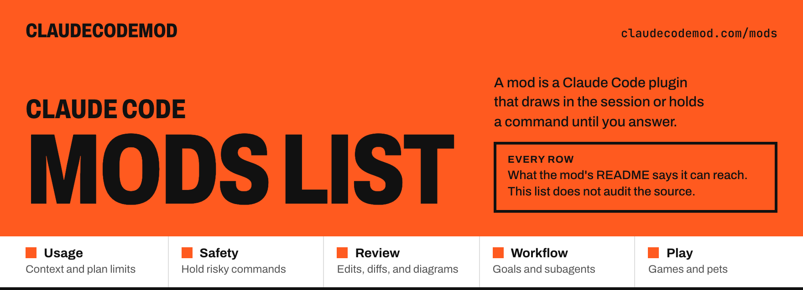

<a href="https://claudecodemod.com/mods"><picture><source media="(prefers-color-scheme: dark)" srcset="assets/banner-dark.png"></picture></a>

# Claude Code mods list

Every Claude Code mod on [ClaudeCodeMod](https://claudecodemod.com/mods): 899 mods from 529 authors, grouped by what they are for, with what each one's README says it can reach.

    

**[Usage](#usage)** · **[Safety](#safety)** · **[Review](#review)** · **[Workflow](#workflow)** · **[Play](#play)**

A mod is a Claude Code plugin that draws in the session, such as a line above the prompt, a pane or a toast, or that holds a command until you answer ([Anthropic's docs](https://code.claude.com/docs/en/plugins/mods/overview)). Each name below links to the mod's page on claudecodemod.com, with the install command copied unchanged from the author's README and a demo. The author under it links to the mod's repo.

## What "can reach" means here

A mod runs with Claude Code's permissions. What it can reach is only what its README names: this list does not audit the source. When the repo and this list disagree, trust the repo. `claude plugin validate` on the plugin folder lists the events it hooks and the calls it makes.

"Session text" means prompts, replies, tool output, code, or a voice call. Sending it to Claude on your own login, or to a model on your own machine, does not count as an outside model. In the tables below, a mod that sends it to an outside model by default says so in bold.

## What they reach, in figures

Counted across the 899 mods on November 8, 2026. A mod is in every row its README names, so the rows add up to more than 899.

| What the README names | Mods | Share |
| --- | ---: | ---: |
| Draws in the session | 852 | 95% |
| Draws, and nothing else | 103 | 11% |
| Reads usage or context figures | 261 | 29% |
| Sees tool calls | 446 | 50% |
| Reads this turn's file edits | 87 | 10% |
| Holds a command | 169 | 19% |
| Runs a command when you press | 170 | 19% |
| Calls another program on this machine | 367 | 41% |
| Reaches the network or an outside service | 253 | 28% |
| Sends session text to an outside model by default | 35 | 4% |
| Sends session text to an outside model if you choose one | 28 | 3% |

## Contents

| Group | Mods | What they draw or hold |
| --- | ---: | --- |
| **[Usage](#usage)** | 184 | Context window and plan limits |
| **[Safety](#safety)** | 73 | Hold risky commands before they run |
| **[Review](#review)** | 145 | Edits, diffs, and diagrams |
| **[Workflow](#workflow)** | 401 | Goals, next steps, and subagents |
| **[Play](#play)** | 96 | Games and pets while Claude works |

## Usage

Draws the context window, the plan limits, or how long the prompt cache has left, above the prompt. [All 184 on claudecodemod.com](https://claudecodemod.com/category/usage).

| Mod and author | What it does | What its README says it can reach |
| --- | --- | --- |
| **[account-rotator](https://claudecodemod.com/mods/account-rotator)** by [ivokund](https://github.com/ivokund/claude-account-rotator) | Draws each account's usage under the prompt, and can move the session to another account as a limit fills. | Reads usage or context figures; Runs a command when you press; Calls another program on this machine; Reaches the network or an outside service |
| **[agent-diet](https://claudecodemod.com/mods/agent-diet)** by [VedantAndhale](https://github.com/VedantAndhale/claude-pro-kit/tree/main/plugins/agent-diet) | Starts Explore subagents, and other agent types you list, on Haiku or a model you pick instead of the main model, and counts how many it moved. | Sees tool calls |
| **[agent-profiler](https://claudecodemod.com/mods/agent-profiler)** by [YeonwooSung](https://github.com/YeonwooSung/my-claude-code-mods/tree/main/agent-profiler) | Draws where a session's time goes, model wait against tools and subagents, in a status line and a live pane, and can write the session out as an OTLP trace. | Reads usage or context figures; Sees tool calls; Reaches the network or an outside service |
| **[agent-router](https://claudecodemod.com/mods/agent-router)** by [alexandernicholson](https://github.com/alexandernicholson/agent-router/tree/main/agent-router) | Assigns a model and effort to each subagent role from your endpoint's catalog, and draws that model beside the prompt. | Reads usage or context figures; Sees tool calls; Holds a command; Calls another program on this machine; Reaches the network or an outside service |
| **[agent-trace](https://claudecodemod.com/mods/agent-trace)** by [krika2810](https://github.com/krika2810/agent-trace) | Draws a pane beside the chat that lists every step after a prompt: each model request, tool call, and subagent, with time, tokens, context, and API-rate cost. | Reads usage or context figures; Sees tool calls; Calls another program on this machine |
| **[agent-usage-guard](https://claudecodemod.com/mods/agent-usage-guard)** by [rbartoli](https://github.com/rbartoli/agent-usage-guard) | Asks before a subagent starts, a heavy prompt is sent, or a tool loop runs on, from the 5-hour and weekly usage, and refuses when nobody can answer. | Reads usage or context figures; Sees tool calls; Holds a command |
| **[am-context-bar](https://claudecodemod.com/mods/am-context-bar)** by [romnycristopher](https://github.com/romnycristopher/claude-am-mods/tree/main/mods/am-context-bar) | Draws a card above the prompt with context use against where quality drops, what fills it, turns left, limits, git status, and the phase of a plan you're on. | Reads usage or context figures; Sees tool calls; Calls another program on this machine |
| **[antiburn](https://claudecodemod.com/mods/antiburn)** by [antiburn](https://github.com/antiburn/antiburn/tree/main/plugins/antiburn) | Draws the five-hour and weekly limits above the prompt with reset times and even-pace markers, in the terminal and the desktop Code tab. | Reads usage or context figures; Calls another program on this machine; Reaches the network or an outside service |
| **[automode](https://claudecodemod.com/mods/automode)** by [mralexivy](https://github.com/mralexivy/AutoMode) | Picks the model and effort for each prompt, draws a bar above the prompt with context, cache countdown, cost, and savings, and denies git writes from subagents. | Reads usage or context figures; Sees tool calls; Holds a command; Calls another program on this machine |
| **[brewmod-plan-effort](https://claudecodemod.com/mods/brewmod-plan-effort)** by [kochetkov-ma](https://github.com/kochetkov-ma/claude-brewcode/tree/main/brewmod-plan-effort) | Draws a row above the prompt while Claude plans, naming the effort it raised to, xhigh by default. | Draws, and nothing else |
| **[budget-guard](https://claudecodemod.com/mods/budget-guard)** by [VedantAndhale](https://github.com/VedantAndhale/claude-pro-kit/tree/main/plugins/budget-guard) | Keeps a prompt from being sent while the 5-hour or weekly usage is at or over your limit, until you send it again, and shows the limit with /budget. | Reads usage or context figures |
| **[burn-meter](https://claudecodemod.com/mods/burn-meter)** by [OneWave-AI](https://github.com/OneWave-AI/claude-code-mods/tree/main/burn-meter) | Draws session spend as a fuse above the prompt, with the plan limits and a cost in burritos and McDoubles. | Reads usage or context figures |
| **[cache-clock](https://claudecodemod.com/mods/cache-clock)** by [hamzafer](https://github.com/hamzafer/claude-code-mods) | Draws a prompt-cache line under the status line: time left while warm, hits and misses, and how many tokens the next message re-caches once it goes cold. | Reads usage or context figures |
| **[cache-clock](https://claudecodemod.com/mods/cache-clock-ray-amjad)** by [ray-amjad](https://github.com/ray-amjad/claude-code-mods/tree/main/plugins/cache-clock) | Draws a line above the prompt with the time until the prompt cache goes cold, the context fill, and a subagent clock, and has Claude write a handoff first. | Reads usage or context figures |
| **[cache-keeper](https://claudecodemod.com/mods/cache-keeper-nateherkai)** by [nateherkai](https://github.com/nateherkai/claude-code-mods/tree/main/cache-keeper) | Draws whether this chat's prompt cache is warm or cold, what a cold rewrite would cost, and the plan limits, and can keep a big chat warm. | Reads usage or context figures; Runs a command when you press |
| **[cache-maxxer](https://claudecodemod.com/mods/cache-maxxer)** by [vayaan-labs](https://github.com/vayaan-labs/cache-maxxer) | Draws the prompt-cache time left and hit rate above the input, says why the cache was rebuilt, and can send a short request to keep it warm. | Reads usage or context figures; Runs a command when you press; Reaches the network or an outside service |
| **[cache-meter](https://claudecodemod.com/mods/cache-meter)** by [T-AI-Labs](https://github.com/T-AI-Labs/claude-code-mods/tree/main/cache-meter) | Draws one row above the prompt with how much of the last turn the prompt cache served, how long it stays warm, and a Keep warm switch that refreshes it. | Reads usage or context figures |
| **[cache-panel](https://claudecodemod.com/mods/cache-panel-danyuchn)** by [danyuchn](https://github.com/danyuchn/claude-mods/tree/main/cache-panel) | After 50 idle minutes, draws a prompt-cache line and a panel to keep it warm, ping it once, or compact, with a cost for each. | Reads usage or context figures; Runs a command when you press; Calls another program on this machine |
| **[cache-refresher](https://claudecodemod.com/mods/cache-refresher)** by [olddonkey](https://github.com/olddonkey/cache-refresher) | Draws a bar above the prompt with the time until the prompt cache expires and what a rebuild would cost, and can refresh the cache while you are away. | Reads usage or context figures |
| **[cache-tax](https://claudecodemod.com/mods/cache-tax)** by [karanb192](https://github.com/karanb192/cache-tax) | Keeps the one-hour prompt cache warm while you step away, and stops a send into a cold cache once with the estimated rewrite cost. | Reads usage or context figures; Reaches the network or an outside service |
| **[cache-timer](https://claudecodemod.com/mods/cache-timer)** by [arasovic](https://github.com/arasovic/claude-code-mods) | Draws a countdown above the prompt until the prompt cache expires, then how many tokens the next message writes again. | Reads usage or context figures |
| **[cache-ttl-statusline](https://claudecodemod.com/mods/cache-ttl-statusline)** by [JerrettDavis](https://github.com/JerrettDavis/ClaudeStatusLineWidgets) | Draws session, plan-limit, and Headroom lines with model, cost, context, and a cache TTL that turns yellow then red, below the prompt or, in mod mode, above it. | Reads usage or context figures; Calls another program on this machine; Reaches the network or an outside service |
| **[cache-warmer](https://claudecodemod.com/mods/cache-warmer)** by [paulbkim-dev](https://github.com/paulbkim-dev/claude-code-cache-warmer) | Resends the last request to keep the prompt cache warm when that saves at least $0.05, and draws a band with Clawd while it runs. | Reads usage or context figures |
| **[cache-watcher](https://claudecodemod.com/mods/cache-watcher-nikisge)** by [nikisge](https://github.com/nikisge/niklas-mods/tree/main/cache-watcher) | Draws the cache time, the context, the plan limits, and this session's API value above the prompt, and a press can keep the cache warm. | Reads usage or context figures; Runs a command when you press |
| **[cachebeat](https://claudecodemod.com/mods/cachebeat)** by [404Mayank](https://github.com/404Mayank/cachebeat) | Keeps the prompt cache warm while you are away with a small background request, and draws a beating heart under the prompt and a beat count under your turn. | Reads usage or context figures; Reaches the network or an outside service |
| **[caliber-jev-compaction](https://claudecodemod.com/mods/caliber-jev-compaction)** by [caliber-ai-org](https://github.com/caliber-ai-org/ai-setup/tree/master/plugin/caliber-jev-compaction) | Replaces /compact: Jev scores each tool call, drops the stale ones, and keeps the rest of the conversation word for word, then toasts what it kept. | Sees tool calls; Reaches the network or an outside service; **By default, sends session text to TypeSafe Jev, or to Vercel AI Gateway instead** |
| **[catnap](https://claudecodemod.com/mods/catnap)** by [LippInc](https://github.com/LippInc/catnap) | Has Claude compact at a clean break: from 50% of the context it asks Claude to finish the piece it is on, write a handoff, and compact, then carry on by itself. | Reads usage or context figures; Sees tool calls |
| **[ccbar](https://claudecodemod.com/mods/ccbar)** by [emaballarin](https://github.com/emaballarin/ccplugins/tree/main/plugins/ccbar) | Draws a quiet band above the prompt: model and effort, the GitHub repo and branch with lines changed, a context bar split as /context, tokens, and plan limits. | Reads usage or context figures; Calls another program on this machine |
| **[ccswap](https://claudecodemod.com/mods/ccswap)** by [errhythm](https://github.com/errhythm/ccswap/tree/main/mod) | Draws your ccswap accounts and their 5-hour and 7-day usage, and switches from a button on the band. | Reads usage or context figures; Runs a command when you press; Calls another program on this machine |
| **[claude-carbon](https://claudecodemod.com/mods/claude-carbon)** by [gwittebolle](https://github.com/gwittebolle/claude-carbon) | Draws the CO2 of each answer and a pane with a pixel molecule colored against your past sessions, plus this session's total under the prompt. | Reads usage or context figures |
| **[claude-load](https://claudecodemod.com/mods/claude-load)** by [Gerrux](https://github.com/Gerrux/claude-load) | Opens a /load pane of CPU and memory per Claude Code session, with orphaned dev servers you can end, and draws a load line above the prompt under high load. | Runs a command when you press; Calls another program on this machine |
| **[claujev-mod](https://claudecodemod.com/mods/claujev-mod)** by [Civalski](https://github.com/Civalski/claujev/tree/main/plugins/claujev-mod) | Draws a status line of the checks and actions TypeSafe's Jev made today for the ClauJev plugin, with the effort Jev suggests, and can apply that effort. | Sees tool calls; Reads this turn's file edits; Holds a command; Reaches the network or an outside service; **By default, sends session text to TypeSafe Jev** |
| **[clawd-dash](https://claudecodemod.com/mods/clawd-dash)** by [pinkpixel-dev](https://github.com/pinkpixel-dev/clawd-dash) | Draws a session dashboard under the prompt: plan limits, context, cost, model, effort, git status, and file changes, beside a pixel Clawd who reacts. | Reads usage or context figures; Sees tool calls; Reads this turn's file edits; Calls another program on this machine |
| **[clawdmeter](https://claudecodemod.com/mods/clawdmeter)** by [weltern](https://github.com/weltern/Clawdmeter/tree/main/claude-code/clawdmeter) | Draws Clawd and the session, weekly, and context bars in a band above the prompt. | Reads usage or context figures; Sees tool calls; Reaches the network or an outside service |
| **[cmd-diet](https://claudecodemod.com/mods/cmd-diet)** by [VedantAndhale](https://github.com/VedantAndhale/claude-pro-kit/tree/main/plugins/cmd-diet) | Adds quiet flags to noisy shell commands before they run, so Claude reads the short output, and counts the quieted commands on the status line. | Sees tool calls |
| **[cockpit](https://claudecodemod.com/mods/cockpit)** by [drkokorev](https://github.com/drkokorev/cockpit-for-claude/tree/main/plugins/cockpit) | Opens a panel beside the transcript with context, rate limits, cost, subagents, tool calls, changed files, and tests, and asks before rm -rf or a force push. | Reads usage or context figures; Sees tool calls; Holds a command; Runs a command when you press; Calls another program on this machine |
| **[codemode](https://claudecodemod.com/mods/codemode)** by [ejklock](https://github.com/ejklock/claude-code-mode) | Gives Claude one tool that runs a JavaScript script calling the session's own tools, so only the output returns, and draws its nested calls live in the row. | Sees tool calls; Calls another program on this machine |
| **[colorwheel](https://claudecodemod.com/mods/colorwheel)** by [AlexeyHRDesign](https://github.com/AlexeyHRDesign/colorwheel) | Draws a band in the desktop app with your 5-hour and 7-day limits on its edges and the context as weather, and redraws replies with full-width diagrams. | Reads usage or context figures |
| **[compact-adviser](https://claudecodemod.com/mods/compact-adviser)** by [kunchenguid](https://github.com/kunchenguid/compact-adviser/tree/main/packages/claude-mod) | Draws a hint above the prompt to run /compact when Jev calls the session a finished checkpoint, and can run /compact itself if you opt in. | Reads usage or context figures; Reaches the network or an outside service; **By default, sends session text to TypeSafe Jev** |
| **[compact-timing](https://claudecodemod.com/mods/compact-timing)** by [lbzepoqo](https://github.com/lbzepoqo/compact-timing) | Lets the model mark task boundaries and compacts at the end of a turn once the context passes 200k tokens, then resumes the work; a toast shows each compaction. | Reads usage or context figures; Sees tool calls |
| **[compactly](https://claudecodemod.com/mods/compactly)** by [swapnildahiphale](https://github.com/swapnildahiphale/compactly/tree/main/plugin/compactly) | Opens a cost and cache pane with each turn's cost and when the cache goes cold, and compacts at a natural break a Sonnet judge picks, with a handoff summary. | Reads usage or context figures; Sees tool calls; Runs a command when you press |
| **[context-alarm](https://claudecodemod.com/mods/context-alarm-mutlumehmet)** by [mutlumehmet](https://github.com/mutlumehmet/claude-plugins/tree/main/plugins/context-alarm) | Warns when the context window fills, with a status line under the prompt, and suggests /save-context before compaction. | Reads usage or context figures |
| **[context-alert](https://claudecodemod.com/mods/context-alert)** by [nathanonn](https://github.com/nathanonn/agent-skills/tree/main/plugins/context-alert) | Opens a question dialog when the context window reaches 40 percent, offering to write a handoff doc and then compact, write one only, or compact now. | Reads usage or context figures; Sees tool calls |
| **[context-bar](https://claudecodemod.com/mods/context-bar)** by [hamzafer](https://github.com/hamzafer/claude-code-mods) | Draws the context window as one stacked bar, a color per category, with token counts and the compaction point. | Reads usage or context figures |
| **[context-budget](https://claudecodemod.com/mods/context-budget)** by [melodic-software](https://github.com/melodic-software/claude-code-plugins/tree/main/plugins/context-budget) | Draws the session's context by category, in a pane or a band above the prompt, and asks before a settings file is written. | Reads usage or context figures; Sees tool calls; Holds a command; Calls another program on this machine |
| **[context-card](https://claudecodemod.com/mods/context-card-nongfsq)** by [Nongfsq](https://github.com/Nongfsq/frank-claude-cockpit/tree/main/context-card) | Draws context fill, the prompt cache, and weekly plan usage in one line above the prompt, with a breakdown on click. One of two mods for running many sessions. | Reads usage or context figures |
| **[context-diet](https://claudecodemod.com/mods/context-diet)** by [drkokorev](https://github.com/drkokorev/context-diet/tree/main/plugins/context-diet) | Replaces a huge tool output with a short digest and the path of a file that still holds the full text, and /diet opens a panel of what it saved. | Sees tool calls |
| **[context-guard](https://claudecodemod.com/mods/context-guard)** by [melodic-software](https://github.com/melodic-software/claude-code-plugins/tree/main/plugins/context-guard) | Shows a toast when the session's context crosses into a worse zone, smart, acceptable, or dumb, and can draw the zone and percent in a row above the prompt. | Reads usage or context figures; Calls another program on this machine |
| **[context-inspector](https://claudecodemod.com/mods/context-inspector)** by [YeonwooSung](https://github.com/YeonwooSung/my-claude-code-mods/tree/main/context-inspector) | Draws what fills the context window and how much of it is waste: re-reads, near-duplicate output, and what compaction kept, with advice and its evidence. | Reads usage or context figures; Sees tool calls; Reads this turn's file edits |
| **[context-keeper](https://claudecodemod.com/mods/context-keeper)** by [mishgoldenberg](https://github.com/mishgoldenberg/claude-mods/tree/main/plugins/context-keeper) | Opens a pane of what fills the context window with tips to trim it, and saves a handoff note of the goal, decisions, files, and TODOs to .claude/checkpoints/. | Reads usage or context figures |
| **[context-lens](https://claudecodemod.com/mods/context-lens)** by [Arunjay4213](https://github.com/Arunjay4213/claude-mods/tree/main/plugins/context-lens) | Pins how full the context window is and what the last turn added, and /context-lens opens the breakdown by category. | Reads usage or context figures |
| **[context-meter](https://claudecodemod.com/mods/context-meter)** by [midudev](https://github.com/midudev/better-claude/tree/main/plugins/context-meter) | Draws how full the context window is at the right end of the band above the prompt: gray, then yellow from 50 percent, then red from 75. | Reads usage or context figures |
| **[context-meter](https://claudecodemod.com/mods/context-meter-t-ai-labs)** by [T-AI-Labs](https://github.com/T-AI-Labs/claude-code-mods/tree/main/context-meter) | Draws one row above the prompt with the context fill against an auto-compact threshold you pick, and Compact and Clear buttons. | Reads usage or context figures; Runs a command when you press |
| **[context-meter](https://claudecodemod.com/mods/context-meter-andrewdongminyoo)** by [AndrewDongminYoo](https://github.com/AndrewDongminYoo/cc-agents-kit/tree/main/plugins/context-meter) | Draws the measured context fill above the prompt past 50%, and skips an auto-compact set off when an advisor request makes the session read twice as full. | Reads usage or context figures |
| **[context-meter](https://claudecodemod.com/mods/context-meter-noash-xrc)** by [noash-xrc](https://github.com/noash-xrc/claude-tools/tree/main/context-meter) | Draws two rows at the right of the band above the prompt: context fill, the rate-limit windows, session cost, the prompt cache, the model, and its effort. | Reads usage or context figures |
| **[context-meter](https://claudecodemod.com/mods/context-meter-vumichien)** by [vumichien](https://github.com/vumichien/claude-code-mods-kit/tree/main/plugins/context-meter) | Draws a band above the prompt with what fills the context window by category, a countdown to when the prompt cache expires, and a Compact button. | Reads usage or context figures; Runs a command when you press |
| **[context-usage](https://claudecodemod.com/mods/context-usage)** by [T-AI-Labs](https://github.com/T-AI-Labs/claude-code-mods/tree/main/context-usage) | Draws the context fill with an auto-compact threshold, Compact and Clear buttons, and the 5-hour and weekly limits in two rows above the prompt. | Reads usage or context figures; Runs a command when you press |
| **[context-widget](https://claudecodemod.com/mods/context-widget)** by [oMaN-Rod](https://github.com/oMaN-Rod/claude-code-widgets/tree/main/plugins/context-widget) | Draws the context window as a stacked bar, one color per /context category, on a card under the prompt or docked beside the transcript. | Reads usage or context figures |
| **[context-xray](https://claudecodemod.com/mods/context-xray)** by [VedantAndhale](https://github.com/VedantAndhale/claude-pro-kit/tree/main/plugins/context-xray) | Draws a pane with the exact breakdown of what fills the context window, opened with /xray. | Reads usage or context figures |
| **[cost-ledger](https://claudecodemod.com/mods/cost-ledger)** by [FynnXland](https://github.com/FynnXland/fynn-mods/tree/main/mods/cost-ledger) | Keeps a ledger of what every chat cost, plus other mods' model calls, and draws /ledger: today, 7 and 30 days, projects, top chats, models, and plan limits. | Reads usage or context figures |
| **[cost-meter](https://claudecodemod.com/mods/cost-meter)** by [Singh-AP](https://github.com/Singh-AP/awesome-claude-mods/tree/main/mods/cost/cost-meter) | Draws session cost, context fill, and the 5-hour and 7-day windows on the status line, plus each turn's cost. An optional budget asks before the next tool call. | Reads usage or context figures; Holds a command |
| **[cost-visibility](https://claudecodemod.com/mods/cost-visibility)** by [patitow](https://github.com/patitow/claude-mod-cost-visibility/tree/main/plugins/cost-visibility) | Draws a two-line band above the prompt with the plan windows, this chat's list-price cost split into main and subagents, and context. /spend opens a pane. | Reads usage or context figures; Holds a command |
| **[dashband](https://claudecodemod.com/mods/dashband)** by [EgonLeitner](https://github.com/EgonLeitner/dashband) | Draws how long the prompt cache has left, the context fill, and the 5-hour and weekly limits against their pace, in the footer and as a band above the prompt. | Reads usage or context figures; Calls another program on this machine |
| **[deck](https://claudecodemod.com/mods/claude-deck)** by [nvr0x5](https://github.com/nvr0x5/claude-deck) | Draws a collapsible panel above the prompt for the plan, context, the 5-hour and 7-day limits, and a small pet. | Reads usage or context figures; Sees tool calls; Reaches the network or an outside service |
| **[desktop-statusline](https://claudecodemod.com/mods/desktop-statusline)** by [centminmod](https://github.com/centminmod/claude-plugins/tree/master/plugins/desktop-statusline) | Draws a status band above the prompt in the Desktop app's Code tab, with context, plan limits, and the last turn. | Reads usage or context figures; Calls another program on this machine |
| **[dispatch-gate](https://claudecodemod.com/mods/dispatch-gate)** by [wdsewdser-bit](https://github.com/wdsewdser-bit/claude-code-mods/tree/main/dispatch-gate) | Refuses one tool call once the main session has made 8 requests in a row itself, and a subagent past 3 an hour, so Claude hands work out. A retry goes through. | Sees tool calls; Holds a command |
| **[dividend](https://claudecodemod.com/mods/dividend)** by [Mint-Security](https://github.com/Mint-Security/open-kitchen/tree/main/plugins/dividend) | Draws a tip above the prompt about the prompt cache, the context, or the plan limits, with a status line and a /dividend pane of the session's figures. | Reads usage or context figures; Sees tool calls; Calls another program on this machine |
| **[dotclaude](https://claudecodemod.com/mods/dotclaude)** by [CarloArnone](https://github.com/CarloArnone/dotclaude/tree/main/mods/dotclaude) | Opens a Workspace pane of live context, rate-limit, and cost traces with ten panels, and refuses Claude's file edits until your message approves. | Reads usage or context figures; Sees tool calls; Reads this turn's file edits; Holds a command; Runs a command when you press; Calls another program on this machine |
| **[effort-cycle](https://claudecodemod.com/mods/effort-cycle)** by [Anerco](https://github.com/Anerco/claude-code-effort-cycle) | Steps the effort level of the agent in view with Ctrl+↑ and Ctrl+↓, and draws it as a colored meter in the footer and in each subagent's tasks list row. | Sees tool calls |
| **[effort-router](https://claudecodemod.com/mods/effort-router)** by [nextscape](https://github.com/nextscape/ns-mods/tree/main/mods/effort-router) | Picks the main thread's effort for each prompt with a Haiku judgment, raises it a level when a turn runs long, and shows the level on the status line. | Sees tool calls |
| **[effortless](https://claudecodemod.com/mods/effortless)** by [HeyCubit](https://github.com/HeyCubit/effortless) | Draws a bar above the prompt with the reasoning effort it picked for this prompt, how full the chat is, and how long the prompt cache stays warm. | Reads usage or context figures; Calls another program on this machine; Reaches the network or an outside service; Sends session text to TypeSafe Jev, only if you set it up |
| **[elizabeth-progress](https://claudecodemod.com/mods/elizabeth-progress)** by [Yaxin9Luo](https://github.com/Yaxin9Luo/spending-effort-with-jev/tree/main/plugins/elizabeth-progress) | Draws Elizabeth from Gintama walking a context-window bar above the prompt, with the usage split, turns left, and rate limits. | Reads usage or context figures |
| **[extra-mods](https://claudecodemod.com/mods/extra-mods)** by [Jhonatan-de-Souza](https://github.com/Jhonatan-de-Souza/ClaudeMods/tree/main/plugins/extra-mods) | Draws a menu for Zen, themes, model and effort, and a status line of context, plan limits, and cache. | Reads usage or context figures; Sees tool calls; Runs a command when you press; Reaches the network or an outside service |
| **[fast-jev-compaction](https://claudecodemod.com/mods/fast-jev-compaction)** by [tamaratran](https://github.com/tamaratran/fast-jev-compaction) | Shows a toast when /compact keeps the messages Jev still wants and drops the rest, instead of replacing the history with a summary. | Reaches the network or an outside service; **By default, sends session text to TypeSafe Jev** |
| **[fast-jev-output](https://claudecodemod.com/mods/fast-jev-output)** by [tamaratran](https://github.com/tamaratran/jev-pruner) | Sends a long Bash result to TypeSafe's Jev, which trims it before Claude reads it, and toasts the cut. The full output stays in the project. | Sees tool calls; Reaches the network or an outside service; **By default, sends session text to TypeSafe Jev** |
| **[green-lantern](https://claudecodemod.com/mods/green-lantern)** by [vogiaan1904](https://github.com/vogiaan1904/green-lantern-claude) | Draws the 5-hour and 7-day limits as Green Lantern charge that drains as you use it, with a power-ring spinner and an emerald theme. | Reads usage or context figures; Sees tool calls |
| **[headroom-snip](https://claudecodemod.com/mods/headroom-snip)** by [headroomlabs-ai](https://github.com/headroomlabs-ai/headroom/tree/main/plugins/headroom-snip) | Draws a band above the prompt showing Headroom cutting each request from its original token count to what was sent, with a /headroom log and a running total. | Reads usage or context figures; Calls another program on this machine |
| **[heatmap](https://claudecodemod.com/mods/heatmap)** by [hamzafer](https://github.com/hamzafer/claude-code-mods) | Draws a GitHub-style grid of your Claude Code time in a pane, one square per day, with your streak, peak hours, and top projects. | Calls another program on this machine |
| **[hud](https://claudecodemod.com/mods/hud-hoobnn)** by [hoobnn](https://github.com/hoobnn/hoobnn-agent-mods/tree/main/claude-code/hud) | Draws model, context, and plan-usage gauges above the prompt, with git, the running tools, and a one-line task summary. | Reads usage or context figures; Sees tool calls; Calls another program on this machine |
| **[hud](https://claudecodemod.com/mods/hud)** by [lycfyi](https://github.com/lycfyi/yskills/tree/main/mods/hud) | Draws a heads-up display above the prompt: context fill, repo state, turn progress with time estimates, and a recap with an automatic /whats-next after a break. | Reads usage or context figures; Runs a command when you press; Calls another program on this machine |
| **[idle-compact](https://claudecodemod.com/mods/idle-compact)** by [noash-xrc](https://github.com/noash-xrc/claude-tools/tree/main/idle-compact) | Runs /compact on a session idle for 55 minutes with 120k tokens or more, just before the prompt cache expires, and shows a toast when it did. | Reads usage or context figures |
| **[idle-compact](https://claudecodemod.com/mods/idle-compact-davidar)** by [davidar](https://github.com/davidar/claude-idle-compact) | Compacts an idle session after 50 minutes, while the prompt cache is still warm, and pins a status line under the prompt with the before and after sizes. | Reads usage or context figures |
| **[jev](https://claudecodemod.com/mods/jev-cli)** by [Nasrallah-AL](https://github.com/Nasrallah-AL/jev-cli/tree/main/plugin) | Has Jev drop stale tool calls at compaction and keep the rest word for word, toasts what it kept, and adds slash commands for the jev CLI. | Reads usage or context figures; Sees tool calls; Calls another program on this machine; Reaches the network or an outside service; **By default, sends session text to TypeSafe Jev** |
| **[jev-orchestrator](https://claudecodemod.com/mods/jev-orchestrator)** by [hiyoku](https://github.com/hiyoku/jev-orc) | Sends each subagent's task to TypeSafe's Jev, which picks its model, effort, and tool profile, and draws the picks, tokens, and cost on the status line. | Reads usage or context figures; Sees tool calls; Reaches the network or an outside service; **By default, sends session text to TypeSafe Jev, or to OpenRouter instead** |
| **[jev-pilot](https://claudecodemod.com/mods/jev-pilot)** by [Akramovic1](https://github.com/Akramovic1/jev-pilot) | Asks TypeSafe's Jev, through OpenRouter, to set each turn's effort, the subagent model, and the one skill a prompt needs, with a pilot that says what it chose. | Sees tool calls; Calls another program on this machine; Reaches the network or an outside service; **By default, sends session text to TypeSafe Jev, or to OpenRouter instead** |
| **[jev-router](https://claudecodemod.com/mods/jev-router)** by [dominicrico](https://github.com/dominicrico/jev-router) | Asks TypeSafe's Jev which Claude model and effort fit each prompt, step, and subagent, runs it there, and draws every pick in a band above the prompt. | Reaches the network or an outside service; **By default, sends session text to TypeSafe Jev** |
| **[keepalive](https://claudecodemod.com/mods/keepalive-alexandernicholson)** by [alexandernicholson](https://github.com/alexandernicholson/agent-router/tree/main/keepalive) | Draws a prompt-cache bar for each conversation, and can keep an idle cache warm or compact it before it expires. | Reads usage or context figures; Reaches the network or an outside service |
| **[laya-router](https://claudecodemod.com/mods/laya-router)** by [marcreichel](https://github.com/marcreichel/laya-router) | Routes the session once from its first prompt to a model and effort, and draws that route on the status line. | Sees tool calls; Calls another program on this machine; Reaches the network or an outside service |
| **[leaks](https://claudecodemod.com/mods/leaks)** by [davekiss](https://github.com/davekiss/mods/tree/main/leaks) | Opens a pane that ranks the avoidable spend in the last 7 days of transcripts, and draws a strip above the prompt when a leak is happening. | Reads usage or context figures; Runs a command when you press |
| **[leitstand](https://claudecodemod.com/mods/leitstand)** by [dominikmartn](https://github.com/dominikmartn/leitstand) | Draws free disk space and context fill above the prompt, and names a hook of yours that just blocked a tool call. | Reads usage or context figures; Sees tool calls; Calls another program on this machine; Reaches the network or an outside service |
| **[limit-bars](https://claudecodemod.com/mods/limit-bars)** by [FynnXland](https://github.com/FynnXland/fynn-mods/tree/main/mods/limit-bars) | Draws the 5-hour and weekly limits as two slim bars above the prompt, a ring for how long the prompt cache stays warm, and asks before a costly cold send. | Reads usage or context figures; Runs a command when you press; Calls another program on this machine |
| **[limits](https://claudecodemod.com/mods/limits)** by [Ryan-LT](https://github.com/Ryan-LT/claude-mods/tree/main/limits) | Draws a band above the prompt with the 5-hour and weekly limits, a pace warning, and context fill, and toasts at 75%, 90%, and 100%. | Reads usage or context figures; Reaches the network or an outside service |
| **[limits-meter](https://claudecodemod.com/mods/limits-meter)** by [ice-lfernandes](https://github.com/ice-lfernandes/claude-code-mods/tree/main/limits-meter) | Draws plan limits and context above the prompt, in tokens and percent, with the model, effort, and a toast on a costly switch. | Reads usage or context figures |
| **[long-live-the-claude](https://claudecodemod.com/mods/long-live-the-claude)** by [Lapis0x0](https://github.com/Lapis0x0/long-live-the-claude) | Draws the 5-hour and 7-day limits, context, and cache time above the prompt. Long-run, off by default, keeps the cache warm and pauses near the limit. | Reads usage or context figures; Sees tool calls; Runs a command when you press |
| **[mod-pack](https://claudecodemod.com/mods/mod-pack-az9713)** by [az9713](https://github.com/az9713/claude-mod-pack/tree/main/mod-pack) | Seven mods in one install: a context forecast, a cache countdown, a follow-up queue, a plain retell, two holds on risky commands, and Snake. | Reads usage or context figures; Holds a command; Runs a command when you press; Calls another program on this machine; Reaches the network or an outside service |
| **[model-effort-band](https://claudecodemod.com/mods/model-effort-band)** by [YeonwooSung](https://github.com/YeonwooSung/my-claude-code-mods/tree/main/model-effort-band) | Draws a band above the prompt with the selected model and the effort of the latest main-conversation request. | Draws, and nothing else |
| **[model-picker](https://claudecodemod.com/mods/model-picker)** by [alfredtm](https://github.com/alfredtm/claude-model-picker) | Draws a band above the prompt when a session opens that lists the models by digit, and runs /model for the one you press; 0 keeps the current one. | Runs a command when you press |
| **[model-relay](https://claudecodemod.com/mods/model-relay)** by [cablate](https://github.com/cablate/model-relay) | Opens a panel above the prompt to switch this window to another model provider, routes subagents to providers, and fails over when Claude returns a 429. | Calls another program on this machine; Reaches the network or an outside service; Sends session text to z.ai, DeepSeek, Kimi, MiniMax, OpenRouter or a provider you choose, only if you set one up |
| **[openai-balance](https://claudecodemod.com/mods/openai-balance)** by [hamzafer](https://github.com/hamzafer/claude-code-mods) | Draws your OpenAI API credit above the prompt: an estimated balance, today's spend, where the money went, and the last call. | Reaches the network or an outside service |
| **[openrouter-balance](https://claudecodemod.com/mods/openrouter-balance)** by [hamzafer](https://github.com/hamzafer/claude-code-mods) | Draws your OpenRouter credit above the prompt: the balance with a gauge, today's spend, and the model the money mostly went to. | Reaches the network or an outside service |
| **[optim-jev](https://claudecodemod.com/mods/optim-jev)** by [Oqura-ai](https://github.com/Oqura-ai/optim-jev) | Has TypeSafe's Jev drop stale tool calls and their output when the session compacts, keeping the rest word for word, and draws a dashboard above the prompt. | Reads usage or context figures; Sees tool calls; Calls another program on this machine; Reaches the network or an outside service; **By default, sends session text to TypeSafe Jev** |
| **[optimaizr](https://claudecodemod.com/mods/optimaizr)** by [blendbunjaku](https://github.com/blendbunjaku/optimaizr/tree/main/mods/optimaizr) | Draws this turn's cost, the 5-hour window, and cache time above the prompt, and holds a command that failed twice unchanged. | Reads usage or context figures; Sees tool calls; Holds a command |
| **[orca-move](https://claudecodemod.com/mods/orca-move)** by [mutlumehmet](https://github.com/mutlumehmet/claude-plugins/tree/main/plugins/orca-move) | Moves a session to a twin account as one nears its usage limit: it runs /exit once the prompt box is empty, or shows a toast asking you to clear it. | Reads usage or context figures; Calls another program on this machine |
| **[orca-quota](https://claudecodemod.com/mods/orca-quota)** by [mutlumehmet](https://github.com/mutlumehmet/claude-plugins/tree/main/plugins/orca-quota) | Draws the 5-hour and 7-day usage of every Claude account on this machine in one band above the prompt, and warns once before the current account hits its limit. | Reads usage or context figures |
| **[output-diet](https://claudecodemod.com/mods/output-diet)** by [VedantAndhale](https://github.com/VedantAndhale/claude-pro-kit/tree/main/plugins/output-diet) | Trims what Claude reads from a long shell, search, or subagent result, saves the full text, and counts the savings on the status line. | Sees tool calls |
| **[pitwall](https://claudecodemod.com/mods/pitwall)** by [axlaser](https://github.com/axlaser/pitwall) | Draws live cost, cache, and limits above the prompt and in a side panel, with a card per subagent you can stop, and fourteen themes that repaint Claude Code. | Reads usage or context figures; Runs a command when you press; Calls another program on this machine |
| **[pixel-buddy](https://claudecodemod.com/mods/pixel-buddy)** by [hamymarnie](https://github.com/hamymarnie/marnie-plugins/tree/main/plugins/pixel-buddy) | Draws the 5-hour and 7-day usage above the prompt, with what each window cost, a cache timer, and a pixel creature. | Reads usage or context figures |
| **[pro-hud](https://claudecodemod.com/mods/pro-hud)** by [VedantAndhale](https://github.com/VedantAndhale/claude-pro-kit/tree/main/plugins/pro-hud) | Draws the 5-hour session, the week, and context above the prompt in the desktop app, plus this turn and finished tool calls as one line. | Reads usage or context figures; Sees tool calls |
| **[pulseline](https://claudecodemod.com/mods/pulseline)** by [GregoryHo](https://github.com/GregoryHo/cc-pulseline) | Draws a band above the prompt when a tool fails three times in a row, a call runs past a minute, or autocompact is a few turns off; /pulseline opens a ledger. | Reads usage or context figures; Sees tool calls; Runs a command when you press; Calls another program on this machine |
| **[quality-router](https://claudecodemod.com/mods/quality-router)** by [nextscape](https://github.com/nextscape/ns-mods/tree/main/mods/quality-router) | Picks each prompt's effort and each subagent's model and effort with Haiku, refuses rule-breaking Workflow scripts, and shows its state on the status line. | Reads usage or context figures; Sees tool calls; Holds a command |
| **[quota-meter](https://claudecodemod.com/mods/quota-meter)** by [Arunjay4213](https://github.com/Arunjay4213/claude-mods/tree/main/plugins/quota-meter) | Pins the 5-hour and 7-day plan limits when they are reported, with the reset and whether the current pace fills them first. | Reads usage or context figures |
| **[rate-limit-guard](https://claudecodemod.com/mods/rate-limit-guard)** by [melodic-software](https://github.com/melodic-software/claude-code-plugins/tree/main/plugins/rate-limit-guard) | Shows a toast when the account's 5-hour or 7-day rate-limit window reaches 90% or 95% and when it resets, and can draw both windows in a row above the prompt. | Reads usage or context figures; Calls another program on this machine |
| **[read-cap](https://claudecodemod.com/mods/read-cap)** by [VedantAndhale](https://github.com/VedantAndhale/claude-pro-kit/tree/main/plugins/read-cap) | Refuses a whole-file read over 1,000 lines once, points Claude at an outline of that file, and counts the reads it capped. | Sees tool calls; Holds a command |
| **[reread-guard](https://claudecodemod.com/mods/reread-guard)** by [VedantAndhale](https://github.com/VedantAndhale/claude-pro-kit/tree/main/plugins/reread-guard) | Skips a repeat read of a file that has not changed, tells Claude to use the copy it has, and counts the re-reads it skipped. | Sees tool calls; Holds a command |
| **[ribbon](https://claudecodemod.com/mods/ribbon)** by [robonuggets](https://github.com/robonuggets/ribbon) | Draws a slim band above the prompt with the 7-day and 5-hour usage left and when each resets, and whether the prompt cache is warm or cold with the next cost. | Reads usage or context figures |
| **[rich-statusline](https://claudecodemod.com/mods/rich-statusline)** by [TheBabaYaga](https://github.com/TheBabaYaga/claude-statusline/tree/main/mod) | Draws one line above the prompt with the directory, git branch and changes, model and effort, and bars for context and the 5-hour and 7-day limits. | Reads usage or context figures; Runs a command when you press; Calls another program on this machine |
| **[router](https://claudecodemod.com/mods/claude-router)** by [alexei-led](https://github.com/alexei-led/claude-router) | Picks a model and effort for each turn from a classifier, and draws the tier above the prompt. | Reads usage or context figures; Calls another program on this machine; Reaches the network or an outside service; **By default, sends session text to TypeSafe Jev, or to Cloudflare or OpenAI instead** |
| **[rtk-gain](https://claudecodemod.com/mods/rtk-gain)** by [rtk-ai](https://github.com/rtk-ai/rtk-gain-mod) | Draws what RTK saves while Claude works: a band above the prompt, the saving in the spinner, and a /rtk-gain pane where a viking breaks the saved tokens. | Reads usage or context figures; Sees tool calls; Calls another program on this machine |
| **[search-meter](https://claudecodemod.com/mods/search-meter)** by [arasovic](https://github.com/arasovic/claude-code-mods) | Draws a status line for the model's searches: green found on the first try, yellow found after misses, red found nothing. | Sees tool calls |
| **[secondwind](https://claudecodemod.com/mods/secondwind)** by [orchetron](https://github.com/orchetron/secondwind/tree/main/integrations/claude-code) | Compresses Bash output of 512 bytes or more through the local secondwind binary, keeps the full text one call away, and draws a pane of the net tokens saved. | Sees tool calls; Calls another program on this machine |
| **[sessclone](https://claudecodemod.com/mods/sessclone)** by [NotTahaAli](https://github.com/NotTahaAli/sessclone/tree/main/packages/plugin) | Reports each turn's tokens, model, and timings to a SessClone dashboard, with a line above the prompt that shows whether this session is synced. | Reads usage or context figures; Calls another program on this machine; Reaches the network or an outside service |
| **[session-hud](https://claudecodemod.com/mods/session-hud-ofeklevy11)** by [ofeklevy11](https://github.com/ofeklevy11/claude-code-hud/tree/main/session-hud) | Draws four cards above the prompt: context left, the 5-hour limit, prompt clocks, and what the session cost. | Reads usage or context figures |
| **[session-hud](https://claudecodemod.com/mods/session-hud-bradtraversy)** by [bradtraversy](https://github.com/bradtraversy/traversy-claude-mods/tree/main/session-hud) | Draws a strip above the prompt with the git branch, warned on main, context used against a target you set, and weekly usage, and a Details pane of the rest. | Reads usage or context figures; Sees tool calls |
| **[session-info](https://claudecodemod.com/mods/session-info)** by [dougcunha](https://github.com/dougcunha/claude-mods/tree/main/session-info) | Opens a pane of the session: context, cost, prompt cache, plan usage, agents, checks, CI runs, and Git, and holds a prompt that would rewrite an expired cache. | Reads usage or context figures; Sees tool calls; Holds a command; Runs a command when you press; Calls another program on this machine; Reaches the network or an outside service |
| **[session-meter](https://claudecodemod.com/mods/session-meter)** by [arasovic](https://github.com/arasovic/claude-code-mods) | Draws a pane of context by category, the 5-hour and 7-day windows and their pace, and the last 30 tool calls and model requests. | Reads usage or context figures; Sees tool calls |
| **[session-radar](https://claudecodemod.com/mods/session-radar)** by [ibrahimkobeissy](https://github.com/ibrahimkobeissy/claude-mods/tree/main/mods/session-radar) | Docks a sidebar of limits, context, subagents, MCP servers, skills, background shells, and the task list, with a toast when a shell or agent ends. | Reads usage or context figures; Sees tool calls; Runs a command when you press; Calls another program on this machine |
| **[session-receipt](https://claudecodemod.com/mods/session-receipt)** by [VedantAndhale](https://github.com/VedantAndhale/claude-pro-kit/tree/main/plugins/session-receipt) | Opens a pane of every turn's tokens, with the five that spent the most, and toasts after a turn that used 3 or more session points. | Reads usage or context figures; Sees tool calls |
| **[shunt](https://claudecodemod.com/mods/shunt)** by [pleaseai](https://github.com/pleaseai/shunt/tree/main/plugins/shunt) | Draws a band above the prompt with the shared pool's usage and reset times, or this session's rate limits when you are off shunt. | Reads usage or context figures; Calls another program on this machine; Reaches the network or an outside service |
| **[sidebar](https://claudecodemod.com/mods/sidebar)** by [FayequeP](https://github.com/FayequeP/sidebar) | Docks a stats sidebar beside the chat: tasks, context, tokens, the limits or cost a session used, cache hit rate and expiry, output speed, and git. | Reads usage or context figures; Sees tool calls |
| **[skill-diet](https://claudecodemod.com/mods/skill-diet)** by [VedantAndhale](https://github.com/VedantAndhale/claude-pro-kit/tree/main/plugins/skill-diet) | Lists skills unused lately in this project by name only, so their descriptions leave the prompt, and counts those characters on the status line. | Sees tool calls |
| **[smart-compact](https://claudecodemod.com/mods/smart-compact)** by [hellosverre](https://github.com/hellosverre/smart-compact) | Offers /compact in a dialog above the prompt at good moments: after a commit, when tests go green, before the prompt cache expires, or when Claude asks. | Reads usage or context figures; Sees tool calls; Runs a command when you press; Calls another program on this machine |
| **[spending-effort-with-jev](https://claudecodemod.com/mods/spending-effort-with-jev)** by [Yaxin9Luo](https://github.com/Yaxin9Luo/spending-effort-with-jev/tree/main/plugins/spending-effort-with-jev) | Asks TypeSafe's Jev which /effort level a message needs, sends that message to api.typesafe.ai, and switches on your OK. | Sees tool calls; Reaches the network or an outside service; **By default, sends session text to TypeSafe Jev** |
| **[statusline](https://claudecodemod.com/mods/statusline-ryanclark)** by [ryanclark](https://github.com/ryanclark/statusline/tree/main/crates/statusline/plugin) | Draws context, the 5-hour and 7-day limits, and extra usage under the prompt, from statusline, a status-line binary you install first. | Reads usage or context figures; Calls another program on this machine; Reaches the network or an outside service |
| **[statusline-anywhere](https://claudecodemod.com/mods/statusline-anywhere)** by [NathanAB](https://github.com/NathanAB/statusline-anywhere) | Draws the status line you already configured, in color, above the prompt in Claude Desktop. In a terminal it stays out of the way. | Reads usage or context figures; Calls another program on this machine |
| **[statuspane](https://claudecodemod.com/mods/statuspane)** by [xuanji86](https://github.com/xuanji86/claude-statuspane) | Draws a card above the prompt: model, context gauge, 5-hour and 7-day limits, directory, branch, and session cost. Press the gauge and confirm to run /compact. | Reads usage or context figures; Sees tool calls; Runs a command when you press; Calls another program on this machine; Reaches the network or an outside service |
| **[stint](https://claudecodemod.com/mods/stint)** by [digital-stoic-org](https://github.com/digital-stoic-org/agent-skills/tree/main/stint) | Draws a band above the prompt with context fill, plan headroom, and the stint count, and /pit saves notes, clears, and starts the fresh context from them. | Reads usage or context figures |
| **[sub-meter](https://claudecodemod.com/mods/sub-meter)** by [midudev](https://github.com/midudev/better-claude/tree/main/plugins/sub-meter) | Draws your 5-hour and weekly subscription usage at the bottom right, on the permission mode's line, with a bar and the time until it resets. | Reads usage or context figures |
| **[subagent-meter](https://claudecodemod.com/mods/subagent-meter)** by [NarenDawar](https://github.com/NarenDawar/narens-claude-toolkit/tree/main/plugins/subagent-meter) | Shows on the status line how many subagents ran, their share of output tokens and of all tokens, and the agent type that used the most. | Reads usage or context figures |
| **[subagent-models](https://claudecodemod.com/mods/subagent-models)** by [jl-cmd-projects](https://github.com/jl-cmd-projects/claude-dev-env/tree/main/packages/subagent-models) | Sets which models and agent types subagents may use, and the effort they run at, and draws that choice above the prompt. One mod inside claude-dev-env. | Sees tool calls; Holds a command |
| **[subagent-statusline-desktop](https://claudecodemod.com/mods/subagent-statusline-desktop)** by [GerardoFC8](https://github.com/GerardoFC8/claude-subagent-statusline/tree/main/desktop) | Draws the subagent statusline as a band above the prompt in the desktop app: model, effort, cost, context, running subagents, and the 5-hour and weekly limits. | Reads usage or context figures |
| **[subagent-tuner](https://claudecodemod.com/mods/subagent-tuner)** by [Kruhlikau](https://github.com/Kruhlikau/subagent-tuner) | Picks each subagent's model and effort by asking you in a pane, from a recommendation for the task, or from your saved default, with a band above the prompt. | Sees tool calls; Holds a command; Calls another program on this machine |
| **[swiss-knife](https://claudecodemod.com/mods/swiss-knife)** by [nocodehack](https://github.com/nocodehack/swiss-knife) | Chimes and turns its strip red when Claude needs you, forecasts when plan limits run out, writes handoffs, and asks before destructive commands. | Reads usage or context figures; Reads this turn's file edits; Holds a command |
| **[taxi-meter](https://claudecodemod.com/mods/taxi-meter)** by [devbrother2024](https://github.com/devbrother2024/devbrothers-mods/tree/main/plugins/taxi-meter) | Draws this session's cost as a taxi fare, in won at API list price, with context fill and the plan limits. | Reads usage or context figures |
| **[tide](https://claudecodemod.com/mods/tide)** by [Hula-Hoop-AI](https://github.com/Hula-Hoop-AI/supermods/tree/main/plugins/tide) | Draws the context window as a tide above the prompt: a fill bar by phase, a sparkline of recent turns, the rise per turn, and turns left before compaction. | Reads usage or context figures |
| **[time-blame](https://claudecodemod.com/mods/time-blame)** by [karanb192](https://github.com/karanb192/time-blame) | Splits each turn's time between Claude, each tool, your approvals, and the rest, under the answer, and /blame opens a panel of the whole session's split. | Sees tool calls |
| **[token-ledger](https://claudecodemod.com/mods/token-ledger)** by [Arunjay4213](https://github.com/Arunjay4213/claude-mods/tree/main/plugins/token-ledger) | Pins this session's cost and the last turn's tokens and cache hit, and /ledger lists each turn. | Reads usage or context figures |
| **[token-meter](https://claudecodemod.com/mods/token-meter)** by [midudev](https://github.com/midudev/better-claude/tree/main/plugins/token-meter) | Ends the hint line under the prompt with the last turn's input, output, and cache tokens, and the session's running total, in color. | Reads usage or context figures |
| **[token-monitor-hud](https://claudecodemod.com/mods/token-monitor-hud)** by [fractal-manifold](https://github.com/fractal-manifold/mcp-marketplace/tree/main/plugins/token-monitor-hud) | Draws the 5-hour and 7-day windows above the prompt with reset times and where each lands at this pace, plus Codex and Antigravity quotas if they're signed in. | Reads usage or context figures; Calls another program on this machine; Reaches the network or an outside service |
| **[token-optimizer](https://claudecodemod.com/mods/token-optimizer)** by [alexgreensh](https://github.com/alexgreensh/token-optimizer) | Draws a status bar above the prompt in the desktop app: session quality, context fill, a cache countdown, and the 5-hour and weekly limits, with buttons to clean up, start fresh, or keep the cache warm. | Reads usage or context figures; Runs a command when you press; Calls another program on this machine |
| **[token-pilot](https://claudecodemod.com/mods/token-pilot)** by [Digital-Threads](https://github.com/Digital-Threads/token-pilot) | For Token Pilot, which cuts what Claude reads from code, draws tokens saved and the 5-hour and 7-day limits above the prompt, and outlines a big file Read. | Reads usage or context figures; Sees tool calls; Holds a command |
| **[token-speed](https://claudecodemod.com/mods/token-speed)** by [liuyejinghong](https://github.com/liuyejinghong/Claude-workflow/tree/main/mods/token-speed) | Draws a line above the prompt for the main agent and each running subagent: model, effort, context fill, and the last and 24-hour output speed from Magpie. | Reads usage or context figures; Calls another program on this machine |
| **[token-weather](https://claudecodemod.com/mods/token-weather)** by [Anthropic](https://github.com/anthropics/claude-code-playground/tree/main/claude-code/mods/token-weather) | Draws a one-line forecast of the context window above the prompt. Fuller goes from clear toward a storm. | Reads usage or context figures |
| **[token-weather](https://claudecodemod.com/mods/token-weather-hamzafer)** by [hamzafer](https://github.com/hamzafer/claude-code-mods) | Draws the context-window forecast above the prompt, plus how long the prompt cache has left. | Reads usage or context figures |
| **[token-weather-usage](https://claudecodemod.com/mods/token-weather-usage)** by [augiefra](https://github.com/augiefra/claude-mods/tree/main/plugins/token-weather-usage) | Draws a band above the prompt for context size, the 5-hour and weekly limits, cache warmth, session cost, and running agents. | Reads usage or context figures; Sees tool calls |
| **[tokendoctor](https://claudecodemod.com/mods/tokendoctor)** by [rsaryev](https://github.com/rsaryev/tokendoctor) | Shows where your Claude Code tokens went, audits your settings with 33 checks, and changes a setting only after a dialog shows the change and you press Apply. | Reads usage or context figures |
| **[tokensaver](https://claudecodemod.com/mods/tokensaver)** by [AGregDev](https://github.com/AGregDev/claude-tokensaver) | Puts Clawd in a pane and a band above the prompt, trims noisy shell output before Claude reads it, warns as the context fills, and routes subagents by tier. | Reads usage or context figures; Sees tool calls |
| **[tool-diet](https://claudecodemod.com/mods/tool-diet)** by [VedantAndhale](https://github.com/VedantAndhale/claude-pro-kit/tree/main/plugins/tool-diet) | Lists tools unused lately by name only, so their descriptions leave every request, and counts how many are on demand. | Sees tool calls |
| **[turn-budget](https://claudecodemod.com/mods/turn-budget)** by [VedantAndhale](https://github.com/VedantAndhale/claude-pro-kit/tree/main/plugins/turn-budget) | Stops a turn that passes the limit you set, writes a handoff, and copies it for a new session, leaving the old one in place. It can ask first instead. | Reads usage or context figures; Sees tool calls; Reads this turn's file edits; Calls another program on this machine |
| **[turn-footer](https://claudecodemod.com/mods/turn-footer)** by [arasovic](https://github.com/arasovic/claude-code-mods) | Draws tool calls, subagents, requests, tokens, and cache hit rate under each answer, and the running tool in the spinner. | Reads usage or context figures; Sees tool calls |
| **[usage-band](https://claudecodemod.com/mods/usage-band)** by [JetsonChan](https://github.com/JetsonChan/CC-Usage-Band/tree/main/usage-band) | Draws one line above the prompt for the 5-hour and 7-day limits, the context, and the last turn's cache hit. | Reads usage or context figures |
| **[usage-band-mod](https://claudecodemod.com/mods/usage-band-mod)** by [jonathanlocks](https://github.com/jonathanlocks/usage-band-mod) | Draws one line above the prompt with the model, session cost, context, the 5-hour and weekly limits, and a per-model weekly limit, led by a pixel crab mascot. | Reads usage or context figures; Calls another program on this machine; Reaches the network or an outside service |
| **[usage-bar](https://claudecodemod.com/mods/usage-bar)** by [omeerdvrn](https://github.com/omeerdvrn/o-mods/tree/main/mods/usage-bar) | Draws your 5-hour and 7-day plan limits under the prompt, used or left, with the git branch and file counts, the model, context, and the session's cost. | Reads usage or context figures; Calls another program on this machine |
| **[usage-bars](https://claudecodemod.com/mods/usage-bars)** by [pepperonas](https://github.com/pepperonas/usage-bars) | Shows the 5-hour and 7-day limits as animated bars under the prompt, with a reset countdown, a pace mark, a projection, and six styles. | Reads usage or context figures |
| **[usage-budget](https://claudecodemod.com/mods/usage-budget-erikdarlingdata)** by [erikdarlingdata](https://github.com/erikdarlingdata/claude-plugins/tree/main/plugins/usage-budget) | Toasts when the 5-hour or 7-day window crosses a percent, and refuses a new subagent past 95% by default. | Reads usage or context figures; Holds a command |
| **[usage-graph](https://claudecodemod.com/mods/usage-graph)** by [donvito](https://github.com/donvito/skillsbento/tree/main/plugins/usage-graph) | Draws cards above the prompt for the 5-hour limit, the weekly limit, and the context window, each with its percentage, a bar, and when it resets. | Reads usage or context figures |
| **[usage-header](https://claudecodemod.com/mods/usage-header-szotasz)** by [Szotasz](https://github.com/Szotasz/claude-mods/tree/main/plugins/usage-header) | Draws the context window above the prompt, a color per category, with the 5-hour and weekly limits under it. | Reads usage or context figures |
| **[usage-hud](https://claudecodemod.com/mods/usage-hud)** by [ronanworks](https://github.com/ronanworks/claude-code-mods/tree/main/usage-hud) | Draws model, effort, context, and the 5-hour and weekly limits in a panel, and a pixel crab above the prompt that acts out the tool. | Reads usage or context figures; Sees tool calls; Runs a command when you press; Calls another program on this machine |
| **[usage-limits](https://claudecodemod.com/mods/usage-limits)** by [T-AI-Labs](https://github.com/T-AI-Labs/claude-code-mods/tree/main/usage-limits) | Draws one row above the prompt with how much of the 5-hour and weekly limits is used, with the time until each resets. | Reads usage or context figures |
| **[usage-meter](https://claudecodemod.com/mods/usage-meter)** by [hamzafer](https://github.com/hamzafer/claude-code-mods) | Draws the 5-hour and 7-day plan limits as small bars above the prompt, with the reset countdown and what this session cost. | Reads usage or context figures |
| **[usage-meter](https://claudecodemod.com/mods/usage-meter-mishgoldenberg)** by [mishgoldenberg](https://github.com/mishgoldenberg/claude-mods/tree/main/plugins/usage-meter) | Opens a pane of the 5-hour and 7-day plan limits with reset countdowns, burn rate and when a limit fills, session cost, cache hit ratio, and tokens per turn. | Reads usage or context figures |
| **[usage-meter](https://claudecodemod.com/mods/usage-meter-leehigma0201)** by [LeeHigma0201](https://github.com/LeeHigma0201/claude-code-mods/tree/main/mods/usage-meter) | Shows context fill, the 5-hour and 7-day plan windows, and session cost on the status line, and toasts when a plan window crosses 80% and 95%. | Reads usage or context figures |
| **[usage-pane](https://claudecodemod.com/mods/usage-pane)** by [T-AI-Labs](https://github.com/T-AI-Labs/claude-code-mods/tree/main/usage-pane) | Opens a /tokens pane that adds up tokens, cache hit rate, and API price by day, model, and project, and lists each session's prompts by cost and why. | Reads usage or context figures; Sees tool calls |
| **[usage-pet](https://claudecodemod.com/mods/usage-pet-manson341349-beep)** by [manson341349-beep](https://github.com/manson341349-beep/claude-desktop-mods/tree/main/plugins/usage-pet) | Draws context, the 5-hour and weekly limits, and the cache hit rate above the prompt. The desktop Code tab draws four rings, with a pixel pet beside them. | Reads usage or context figures; Sees tool calls; Calls another program on this machine |
| **[usage-quota](https://claudecodemod.com/mods/usage-quota)** by [anantraghunath](https://github.com/anantraghunath/claude-code-usage-quota-mod) | Draws the 5-hour and weekly limits with a forecast at reset and the context window above the prompt, with a Compact button and Auto compact at a set percent. | Reads usage or context figures; Runs a command when you press; Calls another program on this machine; Reaches the network or an outside service |
| **[usage-stats](https://claudecodemod.com/mods/usage-stats)** by [omeerdvrn](https://github.com/omeerdvrn/o-mods/tree/main/mods/usage-stats) | Opens a /usage-stats pane of this machine's Claude Code tokens over 7 days, 30 days, or all time, by day, project, and model, with Linear issues closed. | Reads usage or context figures; Calls another program on this machine; Reaches the network or an outside service |
| **[usage-stats](https://claudecodemod.com/mods/usage-stats-connorchuang32)** by [connorchuang32](https://github.com/connorchuang32/claude-usage-stats) | Opens /usage-stats in the desktop app: a heat map of tokens per day, trends and models tabs, and a Wrapped-style card you can save as an SVG. | Reads usage or context figures; Calls another program on this machine |
| **[usage-status](https://claudecodemod.com/mods/usage-status-robbyt)** by [robbyt](https://github.com/robbyt/claude-skills/tree/main/plugins/usage-status) | Draws a row under the prompt hint with the 5-hour and 7-day limits left and how full the context is. | Reads usage or context figures |
| **[usage-weather](https://claudecodemod.com/mods/usage-weather)** by [ptpmediabr](https://github.com/ptpmediabr/usage-weather) | Draws one line above the prompt with the context as a weather icon, the 5-hour and weekly limits with resets, cache warmth, and a Clear & continue button. | Reads usage or context figures; Runs a command when you press |
| **[use-haiku](https://claudecodemod.com/mods/use-haiku)** by [midudev](https://github.com/midudev/better-claude/tree/main/plugins/use-haiku) | Runs a prompt that starts with _ on Haiku, subagents included, and shows it as you type, while it runs, and under the answer. | Draws, and nothing else |
| **[vitals](https://claudecodemod.com/mods/vitals)** by [naicud](https://github.com/naicud/cc-vitals/tree/main/plugins/vitals) | Draws a framed live dashboard above the prompt: model, effort, context, plan limits with a forecast, cost, tokens and cache, subagents, shells, and tools. | Reads usage or context figures; Sees tool calls; Calls another program on this machine; Reaches the network or an outside service |
| **[wavy-usage](https://claudecodemod.com/mods/wavy-usage)** by [BatuhanCakmakk](https://github.com/BatuhanCakmakk/wavy-usage) | Draws liquid-filled rings above the prompt for the 5-hour and 7-day limits, the context, and the prompt cache, a jet for the effort, and a pane of recent turns. | Reads usage or context figures; Reaches the network or an outside service |
| **[winnow](https://claudecodemod.com/mods/winnow)** by [GhalebDweikat](https://github.com/GhalebDweikat/winnow) | Replaces parts of a large Read, Bash, or Grep result a judge calls unneeded with a stub, a summary, and a key that brings the text back, then toasts. | Sees tool calls; Calls another program on this machine; Reaches the network or an outside service; **By default, sends session text to TypeSafe Jev** |
| **[working-memory](https://claudecodemod.com/mods/working-memory-hangghost)** by [Hangghost](https://github.com/Hangghost/learning-hacker-claude-mod/tree/main/plugins/working-memory) | Draws the context window as a brain: tool calls light regions, it fills as context grows, and compact plays a sleep sweep. | Reads usage or context figures; Sees tool calls |
| **[write-guard](https://claudecodemod.com/mods/write-guard)** by [VedantAndhale](https://github.com/VedantAndhale/claude-pro-kit/tree/main/plugins/write-guard) | Lets the first full rewrite of an existing file through, holds the next one so Claude uses Edit, and counts the rewrites it held. | Sees tool calls; Holds a command |

<a href="#claude-code-mods-list">Back to top ↑</a>

## Safety

Holds a risky command before it runs. [All 73 on claudecodemod.com](https://claudecodemod.com/category/safety).

| Mod and author | What it does | What its README says it can reach |
| --- | --- | --- |
| **[agentdb](https://claudecodemod.com/mods/agentdb)** by [ruvnet](https://github.com/ruvnet/agentdb/tree/main/plugins/agentdb) | Refuses a write to AgentDB memory that holds a key, token, password, or private key, and refuses its destructive admin tools unless you turn them on. | Sees tool calls; Holds a command |
| **[agentic-flow](https://claudecodemod.com/mods/agentic-flow)** by [ruvnet](https://github.com/ruvnet/agentic-flow/tree/main/plugins/agentic-flow) | Refuses an agentic_flow_agent call whose task matches a destructive or exfiltration pattern or passes an API key, and adds a status-line entry for the guard. | Sees tool calls; Holds a command; Reaches the network or an outside service; Sends session text to OpenRouter or Gemini, only if you set one up |
| **[agentic-qe-fleet](https://claudecodemod.com/mods/agentic-qe-fleet)** by [proffesor-for-testing](https://github.com/proffesor-for-testing/agentic-qe/tree/main/plugins/agentic-qe-fleet) | Holds a command that would delete or overwrite .agentic-qe learning data, and toasts when the guard is set to notify. | Sees tool calls; Holds a command; Calls another program on this machine; Reaches the network or an outside service |
| **[bash-guard](https://claudecodemod.com/mods/bash-guard)** by [Singh-AP](https://github.com/Singh-AP/awesome-claude-mods/tree/main/mods/safety/bash-guard) | Holds every Bash call, even in bypass mode. Blocks rm -rf on a home or system directory, and asks before a force-push, a hard reset, or a pipe into sh. | Holds a command |
| **[blast-radius](https://claudecodemod.com/mods/blast-radius)** by [Anthropic](https://github.com/anthropics/claude-code-playground/tree/main/claude-code/mods/blast-radius) | Holds a shell command such as rm -rf, a force push, a hard reset, or a migration, shows what it would touch, then asks you to proceed or cancel. | Holds a command; Calls another program on this machine |
| **[cc-askpass](https://claudecodemod.com/mods/cc-askpass)** by [GoneTone](https://github.com/GoneTone/cc-askpass) | Opens a password pane when a command Claude runs asks for sudo, ssh, or git credentials, so the password goes to the program and never reaches the model. | Sees tool calls; Calls another program on this machine |
| **[cockpit](https://claudecodemod.com/mods/cockpit-tsergeytovarov)** by [tsergeytovarov](https://github.com/tsergeytovarov/ai-settings/tree/main/plugins/cockpit) | Draws context weather and the plan limits above the prompt, and can stop a dangerous command. | Reads usage or context figures; Sees tool calls; Holds a command; Runs a command when you press |
| **[collision-guard](https://claudecodemod.com/mods/collision-guard)** by [nateherkai](https://github.com/nateherkai/claude-code-mods) | Holds an edit to a file another open chat changed in the last 30 minutes, and asks you to proceed, move this chat to a worktree, or cancel. | Reads this turn's file edits; Holds a command |
| **[command-explainer](https://claudecodemod.com/mods/command-explainer)** by [Singh-AP](https://github.com/Singh-AP/awesome-claude-mods/tree/main/mods/safety/command-explainer) | Draws a plain-English line and a risk level on the permission prompt, so you can see what the command does before you approve it. | Sees tool calls |
| **[devtools](https://claudecodemod.com/mods/devtools)** by [NMenzel](https://github.com/NMenzel/claude-devtools-mod) | Holds a tool call at a breakpoint you set for Continue, Step, or Reject, with a dashboard pane of every call and Error Lens on why a call failed. | Sees tool calls; Holds a command |
| **[display-redaction](https://claudecodemod.com/mods/display-redaction)** by [melodic-software](https://github.com/melodic-software/claude-code-plugins/tree/main/plugins/display-redaction) | Masks email addresses and secret-shaped text in what Claude Code draws, and leaves the transcript, the model's context, and the files unchanged. | Draws, and nothing else |
| **[dogma](https://claudecodemod.com/mods/dogma)** by [Marcel-Bich](https://github.com/Marcel-Bich/marcel-bich-claude-marketplace/tree/main/plugins/dogma) | Runs, asks about, or blocks git commands and deletes by your DOGMA-PERMISSIONS.md, always denies deleting a protected path, and draws the restricting rules. | Sees tool calls; Holds a command; Calls another program on this machine; Reaches the network or an outside service |
| **[env](https://claudecodemod.com/mods/env)** by [davekiss](https://github.com/davekiss/env) | Opens a card when Claude needs a key, so you paste the value into a pane Claude can't read, and holds Claude's reads of .env files and commands that print them. | Holds a command; Runs a command when you press; Calls another program on this machine; Reaches the network or an outside service |
| **[file-guard](https://claudecodemod.com/mods/file-guard)** by [Singh-AP](https://github.com/Singh-AP/awesome-claude-mods/tree/main/mods/safety/file-guard) | Holds writes outside the project and writes into .git, and asks before lockfiles and CI files. | Holds a command |
| **[flywheel-mod](https://claudecodemod.com/mods/flywheel-mod)** by [HarperZ9](https://github.com/HarperZ9/flywheel/tree/main/integrations/claude-code-mod) | Holds a risky shell or file-edit call when the Flywheel monitor flags it, shows held and passed counts above the prompt, and writes a receipt for each turn. | Sees tool calls; Holds a command; Calls another program on this machine |
| **[guard-pack](https://claudecodemod.com/mods/guard-pack)** by [atretyak1985](https://github.com/atretyak1985/swarmery/tree/main/plugins/guard-pack) | Holds file tools and shell moves that leave the project's roots, asks before a production deploy, and redacts secrets in a tool result before Claude reads it. | Sees tool calls; Holds a command |
| **[guardrails](https://claudecodemod.com/mods/arasovic-guardrails)** by [arasovic](https://github.com/arasovic/claude-code-mods) | Holds Cloudflare write commands, attribution lines in commits and pull requests, and branch names that start with claude/. | Holds a command |
| **[guardrails](https://claudecodemod.com/mods/guardrails)** by [mishgoldenberg](https://github.com/mishgoldenberg/claude-mods/tree/main/plugins/guardrails) | Blocks commands such as rm -rf, mass kubectl deletes, or a force push from clickable rules with presets, and checks scripts Claude wrote before they run. | Sees tool calls; Holds a command |
| **[guardrails-lite](https://claudecodemod.com/mods/guardrails-lite)** by [edtrackai](https://github.com/edtrackai/claude-code-guardrails-lite) | Holds a read of a secret .env file, a git force-push, and a recursive rm on /, ~, or $HOME. .env.example, .env.sample, and .env.template are allowed. | Holds a command |
| **[guardrails-md](https://claudecodemod.com/mods/guardrails-md)** by [berget-ai](https://github.com/berget-ai/guardrails-md) | Sends each Bash command to a Berget AI scoring model and blocks it when the score says it destroys data, leaks a secret, or breaks your GUARDRAILS.md. | Holds a command; Reaches the network or an outside service; **By default, sends session text to Berget AI** |
| **[injection-guard](https://claudecodemod.com/mods/injection-guard)** by [Singh-AP](https://github.com/Singh-AP/awesome-claude-mods/tree/main/mods/safety/injection-guard) | Strips hidden characters from tool output and marks results that carry instructions aimed at Claude, so they reach it as untrusted data. | Sees tool calls |
| **[installguard](https://claudecodemod.com/mods/installguard)** by [griches](https://github.com/griches/installguard) | Holds a package install the registry flags, such as a made-up name, a lookalike, or an hours-old release, and asks you, with a report pane beside the question. | Sees tool calls; Holds a command; Reaches the network or an outside service |
| **[jev-permission-gate](https://claudecodemod.com/mods/jev-permission-gate)** by [madisonrickert](https://github.com/madisonrickert/jev-permission-gate) | Holds routine tool calls in auto mode for Jev to allow or deny, and sends the uncertain ones on to Claude Code's built-in classifier. | Sees tool calls; Holds a command; Reaches the network or an outside service; **By default, sends session text to TypeSafe Jev** |
| **[launch-codes](https://claudecodemod.com/mods/launch-codes-onewave-ai)** by [OneWave-AI](https://github.com/OneWave-AI/claude-code-mods/tree/main/launch-codes) | Holds a dangerous shell command until you type a one-time code and press LAUNCH, and denies it otherwise. | Holds a command |
| **[loop-breaker](https://claudecodemod.com/mods/loop-breaker)** by [mishgoldenberg](https://github.com/mishgoldenberg/claude-mods/tree/main/plugins/loop-breaker) | Notices Claude going in circles, the same command failing 3 times or the same code rewritten 3 times in a turn, tells you, and tells Claude to stop and rethink. | Sees tool calls |
| **[loop-detective](https://claudecodemod.com/mods/loop-detective)** by [YeonwooSung](https://github.com/YeonwooSung/my-claude-code-mods/tree/main/loop-detective) | Opens a case when the same Bash command fails the same way again, ties it to the edits that followed, and shows the live cases in a pane and a status line. | Sees tool calls; Reads this turn's file edits |
| **[merge-gate](https://claudecodemod.com/mods/merge-gate)** by [hamzafer](https://github.com/hamzafer/claude-code-mods) | Holds gh pr merge until CI is green and a Codex review has run once, and draws that pull request's status above the prompt. | Holds a command; Calls another program on this machine |
| **[mod-blast-radius](https://claudecodemod.com/mods/mod-blast-radius)** by [v-amorim](https://github.com/v-amorim/moonlight-claude-mods/tree/main/mod-blast-radius) | Holds a risky Bash command on a card until you choose Run or Cancel, shows what it would change first, and reads your own rules from a JSON file. | Sees tool calls; Holds a command; Calls another program on this machine |
| **[mod-collision-guard](https://claudecodemod.com/mods/mod-collision-guard)** by [v-amorim](https://github.com/v-amorim/moonlight-claude-mods/tree/main/mod-collision-guard) | Pauses a file edit when another open session just edited that file, and asks you to proceed, move to a worktree, cancel, or type an instruction for Claude. | Reads this turn's file edits; Holds a command |
| **[model-allowlist](https://claudecodemod.com/mods/model-allowlist)** by [erikdarlingdata](https://github.com/erikdarlingdata/claude-plugins/tree/main/plugins/model-allowlist) | Refuses a subagent spawn that pins a model id instead of a tier alias such as opus or sonnet, and holds spawns to model rules you write per agent type. | Sees tool calls; Holds a command |
| **[net-guard](https://claudecodemod.com/mods/net-guard)** by [Singh-AP](https://github.com/Singh-AP/awesome-claude-mods/tree/main/mods/safety/net-guard) | Holds curl, wget, ssh, scp, git push, and WebFetch, even in bypass mode. Blocks paste sites and request catchers, and asks before data goes anywhere new. | Holds a command |
| **[outbox](https://claudecodemod.com/mods/outbox)** by [charlie947](https://github.com/charlie947/mod-maker/tree/main/plugins/outbox) | Holds each message Claude tries to send by WhatsApp, email, or Slack in a pane with its text, recipients, and attachments, until you press Send, Edit, or Hold. | Holds a command |
| **[pdpa-thai](https://claudecodemod.com/mods/pdpa-thai)** by [Boom-Vitt](https://github.com/Boom-Vitt/boombignose-mods/tree/main/pdpa-thai) | Refuses a tool call that repeats a placeholder for Thai or other personal data it redacted before sending, and masks that data on screen. | Sees tool calls; Holds a command |
| **[persona](https://claudecodemod.com/mods/persona)** by [omeerdvrn](https://github.com/omeerdvrn/o-mods/tree/main/mods/persona) | Sets the role Claude works for, such as UI/UX Designer or QA Engineer, shows it under the prompt, and refuses edits and shell commands outside that role. | Sees tool calls; Holds a command |
| **[public-repo-guard](https://claudecodemod.com/mods/public-repo-guard)** by [Szotasz](https://github.com/Szotasz/claude-mods/tree/main/plugins/public-repo-guard) | Asks in a popup before a push to a public GitHub repo, or before one goes public, when outgoing commits hold keys, emails, local paths, or private repo names. | Sees tool calls; Holds a command; Calls another program on this machine |
| **[push-gate](https://claudecodemod.com/mods/push-gate)** by [IvanLutsenko](https://github.com/IvanLutsenko/awac-ai-agent-plugins/tree/main/plugins/push-gate) | Asks before every git push the model runs, with the repository, branch, upstream, commit count, and a force-push warning, and runs the confirmed push itself. | Sees tool calls; Holds a command; Runs a command when you press |
| **[recording-mode](https://claudecodemod.com/mods/recording-mode)** by [nateherkai](https://github.com/nateherkai/claude-code-mods) | Masks keys, personal details, and business figures on screen while you record, hides results from mail, chat, and finance tools, and keeps private files closed. | Sees tool calls; Holds a command |
| **[ruflo-agent](https://claudecodemod.com/mods/ruflo-agent)** by [ruvnet](https://github.com/ruvnet/ruflo/tree/main/plugins/ruflo-agent) | Refuses text sent into a ruflo agent runtime, a local WASM sandbox or Anthropic's managed cloud agents, when it holds a key, token, or password. | Sees tool calls; Holds a command |
| **[ruflo-agentdb](https://claudecodemod.com/mods/ruflo-agentdb)** by [ruvnet](https://github.com/ruvnet/ruflo/tree/main/plugins/ruflo-agentdb) | Refuses a write to ruflo's agent memory, or a memory import, that holds a private key, token, or key-like value, and can add the best memories to each prompt. | Sees tool calls; Holds a command |
| **[ruflo-aidefence](https://claudecodemod.com/mods/ruflo-aidefence)** by [ruvnet](https://github.com/ruvnet/ruflo/tree/main/plugins/ruflo-aidefence) | Refuses a sample sent to ruflo's AI defence to learn from when it holds a key, token, or password, since learned patterns are stored and replayed. | Sees tool calls; Holds a command |
| **[ruflo-autopilot](https://claudecodemod.com/mods/ruflo-autopilot)** by [ruvnet](https://github.com/ruvnet/ruflo/tree/main/plugins/ruflo-autopilot) | Refuses a ruflo autopilot log or lesson that holds a key, token, or password, and an autopilot config that raises the loop past its iteration cap. | Sees tool calls; Holds a command |
| **[ruflo-browser](https://claudecodemod.com/mods/ruflo-browser)** by [ruvnet](https://github.com/ruvnet/ruflo/tree/main/plugins/ruflo-browser) | Refuses ruflo browser opens of file, javascript, data, or chrome URLs, credentialed or cloud-metadata hosts, unsafe Chrome flags, and cookie-reading scripts. | Sees tool calls; Holds a command |
| **[ruflo-daa](https://claudecodemod.com/mods/ruflo-daa)** by [ruvnet](https://github.com/ruvnet/ruflo/tree/main/plugins/ruflo-daa) | Refuses a call to ruflo's dynamic agent tools, the daa_ family, when its input holds a key, token, or password, and names the kind of secret, never the value. | Sees tool calls; Holds a command |
| **[ruflo-docs](https://claudecodemod.com/mods/ruflo-docs)** by [ruvnet](https://github.com/ruvnet/ruflo/tree/main/plugins/ruflo-docs) | Refuses a ruflo documentation memory write, or a document worker dispatch, when it holds a key, token, or password, and names the kind of secret, not the value. | Sees tool calls; Holds a command |
| **[ruflo-federation](https://claudecodemod.com/mods/ruflo-federation)** by [ruvnet](https://github.com/ruvnet/ruflo/tree/main/plugins/ruflo-federation) | Refuses ruflo federation publishes and syncs to other machines that hold a key, token, or password, or personal data such as an SSN or a card number. | Sees tool calls; Holds a command |
| **[ruflo-goals](https://claudecodemod.com/mods/ruflo-goals)** by [ruvnet](https://github.com/ruvnet/ruflo/tree/main/plugins/ruflo-goals) | Refuses a ruflo goal, horizon, research, or dossier write, or a task, that holds a key, token, or password, and a dossier note that holds an SSN-shaped number. | Sees tool calls; Holds a command |
| **[ruflo-intelligence](https://claudecodemod.com/mods/ruflo-intelligence)** by [ruvnet](https://github.com/ruvnet/ruflo/tree/main/plugins/ruflo-intelligence) | Refuses a key, token, or password in what ruflo learns from, an email address in a public transfer, and a reset of ruflo's intelligence without confirm. | Sees tool calls; Holds a command |
| **[ruflo-jujutsu](https://claudecodemod.com/mods/ruflo-jujutsu)** by [ruvnet](https://github.com/ruvnet/ruflo/tree/main/plugins/ruflo-jujutsu) | Refuses a pull request ruflo creates or reviews when its title or body holds a key, token, or password, and a merge or close that does not carry confirm. | Sees tool calls; Holds a command |
| **[ruflo-loop-workers](https://claudecodemod.com/mods/ruflo-loop-workers)** by [ruvnet](https://github.com/ruvnet/ruflo/tree/main/plugins/ruflo-loop-workers) | Refuses a ruflo background worker dispatch whose context holds a key, token, or password, and any dispatch past a per-session cap, which catches a stuck loop. | Sees tool calls; Holds a command |
| **[ruflo-neural-trader](https://claudecodemod.com/mods/ruflo-neural-trader)** by [ruvnet](https://github.com/ruvnet/ruflo/tree/main/plugins/ruflo-neural-trader) | Refuses a live order from ruflo's neural-trader tools unless it is confirmed, paper, or a dry run, and any trader call or memory write that holds a broker key. | Sees tool calls; Holds a command |
| **[ruflo-rag-memory](https://claudecodemod.com/mods/ruflo-rag-memory)** by [ruvnet](https://github.com/ruvnet/ruflo/tree/main/plugins/ruflo-rag-memory) | Refuses a write to ruflo's vector memory, memory_store or an AgentDB store, when it holds a key, token, private key, or password, so it never reaches the store. | Sees tool calls; Holds a command |
| **[ruflo-ruvllm](https://claudecodemod.com/mods/ruflo-ruvllm)** by [ruvnet](https://github.com/ruvnet/ruflo/tree/main/plugins/ruflo-ruvllm) | Refuses a ruflo local-model training or index call when its input holds a key, token, or password, so credentials are never trained into an adapter. | Sees tool calls; Holds a command |
| **[ruflo-rvf](https://claudecodemod.com/mods/ruflo-rvf)** by [ruvnet](https://github.com/ruvnet/ruflo/tree/main/plugins/ruflo-rvf) | Refuses a ruflo memory save, session save, or transfer that holds a key, token, or password, so an RVF export or saved session never carries it off the machine. | Sees tool calls; Holds a command |
| **[ruflo-security-audit](https://claudecodemod.com/mods/ruflo-security-audit)** by [ruvnet](https://github.com/ruvnet/ruflo/tree/main/plugins/ruflo-security-audit) | Refuses to store a ruflo security audit finding that quotes a live secret in a security, audit, CVE, or findings memory namespace, and never repeats the secret. | Sees tool calls; Holds a command |
| **[ruflo-workflows](https://claudecodemod.com/mods/ruflo-workflows)** by [ruvnet](https://github.com/ruvnet/ruflo/tree/main/plugins/ruflo-workflows) | Refuses a ruflo workflow definition, run, or workflow memory record that holds a secret, and a workflow_delete that names no single workflow id. | Sees tool calls; Holds a command |
| **[rulebook-guard](https://claudecodemod.com/mods/rulebook-guard)** by [hamzafer](https://github.com/hamzafer/claude-code-mods) | Asks before git commit --amend, an unformatted push, or personal details in notes and commits. | Sees tool calls; Holds a command; Calls another program on this machine |
| **[safe-delete](https://claudecodemod.com/mods/safe-delete)** by [charlie947](https://github.com/charlie947/mod-maker/tree/main/plugins/safe-delete) | Moves the files Claude deletes to the Bin instead, toasts a receipt, and /undo-delete puts the last batch back. | Holds a command |
| **[scope-guard](https://claudecodemod.com/mods/scope-guard)** by [theonly1me](https://github.com/theonly1me/claude-code-mods/tree/main/plugins/scope-guard) | Asks before Claude edits, deletes, or moves files outside what you asked for, and flags milder drift above the prompt with keys to pull Claude back. | Sees tool calls; Holds a command |
| **[secret-box](https://claudecodemod.com/mods/secret-box)** by [ray-amjad](https://github.com/ray-amjad/claude-code-mods/tree/main/plugins/secret-box) | Opens a masked box when Claude needs a key, writes the key to .env, and gives Claude a placeholder; any key a tool prints comes back as a placeholder too. | Sees tool calls; Holds a command |
| **[secret-env](https://claudecodemod.com/mods/secret-env)** by [toy-crane](https://github.com/toy-crane/skills/tree/main/mods/secret-env) | Opens a pane for typing an API key into a .env file, shows [hidden] wherever the value appears in tool results, and denies Write and Edit on that key's line. | Sees tool calls; Holds a command |
| **[secret-guard](https://claudecodemod.com/mods/secret-guard)** by [arasovic](https://github.com/arasovic/claude-code-mods) | Hides API keys and private keys before the model or the transcript sees them, blocks credential files and commands that print secrets, and shows what it caught. | Sees tool calls; Holds a command |
| **[secret-guard](https://claudecodemod.com/mods/secret-guard-vumichien)** by [vumichien](https://github.com/vumichien/claude-code-mods-kit/tree/main/plugins/secret-guard) | Hides secret values from your env files and secret-shaped text in tool results, tells Claude to use $NAME instead, and refuses commands that print them. | Sees tool calls; Holds a command |
| **[secret-pane](https://claudecodemod.com/mods/secret-pane)** by [bengous](https://github.com/bengous/claude-code-plugins/tree/main/secret-pane) | Opens a masked box beside the transcript when Claude needs a secret, gives Claude a placeholder, and puts the real value back only inside a Bash command. | Sees tool calls; Holds a command; Calls another program on this machine |
| **[secret-shield](https://claudecodemod.com/mods/secret-shield)** by [Singh-AP](https://github.com/Singh-AP/awesome-claude-mods/tree/main/mods/safety/secret-shield) | Replaces API keys, tokens, private keys, and passwords in tool output with a redaction marker before the model or the transcript sees them. | Sees tool calls; Holds a command |
| **[secrets-guard](https://claudecodemod.com/mods/secrets-guard)** by [BioInfo](https://github.com/BioInfo/slopless/tree/main/mods/secrets-guard) | Denies writes of secret files and credential-shaped content, and Bash that would print those secrets. | Sees tool calls; Holds a command |
| **[slopsquat-guard](https://claudecodemod.com/mods/slopsquat-guard)** by [Singh-AP](https://github.com/Singh-AP/awesome-claude-mods/tree/main/mods/safety/slopsquat-guard) | Holds a package install and checks the name against its registry, so a hallucinated or typosquatted package does not install. | Holds a command; Reaches the network or an outside service |
| **[subagent-fence](https://claudecodemod.com/mods/subagent-fence-erikdarlingdata)** by [erikdarlingdata](https://github.com/erikdarlingdata/claude-plugins/tree/main/plugins/subagent-fence) | Refuses a force-push, a push to a protected branch, a git command that skips hooks, and killing a process by name. | Sees tool calls; Holds a command |
| **[subagent-wall](https://claudecodemod.com/mods/subagent-wall)** by [erikdarlingdata](https://github.com/erikdarlingdata/claude-plugins/tree/main/plugins/subagent-wall) | Holds a subagent after a time limit to git, gh, and Markdown or text writes, and nudges a code-changing subagent that has edited nothing. | Reads usage or context figures; Sees tool calls; Holds a command |
| **[supabase-guard](https://claudecodemod.com/mods/supabase-guard)** by [Szotasz](https://github.com/Szotasz/claude-mods/tree/main/plugins/supabase-guard) | Asks before a Supabase write aimed at another project, or a destructive call, and stops the call when you refuse. | Sees tool calls; Holds a command |
| **[taxi-speedcam](https://claudecodemod.com/mods/taxi-speedcam)** by [devbrother2024](https://github.com/devbrother2024/devbrothers-mods/tree/main/plugins/taxi-speedcam) | Stops a risky shell command and asks before it runs, shown as a taxi speed camera. | Holds a command |
| **[transcript-redactor](https://claudecodemod.com/mods/transcript-redactor)** by [ray-amjad](https://github.com/ray-amjad/claude-code-mods/tree/main/plugins/transcript-redactor) | Swaps secrets and email addresses in the session for stable placeholders, and puts the real value back on the way into Bash, Write, and Edit. | Sees tool calls |
| **[ultramod](https://claudecodemod.com/mods/ultramod)** by [mertkayacs](https://github.com/mertkayacs/ultramod/tree/main/plugin) | Packs ten mods: limits and context above the prompt, a guard with undo for rm -rf and git reset --hard, .env reads refused, and a receipt under each answer. | Reads usage or context figures; Sees tool calls; Reads this turn's file edits; Holds a command; Runs a command when you press; Calls another program on this machine |
| **[wp-credential-guard](https://claudecodemod.com/mods/wp-credential-guard)** by [nathanonn](https://github.com/nathanonn/agent-skills/tree/main/plugins/wp-credential-guard) | Masks a WordPress username and application password, refuses a slash command that carries one, and denies Bash when a placeholder is unknown. | Sees tool calls; Holds a command |

<a href="#claude-code-mods-list">Back to top ↑</a>

## Review

Draws this turn's edits, a running review, or the Markdown Claude changed. [All 145 on claudecodemod.com](https://claudecodemod.com/category/review).

| Mod and author | What it does | What its README says it can reach |
| --- | --- | --- |
| **[accountable-review](https://claudecodemod.com/mods/accountable-review)** by [wyeworks](https://github.com/wyeworks/accountable-review) | Shows a review run on the status line, then publishes a review agenda for a pull request as a private Claude Artifact page. | Reads this turn's file edits; Reaches the network or an outside service |
| **[archpane](https://claudecodemod.com/mods/archpane)** by [facumarcet](https://github.com/facumarcet/archpane/tree/main/plugins/archpane) | Opens a live architecture diagram in a side pane that Claude draws and keeps current as you talk, with subdiagrams, build status by color, and clickable boxes. | Draws, and nothing else |
| **[asd-ste100](https://claudecodemod.com/mods/asd-ste100)** by [JAICHANGPARK](https://github.com/JAICHANGPARK/ASD-STE100) | After each answer, draws that answer as a Simplified Technical English page in a side pane. The same install includes the STE skill. | Draws, and nothing else |
| **[assumption-check](https://claudecodemod.com/mods/assumption-check)** by [vumichien](https://github.com/vumichien/claude-code-mods-kit/tree/main/plugins/assumption-check) | Lists the choices Claude made that you did not state after a turn that edited files or ran commands; mark each right or wrong and send the corrections. | Sees tool calls |
| **[assumption-ledger](https://claudecodemod.com/mods/assumption-ledger)** by [DannyMac180](https://github.com/DannyMac180/skills/tree/main/modsmith/templates/assumption-ledger) | Gives Claude a tool to note what it assumed, decided, or chose not to do, and lists them above the prompt when the turn ends, with Do it on each skipped fix. | Draws, and nothing else |
| **[bilingual-view](https://claudecodemod.com/mods/bilingual-view)** by [againest1](https://github.com/againest1/bilingual-view/tree/main/plugins/bilingual-view) | Translates a Chinese prompt into English before it is sent, and draws Claude's English reply in Chinese, with buttons to see the sent text or the original. | Reaches the network or an outside service; **By default, sends session text to a provider you choose** |
| **[cav-review](https://claudecodemod.com/mods/cav-review)** by [rock3r](https://github.com/rock3r/cav/tree/main/plugins/cav-review) | For cav, which builds motion graphics in Cavalry from a terminal, shows open review notes above the prompt and can start a turn when the reviewer sends notes. | Runs a command when you press |
| **[cc-esol](https://claudecodemod.com/mods/cc-esol)** by [rapha-rodrigues](https://github.com/rapha-rodrigues/cc-esol/tree/main/plugins/cc-esol) | Corrects the English you type or dictate into a local learning log, with an esol pane of your corrections and a Review of your recurring patterns. | Draws, and nothing else |
| **[cc-grammar](https://claudecodemod.com/mods/cc-grammar)** by [rapita](https://github.com/rapita/cc-grammar) | Shows the English of your draft in gray after a pause, translated or corrected, and one key takes it in. A message sent unseen gets a gray line of fixes. | Draws, and nothing else |
| **[cc-image-view](https://claudecodemod.com/mods/cc-image-view)** by [GGGODLIN](https://github.com/GGGODLIN/cc-mod-image-view) | Draws thumbnails of the images you paste, above the prompt and under the prompts you sent. | Calls another program on this machine |
| **[cc-intelligent-ui](https://claudecodemod.com/mods/cc-intelligent-ui)** by [razorback16](https://github.com/razorback16/cc-intelligent-ui) | Draws each answer from Claude as a typeset picture made with Typst: rendered Markdown, LaTeX math, charts, and diagrams, in kitty, Ghostty, or iTerm2. | Calls another program on this machine; Reaches the network or an outside service |
| **[cc-preview](https://claudecodemod.com/mods/cc-preview)** by [andrew54068](https://github.com/andrew54068/claude-plugins/tree/main/cc-preview) | Draws hover cards and thumbnails for images in the conversation, and a side pane that previews markdown. | Sees tool calls; Calls another program on this machine |
| **[cc-split-diff-view](https://claudecodemod.com/mods/cc-split-diff-view)** by [neteye-platform](https://github.com/neteye-platform/cc-split-diff-view) | Draws Edit and Write diffs in two columns, removed lines on the left and added lines on the right, in Claude Code's own diff colors. | Reads this turn's file edits |
| **[change-journal](https://claudecodemod.com/mods/change-journal)** by [theonly1me](https://github.com/theonly1me/claude-code-mods/tree/main/plugins/change-journal) | Opens a live page in your browser of every change Claude makes, each diff with its reason, plus a /changes pane and a count of files on the status line. | Sees tool calls; Reads this turn's file edits; Calls another program on this machine |
| **[change-ledger](https://claudecodemod.com/mods/change-ledger)** by [arasovic](https://github.com/arasovic/claude-code-mods) | Draws a pane of every file this session touched, with lines added and removed and which agent edited it, beside the git working tree. | Reads this turn's file edits; Calls another program on this machine |
| **[changes](https://claudecodemod.com/mods/changes)** by [mishgoldenberg](https://github.com/mishgoldenberg/claude-mods/tree/main/plugins/changes) | Opens a pane of every file Claude created or edited this session with +/- counts from git, and one-click why?, summarize all, and self-review. | Reads this turn's file edits; Calls another program on this machine |
| **[changes-receipt](https://claudecodemod.com/mods/changes-receipt)** by [promptadvisers](https://github.com/promptadvisers/claude-mods-starter-kit/tree/main/plugins/changes-receipt) | Opens a receipt of the files created, edited, and deleted in a tracked turn, with failed attempts listed apart from the changes that worked. | Reads this turn's file edits |
| **[circuit-viewer](https://claudecodemod.com/mods/circuit-viewer-punkfab)** by [punkfab](https://github.com/punkfab/circuit-skills/tree/main/claude/circuit-viewer) | Draws a routed KiCad board in a pane, with blocking DRC markers for open nets and shorts, and runs the layout gates. | Sees tool calls; Calls another program on this machine |
| **[clarity](https://claudecodemod.com/mods/clarity)** by [CircularBlox](https://github.com/CircularBlox/Clarity) | Boxes your prompts and Claude's replies, draws tool rows as colored badges, replaces the spinner with a status band, and adds a session panel and a sprout, Pip. | Reads usage or context figures; Sees tool calls; Reads this turn's file edits; Calls another program on this machine |
| **[claude-jev](https://claudecodemod.com/mods/claude-jev)** by [0x7067](https://github.com/0x7067/claude-jev) | Has Jev judge each edit against your instruction files and cite a broken rule by file and line, and sends a thin subagent brief back once. | Sees tool calls; Reads this turn's file edits; Holds a command; Calls another program on this machine; Reaches the network or an outside service; **By default, sends session text to TypeSafe Jev, or to OpenRouter instead** |
| **[coa-desk](https://claudecodemod.com/mods/coa-desk)** by [davebream](https://github.com/davebream/claude-of-alexandria/tree/main/plugins/coa-desk) | For Claude of Alexandria, biblical study skills, draws a grounding line under each answer. Passage text comes from coa.davebream.com. | Sees tool calls; Reaches the network or an outside service |
| **[compost](https://claudecodemod.com/mods/compost)** by [JoshuaOliphant](https://github.com/JoshuaOliphant/claude-plugins/tree/main/plugins/compost) | For compost, a skill workflow from spec to review, draws compost:deepen's design candidates as cards you can explore here or in a new session. | Sees tool calls; Runs a command when you press; Calls another program on this machine; Reaches the network or an outside service; Sends session text to TypeSafe Jev, only if you set it up |
| **[coral-skin](https://claudecodemod.com/mods/coral-skin)** by [promptadvisers](https://github.com/promptadvisers/claude-mods-starter-kit/tree/main/plugins/coral-skin) | Restyles Claude Code's message and tool rows in coral, ink, and cream, with colored chips that mark reads, edits, and commands, and a risk mode, under /skin. | Sees tool calls |
| **[crayon](https://claudecodemod.com/mods/crayon)** by [jonpojonpo](https://github.com/jonpojonpo/cc-crayon) | Redraws every reply in themed color, with gradient headings, boxed tables, and callouts, and teaches Claude tags for badges, colors, and panels. Six themes. | Draws, and nothing else |
| **[creation-log](https://claudecodemod.com/mods/creation-log)** by [Uginim](https://github.com/Uginim/claude-code-mods/tree/main/plugins/creation-log) | Opens a pane of the new files Claude wrote and the links it published, grouped by session, with Open, Show in folder, and Copy path on each. | Sees tool calls; Runs a command when you press |
| **[crit-tui](https://claudecodemod.com/mods/crit-tui)** by [tomasz-tomczyk](https://github.com/tomasz-tomczyk/crit/tree/main/integrations/claude-code-tui) | Opens a pane where you comment on lines of the conversation, the diff, or a file, sends the review to Claude in one go, and threads Claude's replies. | Calls another program on this machine |
| **[dash-guard](https://claudecodemod.com/mods/dash-guard-mutlumehmet)** by [mutlumehmet](https://github.com/mutlumehmet/claude-plugins/tree/main/plugins/dash-guard) | Refuses a write that adds an em dash, an en dash, or a double hyphen in prose, and names the lines to rewrite. | Sees tool calls; Reads this turn's file edits; Holds a command |
| **[debugger](https://claudecodemod.com/mods/debugger)** by [Hula-Hoop-AI](https://github.com/Hula-Hoop-AI/supermods/tree/main/plugins/debugger) | Opens a step debugger pane for the agent loop: pause at a prompt, model request, response, or tool call, edit it or skip the call, then step, play, or stop. | Sees tool calls; Holds a command |
| **[decision-lens](https://claudecodemod.com/mods/decision-lens)** by [theonly1me](https://github.com/theonly1me/claude-code-mods/tree/main/plugins/decision-lens) | Lists the decisions Claude made in each turn in a /why pane, with why and what it chose not to do, and keys to keep or stop a behavior in later turns. | Sees tool calls |
| **[decorated](https://claudecodemod.com/mods/decorated)** by [thomas-whitaker1](https://github.com/thomas-whitaker1/decorated) | Teaches Claude a small tag language and draws it in the reply: colored badges, callouts, bar and braille charts, heat maps, flow and sequence diagrams, and SVG. | Draws, and nothing else |
| **[desk-look](https://claudecodemod.com/mods/desk-look)** by [KyongSik-Yoon](https://github.com/KyongSik-Yoon/cc-desktop-mod/tree/main/desk-look) | Redraws the terminal like the desktop app's Code tab: prompt bubbles, folded tool calls, cards, a band of branch, PR checks, and context, and seven side panes. | Reads usage or context figures; Sees tool calls; Reads this turn's file edits; Runs a command when you press; Calls another program on this machine; Reaches the network or an outside service |
| **[desk-plan](https://claudecodemod.com/mods/desk-plan)** by [KyongSik-Yoon](https://github.com/KyongSik-Yoon/cc-desktop-mod/tree/main/desk-plan) | Asks for plan approval in a card above the prompt with the plan open in a side pane: 1 approves, typed changes send it back, 9 opens Claude Code's own dialog. | Holds a command; Runs a command when you press; Calls another program on this machine |
| **[desk-review](https://claudecodemod.com/mods/desk-review)** by [KyongSik-Yoon](https://github.com/KyongSik-Yoon/cc-desktop-mod/tree/main/desk-review) | Opens the report of /desk-review:simplify-review, which runs /simplify then /code-review medium, in a side pane: each item with its file, line, and reason. | Draws, and nothing else |
| **[diagram-pane](https://claudecodemod.com/mods/diagram-pane)** by [ray-amjad](https://github.com/ray-amjad/claude-code-mods/tree/main/plugins/diagram-pane) | Pins every diagram Claude draws in a side pane, keeps a live map of the work, and lets you open boxes and change them. | Draws, and nothing else |
| **[diagram-pane](https://claudecodemod.com/mods/diagram-pane-potto007)** by [potto007](https://github.com/potto007/ottomation/tree/main/plugins/diagram-pane) | Pins each mermaid or ASCII diagram Claude draws in a side pane, keeps a live map of the work, and lets you open its boxes or change them. | Draws, and nothing else |
| **[diff-review](https://claudecodemod.com/mods/diff-review)** by [nicolas-codemate](https://github.com/nicolas-codemate/claude-code-mods/tree/main/plugins/diff-review) | Opens a review pane for your uncommitted changes, the pull request, or one commit, where you click a line to ask Claude and the answer streams in under it. | Reads this turn's file edits; Runs a command when you press; Calls another program on this machine; Reaches the network or an outside service |
| **[doc-preview](https://claudecodemod.com/mods/doc-preview)** by [radumarias](https://github.com/radumarias/xorio-claude-plugin/tree/main/mods/doc-preview) | Draws a Preview band above the prompt when Claude writes a Markdown or Mermaid file or a mermaid block, and opens it in a side panel with the diagrams drawn. | Reads this turn's file edits; Calls another program on this machine |
| **[done-gate](https://claudecodemod.com/mods/done-gate)** by [vumichien](https://github.com/vumichien/claude-code-mods-kit/tree/main/plugins/done-gate) | Tells Claude and you, in a toast, when a task is marked done while changed code is untested, and draws the last test run in a band. | Sees tool calls; Reads this turn's file edits |
| **[Echo](https://claudecodemod.com/mods/language-coach)** by [jiang1997](https://github.com/jiang1997/Echo) | Draws a short note above the prompt, and a pane with a cleaner wording of the prompt you sent. | Reaches the network or an outside service; Sends session text to OpenAI or a provider you choose, only if you set one up |
| **[edit-diff-log](https://claudecodemod.com/mods/edit-diff-log)** by [Uginim](https://github.com/Uginim/claude-code-mods/tree/main/plugins/edit-diff-log) | Opens a pane of every file edit Claude made, each with its unified diff, grouped by session and kept across sessions, for files outside git too. | Reads this turn's file edits |
| **[editlens](https://claudecodemod.com/mods/editlens)** by [mymotomaker-ai](https://github.com/mymotomaker-ai/EditLens) | Shows each change Claude makes to your website in your browser as it happens, with the chat and the code beside the page, and draws a line above the prompt. | Sees tool calls; Reads this turn's file edits; Runs a command when you press; Calls another program on this machine; Reaches the network or an outside service |
| **[explain-as](https://claudecodemod.com/mods/explain-as)** by [Sumit189](https://github.com/Sumit189/explain-claude-mod) | Draws a format band above the prompt and a pane of Claude's answer as a diagram, a page, or a video. | Calls another program on this machine; Reaches the network or an outside service; Sends session text to ElevenLabs, only if you set it up |
| **[fanyi](https://claudecodemod.com/mods/fanyi)** by [JrCx7scC](https://github.com/JrCx7scC/claude-code-fanyi) | By default translates a prompt that is not already English into English before Claude reads it, and draws a translation under each reply. | Sees tool calls; Calls another program on this machine; Reaches the network or an outside service; **By default, sends session text to OpenCode Go, or to a provider you choose instead** |
| **[figures](https://claudecodemod.com/mods/figures-natsukium)** by [natsukium](https://github.com/natsukium/claude-code-figures-plugin) | Draws diagrams and LaTeX math from Claude's replies, and images from tool results, as pictures in the transcript, in kitty or Ghostty. | Sees tool calls; Calls another program on this machine |
| **[file-tree](https://claudecodemod.com/mods/file-tree)** by [ha-ptt0601](https://github.com/ha-ptt0601/cc-mods/tree/main/file-tree) | Draws an IDE-style file tree beside the conversation that lights up what Claude reads, edits, and commits, with git status, search, and a file preview. | Sees tool calls; Runs a command when you press |
| **[files-touched](https://claudecodemod.com/mods/files-touched)** by [Singh-AP](https://github.com/Singh-AP/awesome-claude-mods/tree/main/mods/awareness/files-touched) | Draws one line above the prompt for files Claude changed this session, with lines added and removed. /touched pane lists them, and a press inserts @path. | Sees tool calls; Reads this turn's file edits; Calls another program on this machine |
| **[filetree](https://claudecodemod.com/mods/filetree)** by [data-goblin](https://github.com/data-goblin/claude-code-filetree) | Draws an IDE-style file tree beside the transcript that lights up what Claude reads, writes, and commits, and follows it through the folders. | Sees tool calls; Calls another program on this machine |
| **[flight-recorder](https://claudecodemod.com/mods/flight-recorder)** by [promptadvisers](https://github.com/promptadvisers/claude-mods-starter-kit/tree/main/plugins/flight-recorder) | Opens a timeline of each turn: model requests, tool calls, and helper agents as lanes over time, so you see what ran alongside what, with an estimated cost. | Reads usage or context figures; Sees tool calls |
| **[flow-plan](https://claudecodemod.com/mods/flow-plan)** by [madmat01](https://github.com/madmat01/flow-plan) | Draws Claude's Power Automate flow plan in a pane with licence badges and design checks, and blocks the build tools until you approve that flow's plan. | Sees tool calls; Holds a command |
| **[for-your-eyes](https://claudecodemod.com/mods/for-your-eyes)** by [keshavatearth](https://github.com/keshavatearth/for-your-eyes) | Draws a rounded border around each turn's final answer, so it stands out from the progress notes and tool calls above it. /for-your-eyes turns it off. | Calls another program on this machine |
| **[frontend-skills-mods](https://claudecodemod.com/mods/frontend-skills-mods)** by [malinskibeniamin](https://github.com/malinskibeniamin/skills/tree/main/plugins/frontend-skills-mods) | Opens a Harness desk pane of check receipts, the last 24 Skill calls, and replayable edit patches, with a context and last-skill readout above the prompt. | Reads usage or context figures; Sees tool calls; Reads this turn's file edits; Calls another program on this machine |
| **[georgian-bridge](https://claudecodemod.com/mods/georgian-bridge)** by [kakha13](https://github.com/kakha13/claude/tree/main/mods/georgian-bridge) | Translates Georgian in a prompt into English for Claude, and leaves what you typed on screen. | Draws, and nothing else |
| **[glamour-dark](https://claudecodemod.com/mods/glamour-dark)** by [Tickloop](https://github.com/Tickloop/claude-mods/tree/main/glamour-dark) | Draws the model's text replies in glamour's default dark style. | Draws, and nothing else |
| **[glass](https://claudecodemod.com/mods/glass)** by [rashedInt32](https://github.com/rashedInt32/glass) | Redraws the terminal transcript as colored commands, diff cards, a tool tree, and a band of running subagents above the prompt. | Sees tool calls; Reads this turn's file edits |
| **[glossary-browser](https://claudecodemod.com/mods/glossary-browser-chicio)** by [chicio](https://github.com/chicio/chicio-labs/tree/main/claude-plugins/glossary-browser) | Refuses a Markdown edit that uses a glossary Avoid word, and draws that repo's terms in a band above the prompt. | Sees tool calls; Reads this turn's file edits; Holds a command |
| **[glowup](https://claudecodemod.com/mods/glowup)** by [NovusEdge](https://github.com/NovusEdge/glowup) | Draws a side pane of changed files with their diffs, subagents, and context use, restyles the transcript in the pack you pick, and adds a pixel pet. | Reads usage or context figures; Sees tool calls; Reads this turn's file edits; Calls another program on this machine; Reaches the network or an outside service |
| **[grammar](https://claudecodemod.com/mods/grammar)** by [jaklimoff](https://github.com/jaklimoff/claude-grammar) | Checks the English of each prompt with Haiku and draws the fixes in red and green under it, with stats and a review of the mistakes you make most. | Draws, and nothing else |
| **[grammar-fix](https://claudecodemod.com/mods/grammar-fix)** by [kakha13](https://github.com/kakha13/claude/tree/main/mods/grammar-fix) | Fixes the grammar of an English prompt before Claude reads it, and shows each change under the message. | Draws, and nothing else |
| **[hal-grammar-check](https://claudecodemod.com/mods/hal-grammar-check)** by [vinta](https://github.com/vinta/hal-9000/tree/main/plugins/hal-grammar-check) | Draws grammar corrections above the prompt while you type, with explanations in your language: English by default, or Chinese, Japanese, or Korean. | Calls another program on this machine |
| **[hide-diffs](https://claudecodemod.com/mods/hide-diffs-gixxy22)** by [gixxy22](https://github.com/gixxy22/hide-diffs) | Swaps a long diff for a one-line summary of the file and the lines changed, and folds each finished shell command to one line. | Sees tool calls; Reads this turn's file edits |
| **[huh](https://claudecodemod.com/mods/huh)** by [omeerdvrn](https://github.com/omeerdvrn/o-mods/tree/main/mods/huh) | Opens Claude's last answer in a sidebar when you type /huh, rewritten by Haiku for reading: a short summary up top, clear headings, every fact and command kept. | Calls another program on this machine |
| **[image-peek](https://claudecodemod.com/mods/image-peek)** by [arasovic](https://github.com/arasovic/claude-code-mods) | Draws thumbnails of images you paste, above the prompt while you write, and larger pictures under the message once it is sent. | Draws, and nothing else |
| **[image-peek](https://claudecodemod.com/mods/image-peek-karanb192)** by [karanb192](https://github.com/karanb192/claude-code-mods/tree/main/plugins/image-peek) | Shows a pasted image while the text cursor sits on its [Image #N] marker, in a large pane on a wide window or above the prompt, on macOS in Ghostty. | Calls another program on this machine |
| **[image-peek](https://claudecodemod.com/mods/image-peek-chicio)** by [chicio](https://github.com/chicio/chicio-labs/tree/main/claude-plugins/image-peek) | Draws a tile above the prompt for each image you paste, real pixels in kitty and Ghostty and block characters in Warp, and opens one full size in Quick Look. | Calls another program on this machine |
| **[image-preview](https://claudecodemod.com/mods/image-preview)** by [midudev](https://github.com/midudev/better-claude/tree/main/plugins/image-preview) | Opens a pasted [Image #N] by the pointer when you hover it, in a small window or drawn in the terminal, and a click opens the system's viewer. | Calls another program on this machine |
| **[image-view](https://claudecodemod.com/mods/image-view)** by [jarrodwatts](https://github.com/jarrodwatts/claude-image-view) | Draws thumbnails of the images you paste, in the band above the prompt, instead of bare [Image #1] tags. | Calls another program on this machine |
| **[improve-prompt](https://claudecodemod.com/mods/improve-prompt)** by [waltherhuggo](https://github.com/waltherhuggo/PromptEnhancer/tree/main/.claude/skills/improve-prompt) | Draws an Improve prompt button above the prompt box that rewrites your draft with the session's context; /improve does the same, and you review and send it. | Draws, and nothing else |
| **[ink-figure](https://claudecodemod.com/mods/ink-figure)** by [jongwony](https://github.com/jongwony/cc-plugin/tree/main/ink-figure) | Draws Mermaid diagrams, line charts, and math in the transcript as box art and images, with an output style that writes them. | Draws, and nothing else |
| **[latex](https://claudecodemod.com/mods/latex)** by [zaahiral](https://github.com/zaahiral/claude-latex) | Typesets TeX math, TikZ diagrams, and LaTeX blocks in Claude's replies in the desktop app's Code tab, with MathJax or one of 10 LaTeX fonts. | Calls another program on this machine |
| **[leaf](https://claudecodemod.com/mods/leaf)** by [max-sixty](https://github.com/max-sixty/leaf) | Has the agent build a browser page for a plan, a decision, or live work. You comment and edit, the agent revises it, and a line per page sits above the prompt. | Calls another program on this machine; Reaches the network or an outside service |
| **[learning-gate](https://claudecodemod.com/mods/learning-gate-2steaks)** by [2Steaks](https://github.com/2Steaks/skills/tree/main/plugins/learning-gate) | Refuses a code edit while a learning-guardrails checkpoint is open, and pins that question above the prompt. | Sees tool calls; Reads this turn's file edits; Holds a command |
| **[lightbox](https://claudecodemod.com/mods/lightbox)** by [arihantbansal](https://github.com/arihantbansal/claude-lightbox) | Shows each image you paste as a large preview above the prompt, with a caption, the size Claude reads it at, and a token estimate, then thumbnails as you type. | Calls another program on this machine; Reaches the network or an outside service |
| **[looks](https://claudecodemod.com/mods/looks)** by [theonly1me](https://github.com/theonly1me/claude-code-mods/tree/main/plugins/looks) | Redraws the transcript in one of four themes, Retro CRT, Punk, Synthwave, or Zen paper, with tidier tool rows, and optional one-line rows or centered replies. | Draws, and nothing else |
| **[loom-mermaid](https://claudecodemod.com/mods/loom-mermaid)** by [Yassimba](https://github.com/Yassimba/loom/tree/main/plugins/pi-loom-mermaid) | Draws Mermaid in Claude Code replies as colored character art, and a band above the prompt while a reply streams. | Draws, and nothing else |
| **[md-preview](https://claudecodemod.com/mods/md-preview)** by [hamzafer](https://github.com/hamzafer/claude-code-mods) | When Claude edits Markdown, draws the before and after beside the session, rendered the way GitHub does. | Reads this turn's file edits; Calls another program on this machine; Reaches the network or an outside service |
| **[md-render](https://claudecodemod.com/mods/md-render-deepskyblue86)** by [deepskyblue86](https://github.com/deepskyblue86/claude-markdown-mod) | Redraws each finished assistant message as colored markdown: headings, bold, italic, code, lists, and quotes. | Draws, and nothing else |
| **[mdview](https://claudecodemod.com/mods/mdview)** by [xuanji86](https://github.com/xuanji86/claude-mdview) | Opens a clicked Markdown path as a rendered pane beside the conversation, pictures included, and sends an edit when you type one in a block. | Reads this turn's file edits; Calls another program on this machine |
| **[mermaid-draw](https://claudecodemod.com/mods/mermaid-draw)** by [galElmalah](https://github.com/galElmalah/claude-mods/tree/main/claude-mermaid) | Draws each mermaid block Claude writes as colored box art in the reply, where the fence was: flowcharts, state, sequence, class, and ER diagrams, and xy charts. | Draws, and nothing else |
| **[mermaid-mod](https://claudecodemod.com/mods/mermaid-mod)** by [ngothanhluc](https://github.com/ngothanhluc/claude-mermaid-mod) | Draws mermaid blocks in Claude's replies as Unicode diagrams in place, and leaves the stored message as Mermaid source. | Draws, and nothing else |
| **[mod-file-tree](https://claudecodemod.com/mods/mod-file-tree)** by [v-amorim](https://github.com/v-amorim/moonlight-claude-mods/tree/main/mod-file-tree) | Draws a Files panel of what Claude read and changed this session, lit live while it works, with +/- line counts and a replay of the last turn's diffs. | Sees tool calls; Reads this turn's file edits |
| **[mod-transcript](https://claudecodemod.com/mods/mod-transcript)** by [v-amorim](https://github.com/v-amorim/moonlight-claude-mods/tree/main/mod-transcript) | Restyles the transcript as chat bubbles, folds each finished turn and each tool row to one line, colors code, and adds a copy button to replies. | Sees tool calls; Reads this turn's file edits; Calls another program on this machine |
| **[mods-image-preview](https://claudecodemod.com/mods/mods-image-preview-hahmjuntae)** by [hahmjuntae](https://github.com/hahmjuntae/claude-mods-image-preview) | Draws thumbnails of the images you paste, above the prompt, in any terminal. A terminal without pictures uses colored quadrant blocks. | Calls another program on this machine |
| **[neo](https://claudecodemod.com/mods/neo)** by [Parslee-ai](https://github.com/Parslee-ai/neo) | Draws a band with Neo's latest finding and a pane to ask Neo, a second model with project memory that also reviews Claude's edits and checks plans on its own. | Sees tool calls; Reads this turn's file edits; Calls another program on this machine; Reaches the network or an outside service; **By default, sends session text to OpenAI, or to Anthropic or Google instead** |
| **[next-steps-supervisor](https://claudecodemod.com/mods/next-steps-supervisor)** by [DannyMac180](https://github.com/DannyMac180/skills/tree/main/modsmith/templates/next-steps-supervisor) | After a turn that changed something, has a fork of the chat judge whether the work met the goal, and draws its verdict and next-step buttons above the prompt. | Sees tool calls |
| **[output-tray](https://claudecodemod.com/mods/output-tray)** by [promptadvisers](https://github.com/promptadvisers/claude-mods-starter-kit/tree/main/plugins/output-tray) | Collects the new files Claude creates during the session in a side panel, with Copy path, and Open and Reveal in Finder on macOS. | Reads this turn's file edits; Runs a command when you press; Calls another program on this machine |
| **[owner-rep](https://claudecodemod.com/mods/owner-rep)** by [macollins27](https://github.com/macollins27/owner-rep) | Draws a row above the prompt with the result you asked for and what the agent is doing, warns when work is dropped, and checks the agent's claims on a press. | Reads usage or context figures; Sees tool calls; Runs a command when you press; Calls another program on this machine |
| **[paf-tasks](https://claudecodemod.com/mods/paf-tasks)** by [freibergergarcia](https://github.com/freibergergarcia/phone-a-friend/tree/main/mods/paf-tasks) | Draws phone-a-friend reviews, where Claude asks another model for a second opinion, in the conversation and a panel: the question, progress, and findings. | Sees tool calls; Runs a command when you press; Calls another program on this machine |
| **[paste-preview](https://claudecodemod.com/mods/paste-preview)** by [alan890104](https://github.com/alan890104/claude-code-paste-preview) | Draws thumbnails of the images you paste, and opens an editor so Claude gets the marked-up picture. | Calls another program on this machine |
| **[paste-view](https://claudecodemod.com/mods/paste-view)** by [Amorfx](https://github.com/Amorfx/claude-paste-view) | Draws thumbnails of the images you paste, and a one-line preview of long text, above the prompt. | Calls another program on this machine |
| **[pending-changes](https://claudecodemod.com/mods/pending-changes)** by [comertial](https://github.com/comertial/claude-pending-changes) | Docks a review pane of every file Claude created, edited, or deleted, as a tree with line counts, to accept or reject each and tell Claude, with VS Code diffs. | Sees tool calls; Reads this turn's file edits; Runs a command when you press; Calls another program on this machine |
| **[pi-review](https://claudecodemod.com/mods/pi-review)** by [ZephyrDeng](https://github.com/ZephyrDeng/pi-review/tree/main/claude-plugin) | Hands a code review to a panel of read-only Pi reviewers, and draws their progress in a live pane. | Reaches the network or an outside service; **By default, sends session text to a provider you choose, or to TypeSafe Jev instead** |
| **[plain-english](https://claudecodemod.com/mods/plain-english)** by [nordscope-fi](https://github.com/nordscope-fi/plain-english/tree/main/integrations/claude-code-plugin) | Refuses or asks before a Markdown write, commit message, or tracker issue that breaks its prose rules, quoting the passage, and holds a reply for a rewrite. | Sees tool calls; Reads this turn's file edits; Holds a command |
| **[plain-reply](https://claudecodemod.com/mods/plain-reply)** by [charlie947](https://github.com/charlie947/mod-maker/tree/main/plugins/plain-reply) | Grades each reply for length, long sentences, and jargon in a band above the prompt. Over your bar, Say it simpler puts a rewrite request in the prompt box. | Draws, and nothing else |
| **[plannotator](https://claudecodemod.com/mods/plannotator)** by [backnotprop](https://github.com/backnotprop/plannotator/tree/main/apps/hook) | Opens Claude's plan in a review UI where you mark it up, sends your annotations back, and shows what changed when the plan comes back. | Calls another program on this machine; Reaches the network or an outside service |
| **[pr-review-board](https://claudecodemod.com/mods/pr-review-board)** by [ekcm](https://github.com/ekcm/agent-toolkit/tree/main/mods/pr-review-board) | Reviews several pull requests at once with Claude and Codex in a live panel, runs each PR's tests, and shows what both agree on and what they still dispute. | Runs a command when you press; Calls another program on this machine; Reaches the network or an outside service; **By default, sends session text to OpenAI** |
| **[prismantis](https://claudecodemod.com/mods/prismantis)** by [NahumLitvin](https://github.com/NahumLitvin/prismantis) | Redraws Claude's replies in the terminal: colored tables, code, charts, flowcharts, and one quiet line per tool call. | Sees tool calls; Runs a command when you press; Calls another program on this machine |
| **[prompt-coach](https://claudecodemod.com/mods/prompt-coach)** by [mishgoldenberg](https://github.com/mishgoldenberg/claude-mods/tree/main/plugins/prompt-coach) | Before a vague prompt is sent, has a small model suggest a sharper one in a question dialog, and you pick Send improved, Send mine, or Edit. | Draws, and nothing else |
| **[prompt-enhancer](https://claudecodemod.com/mods/prompt-enhancer)** by [vumichien](https://github.com/vumichien/claude-code-mods-kit/tree/main/plugins/prompt-enhancer) | Draws an Enhance button above the prompt: Haiku rewrites your draft to name fitting skills, what to ask first, and what done looks like. It never sends it. | Draws, and nothing else |
| **[prompt-polish](https://claudecodemod.com/mods/prompt-polish)** by [VedantAndhale](https://github.com/VedantAndhale/claude-pro-kit/tree/main/plugins/prompt-polish) | Rewrites the draft in the prompt box when you press Improve, with one model call, and does not send the rewrite. | Draws, and nothing else |
| **[prompt-polish](https://claudecodemod.com/mods/prompt-polish-jheroorehj)** by [jheroorehj](https://github.com/jheroorehj/prompt-polish) | Rewrites your prompt with the prompting guide for the session's model before it is sent, and shows the polish beside the original to apply, retry, or keep. | Calls another program on this machine |
| **[prompt-spellcheck](https://claudecodemod.com/mods/prompt-spellcheck)** by [ljmerza](https://github.com/ljmerza/prompt-spellcheck/tree/main/plugins/prompt-spellcheck) | Fixes the spelling in each prompt you type with a Haiku request before the model reads it, and a toast lists each word it changed. | Draws, and nothing else |
| **[quality-gate](https://claudecodemod.com/mods/quality-gate)** by [Eigenwise](https://github.com/Eigenwise/eigenwise-toolshed/tree/main/plugins/quality-gate) | After each turn with edits, measures the complexity of the functions Claude changed, and draws it above the prompt with the cost and test status. | Reads usage or context figures; Sees tool calls; Reads this turn's file edits; Calls another program on this machine; Reaches the network or an outside service |
| **[quick-look](https://claudecodemod.com/mods/quick-look)** by [AndrewDongminYoo](https://github.com/AndrewDongminYoo/cc-agents-kit/tree/main/plugins/quick-look) | Lists the nine files the agent last read, wrote, or edited in a /ql pane with hotkeys 1 to 9, and opens the one you pick in macOS Quick Look. | Sees tool calls; Reads this turn's file edits; Calls another program on this machine |
| **[quick-peek](https://claudecodemod.com/mods/quick-peek)** by [midudev](https://github.com/midudev/better-claude/tree/main/plugins/quick-peek) | Turns file paths in Claude's replies into links: hover one for a preview of the file, or its lines, by the pointer, and click to show it in Finder. | Calls another program on this machine |
| **[quiet-bash](https://claudecodemod.com/mods/quiet-bash)** by [schreibse](https://github.com/schreibse/claude-code-mods/tree/main/quiet-bash) | Draws each tool call as one line, with ✗ exit N on a failure and +N −M on edits, hides result blocks, and shows PNG thumbnails under rows that touch one. | Draws, and nothing else |
| **[quiz-after](https://claudecodemod.com/mods/quiz-after)** by [DannyMac180](https://github.com/DannyMac180/skills/tree/main/modsmith/templates/quiz-after) | When Claude finishes a task that changed something, draws a quiz of two or three questions about the change above the prompt, each with a button for the answer. | Sees tool calls |
| **[raven](https://claudecodemod.com/mods/raven)** by [arunkumar9t2](https://github.com/arunkumar9t2/raven/tree/main/plugins/raven) | Opens a live diff pane beside the session where you leave a note on a file, hunk, or line, sends the notes to Claude, and marks the ones it addressed. | Sees tool calls; Reads this turn's file edits; Runs a command when you press |
| **[readable-layout](https://claudecodemod.com/mods/readable-layout)** by [GarvitNangru](https://github.com/GarvitNangru/claude-code-mods/tree/main/mods/readable-layout) | Draws your messages and Claude's answers in labeled boxes, short notes as quiet lines, and a rule after every turn. | Draws, and nothing else |
| **[receipt](https://claudecodemod.com/mods/receipt-hoobnn)** by [hoobnn](https://github.com/hoobnn/hoobnn-agent-mods/tree/main/claude-code/receipt) | Draws a one-line receipt of the files, lines, and commands from the turn that just ended. | Sees tool calls; Reads this turn's file edits |
| **[replay-theater](https://claudecodemod.com/mods/replay-theater)** by [Anthropic](https://github.com/anthropics/claude-code-playground/tree/main/claude-code/mods/replay-theater) | Adds /replay. Steps through the files Claude edited last turn, one diff at a time. | Reads this turn's file edits |
| **[reply-comments](https://claudecodemod.com/mods/reply-comments)** by [Malkiz](https://github.com/Malkiz/claude-reply-comments) | Opens a pane of the whole conversation where you select any span with vim keys or the mouse, comment on it, and send all your comments to Claude as one prompt. | Draws, and nothing else |
| **[reply-view](https://claudecodemod.com/mods/reply-view)** by [Yrzhe](https://github.com/Yrzhe/claude-skills/tree/main/plugins/reply-view) | Draws pasted images, the last reply's media and links, and a copy button above the prompt. | Calls another program on this machine; Reaches the network or an outside service |
| **[repo-heatmap](https://claudecodemod.com/mods/repo-heatmap)** by [promptadvisers](https://github.com/promptadvisers/claude-mods-starter-kit/tree/main/plugins/repo-heatmap) | Opens a map of the project's files, each area sized by the file, that lights up as Claude reads, searches, and edits them, and marks failed operations. | Sees tool calls |
| **[repowise](https://claudecodemod.com/mods/repowise)** by [repowise-dev](https://github.com/repowise-dev/repowise/tree/main/plugins/claude-code) | Draws margin notes under edits, a change review under the answer, and a /lens pane of what an edit reaches. | Sees tool calls; Reads this turn's file edits; Runs a command when you press; Calls another program on this machine; Reaches the network or an outside service; Sends session text to a provider you choose, only if you set it up |
| **[review-inbox](https://claudecodemod.com/mods/review-inbox)** by [SummerRiversound](https://github.com/SummerRiversound/review-inbox) | Draws a band above the prompt for the pull requests waiting on you, and a drawer of them, each summarized in plain language, with your own PRs and your issues. | Runs a command when you press; Calls another program on this machine; Reaches the network or an outside service |
| **[review-pane](https://claudecodemod.com/mods/review-pane)** by [r3al1tym](https://github.com/r3al1tym/claude-review) | Docks the session's latest reply in a calm reading pane beside the conversation, following the live turn, with its plan, question, and tasks one key away. | Draws, and nothing else |
| **[review-ping](https://claudecodemod.com/mods/review-ping)** by [arasovic](https://github.com/arasovic/claude-code-mods/tree/main/review-ping) | Shows a toast when Claude commits 30 or more lines with no review since the last commit, and adds a note to that commit asking the model to review it. | Sees tool calls |
| **[review-radar](https://claudecodemod.com/mods/review-radar)** by [pedrovelasquez9](https://github.com/pedrovelasquez9/review-radar) | Reads the branch diff after each turn and draws a pane of only the changes a person must confirm, with diff lines and Reviewed and Request changes buttons. | Reads this turn's file edits; Calls another program on this machine |
| **[review-watch](https://claudecodemod.com/mods/review-watch)** by [hamzafer](https://github.com/hamzafer/claude-code-mods) | Draws one line above the prompt per running code review, with the model, the target, the elapsed time, and Codex's latest output. A toast lists the findings. | Sees tool calls; Calls another program on this machine |
| **[rich-terminal](https://claudecodemod.com/mods/rich-terminal)** by [xiaolai](https://github.com/xiaolai/claude-rich-terminal) | Redraws each Mermaid diagram in a reply as a drawing, and a status line under the prompt shows context, cost, and rate limits. | Reads usage or context figures; Calls another program on this machine |
| **[rich-ui](https://claudecodemod.com/mods/rich-ui)** by [emergentai](https://github.com/emergentai/claude-code-rich-ui) | Draws mermaid diagrams in Claude's replies as text diagrams, opens a markdown file you click rendered in a pane, and shows context and usage when they run high. | Reads usage or context figures |
| **[ripple](https://claudecodemod.com/mods/ripple)** by [Neal](https://github.com/nsodhi-cmu/claude-code-ripple/tree/main/ripple) | Maps what a code change reaches: a background agent traces the code that uses what you changed, and a pane draws the files, which break, and which to review. | Sees tool calls; Reads this turn's file edits; Runs a command when you press; Calls another program on this machine |
| **[sc-mods](https://claudecodemod.com/mods/sc-mods)** by [kylesnowschwartz](https://github.com/kylesnowschwartz/SimpleClaude/tree/main/plugins/sc-mods) | Draws mermaid diagrams in replies as text, jump buttons above the prompt, and a copy button under each reply. | Calls another program on this machine; Reaches the network or an outside service |
| **[screen-guard](https://claudecodemod.com/mods/screen-guard-danyuchn)** by [danyuchn](https://github.com/danyuchn/claude-mods/tree/main/screen-guard) | Draws black bars over names, organisations, secrets, and contact details in the transcript while you share your screen. | Sees tool calls; Calls another program on this machine; Reaches the network or an outside service; **By default, sends session text to TypeSafe Jev** |
| **[sermo-translate](https://claudecodemod.com/mods/parrot-translate)** by [jhao0413](https://github.com/jhao0413/sermo/tree/main/claude/sermo-translate) | By default rewrites each prompt into English before sending it, and draws the reply's translation under the English text. | Calls another program on this machine; Reaches the network or an outside service; Sends session text to a provider you choose, only if you set it up |
| **[serpiff](https://claudecodemod.com/mods/serpiff)** by [serpiff](https://github.com/serpiff/serpiff/tree/main/claude-code) | For serpiff, a local code-review app, draws how far this worktree's review has come and opens that review in the app. | Calls another program on this machine |
| **[shot](https://claudecodemod.com/mods/shot)** by [davekiss](https://github.com/davekiss/shot/tree/main/claude-mod) | Adds a screenshot MCP server, a /shot command that captures your terminal window, and a history pane of your screenshots, on macOS. | Calls another program on this machine; Reaches the network or an outside service |
| **[show-me](https://claudecodemod.com/mods/show-me)** by [arasovic](https://github.com/arasovic/claude-code-mods) | Draws each mermaid diagram in an answer as a picture in a pane once the turn ends. /show-me asks for an answer in diagrams. | Runs a command when you press; Calls another program on this machine |
| **[show-your-work](https://claudecodemod.com/mods/show-your-work)** by [iamumeransari](https://github.com/iamumeransari/claude-show-your-work) | Shows Claude's finished work in the terminal: screenshots, videos of it clicking through your app, and before-and-after QA recordings. | Calls another program on this machine; Reaches the network or an outside service |
| **[skins](https://claudecodemod.com/mods/skins)** by [hellosverre](https://github.com/hellosverre/claude-skins) | Redraws tool rows, code, diffs, tables, math, and Mermaid charts as cards, with a usage band, a calm mode, and fifteen themes; /skin swaps them live. | Reads usage or context figures; Calls another program on this machine; Reaches the network or an outside service |
| **[slint-preview](https://claudecodemod.com/mods/slint-preview)** by [tilladam](https://github.com/tilladam/ratatui-slint/tree/main/integrations/claude-code/slint-preview) | Opens a live preview of a Slint UI file in a pane beside the conversation, reloads it when you save, and lists build errors under the last good UI. | Calls another program on this machine |
| **[slop-filter](https://claudecodemod.com/mods/slop-filter)** by [NicoSKOOL](https://github.com/NicoSKOOL/seo-mods/tree/main/slop-filter) | Scores each page of website copy Claude writes for AI tells and SEO cliches, in English and Spanish, refuses one that reads like AI, and shows the score. | Reads this turn's file edits; Holds a command |
| **[testivai-report](https://claudecodemod.com/mods/testivai-report)** by [TestivAI](https://github.com/testivai/testivai-oss/tree/main/plugins/claude-code/testivai-report) | Draws a pane of a TestivAI visual report's snapshots, changed first, toasts what a run found, and opens the full report with its screenshots in the side panel. | Sees tool calls |
| **[textfold](https://claudecodemod.com/mods/textfold)** by [chenxiachan](https://github.com/chenxiachan/textfold/tree/main/plugins/textfold) | Folds each reply to one of five levels, from every word to the answer in one sentence, picked with a key or from the row above the prompt. | Draws, and nothing else |
| **[time-machine](https://claudecodemod.com/mods/time-machine)** by [YeonwooSung](https://github.com/YeonwooSung/my-claude-code-mods/tree/main/time-machine) | Draws a branching timeline of Claude's tool calls with a git snapshot after each change, to diff steps, trace a test failure, restore files, or re-run a step. | Sees tool calls; Reads this turn's file edits; Calls another program on this machine |
| **[time-machine](https://claudecodemod.com/mods/time-machine-diegomarty)** by [DiegoMarty](https://github.com/midudev/better-claude/tree/main/plugins/time-machine) | Snapshots the working tree with git at each turn that changes files, Bash included, and /timeline opens a pane to move the files to any state and back. | Sees tool calls; Reads this turn's file edits; Runs a command when you press; Calls another program on this machine |
| **[tool-cards](https://claudecodemod.com/mods/tool-cards)** by [bradtraversy](https://github.com/bradtraversy/traversy-claude-mods/tree/main/tool-cards) | Replaces each tool-use row with a card: the tool's icon, an action title, its state, and the time, with the output folded behind Details until a call fails. | Sees tool calls |
| **[tool-lines](https://claudecodemod.com/mods/tool-lines)** by [Tickloop](https://github.com/Tickloop/claude-mods/tree/main/tool-lines) | Draws each tool call as one compact line and hides its result block. | Sees tool calls |
| **[trace](https://claudecodemod.com/mods/trace)** by [Hula-Hoop-AI](https://github.com/Hula-Hoop-AI/supermods/tree/main/plugins/trace) | Opens a /trace pane of the skills that loaded this session and the web pages Claude fetched or saw in search results, ready to insert as citations. | Sees tool calls |
| **[translate-view](https://claudecodemod.com/mods/translate-view)** by [Yrzhe](https://github.com/Yrzhe/claude-skills/tree/main/plugins/translate-view) | Translates each prompt before sending it, and draws the reply's translation in a side pane. | Calls another program on this machine; Reaches the network or an outside service; **By default, sends session text to TypeSafe Jev, or to a provider you choose instead** |
| **[turn-timeline](https://claudecodemod.com/mods/turn-timeline)** by [arasovic](https://github.com/arasovic/claude-code-mods) | Draws the current turn as a timeline: one lane for the main loop, one per subagent, the split between model, tools, and idle, and the three slowest steps. | Sees tool calls |
| **[unslop](https://claudecodemod.com/mods/unslop)** by [theonly1me](https://github.com/theonly1me/claude-code-mods/tree/main/plugins/unslop) | Finds AI slop in each edit Claude makes, such as dashes, comment blocks, and tests that assert nothing, has Claude remove it, and counts it on the status line. | Reads this turn's file edits |
| **[vellum](https://claudecodemod.com/mods/vellum)** by [bengous](https://github.com/bengous/claude-code-plugins/tree/main/vellum) | Holds a planning mode: Claude writes the plan, you review it in a browser page, a band shows above the prompt, and other writes are refused while it plans. | Holds a command; Calls another program on this machine |
| **[visual-review](https://claudecodemod.com/mods/visual-review)** by [dougcunha](https://github.com/dougcunha/claude-mods/tree/main/visual-review) | Runs /visual-review so a subagent models your branch's design, shows it as a diagram in the browser, and sends your comments back to the session in one step. | Calls another program on this machine |
| **[windbg-pane](https://claudecodemod.com/mods/windbg-pane)** by [glslang](https://github.com/glslang/windbg-mcp/tree/main/mods/windbg-pane) | Draws a WinDbg-style pane from windbg-mcp tool calls as they happen: disassembly with the stop marked, registers, stack, memory, breakpoints, and commands. | Sees tool calls |

<a href="#claude-code-mods-list">Back to top ↑</a>

## Workflow

Draws the goal, the next step, the subagents, or a menu you can press. [All 401 on claudecodemod.com](https://claudecodemod.com/category/workflow).

| Mod and author | What it does | What its README says it can reach |
| --- | --- | --- |
| **[abofles-guide](https://claudecodemod.com/mods/abofles-guide)** by [Sajadh92](https://github.com/Sajadh92/claude-plugins/tree/main/plugins/abofles-guide) | For abofles, which routes each subagent to a model and effort, draws a band of what to do next and a pane of the guide, resume, spawns, and overrides. | Reads usage or context figures; Runs a command when you press |
| **[activity](https://claudecodemod.com/mods/activity)** by [mishgoldenberg](https://github.com/mishgoldenberg/claude-mods/tree/main/plugins/activity) | Opens a pane of what Claude is doing this second: thinking, the command it runs and for how long, an approval waiting on you, its subagents, and its todo plan. | Sees tool calls |
| **[actual-cli](https://claudecodemod.com/mods/actual-cli)** by [actual-software](https://github.com/actual-software/actual-skill) | For Actual AI, which keeps agents on a team's architecture decisions, draws a row of how many ADRs reached context and adds a file's rules beside each read. | Sees tool calls; Calls another program on this machine; Reaches the network or an outside service |
| **[after](https://claudecodemod.com/mods/after)** by [midudev](https://github.com/midudev/better-claude/tree/main/plugins/after) | Queues prompts with /after while Claude works, draws the queue above the prompt, and sends the next one as your message when the turn ends. | Runs a command when you press |
| **[agent-crew](https://claudecodemod.com/mods/agent-crew)** by [bekir1184](https://github.com/bekir1184/agent-crew) | Draws your subagents above the prompt as a pixel-art crew, with the current work, progress, time left, and tokens. | Reads usage or context figures; Sees tool calls |
| **[agent-discover](https://claudecodemod.com/mods/agent-discover)** by [keshrath](https://github.com/keshrath/agent-discover/tree/main/plugin) | Opens a pane to search, approve, and enable MCP servers through agent-discover, a local daemon any MCP host can share. | Sees tool calls; Runs a command when you press; Calls another program on this machine; Reaches the network or an outside service; Sends session text to OpenAI, only if you set it up |
| **[agent-flow](https://claudecodemod.com/mods/agent-flow-luucas42)** by [luucas42](https://github.com/luucas42/agent-flow) | Draws the main model, an advisor, and every subagent as cards joined by arrows in a side pane, plus every Claude Code session on this machine. | Reads usage or context figures; Sees tool calls; Calls another program on this machine |
| **[agent-flow](https://claudecodemod.com/mods/agent-flow-charlie0113-t)** by [Charlie0113-T](https://github.com/Charlie0113-T/claude-agent-flow) | Draws a live tree of the session's subagents and teammates beside the transcript: status, the tool call in flight or a wait for approval, time, and tokens. | Reads usage or context figures; Sees tool calls |
| **[agent-knowledge](https://claudecodemod.com/mods/agent-knowledge)** by [keshrath](https://github.com/keshrath/agent-knowledge/tree/main/plugin) | Opens a /knowledge pane beside the chat to browse and search agent-knowledge, a git-synced memory vault that also searches past sessions of seven coding tools. | Reaches the network or an outside service; Sends session text to OpenAI, Voyage AI or Gemini, only if you set one up |
| **[agent-monitor](https://claudecodemod.com/mods/agent-monitor-garvitnangru)** by [GarvitNangru](https://github.com/GarvitNangru/claude-code-mods/tree/main/mods/agent-monitor) | Draws a progress bar above the prompt as each plan step finishes, and a panel of the plan and every subagent's model, context, and cost. | Reads usage or context figures; Sees tool calls |
| **[agent-panel](https://claudecodemod.com/mods/agent-panel)** by [koomai](https://github.com/koomai/claude-kit/tree/main/plugins/agent-panel) | Sends one question to a panel of Claude subagents at the models and efforts you pick, shows each seat live in a /panel-view pane, and writes a verdict page. | Reads usage or context figures; Sees tool calls; Calls another program on this machine |
| **[agent-quick-menu](https://claudecodemod.com/mods/agent-quick-menu)** by [agentic-workbench](https://github.com/agentic-workbench/agent-quick-menu) | Puts installed plugins' commands and settings, and Claude Code's own settings, in a pane beside the session, with a favorites line above the prompt. | Runs a command when you press |
| **[agent-race](https://claudecodemod.com/mods/agent-race)** by [OneWave-AI](https://github.com/OneWave-AI/claude-code-mods/tree/main/agent-race) | Draws a live race pane for the sessions you put on one track, with tools, files, and tests. | Sees tool calls; Reads this turn's file edits |
| **[agent-radar](https://claudecodemod.com/mods/agent-radar)** by [hamzafer](https://github.com/hamzafer/claude-code-mods) | Draws one line above the prompt for each running subagent: time, tool count, and what it is doing. | Sees tool calls; Calls another program on this machine |
| **[agent-status](https://claudecodemod.com/mods/agent-status)** by [dodobrands](https://github.com/dodobrands/ai-hub/tree/main/integrations/agent-status) | In the desktop app, puts an icon before each session's name for working, waiting on you, stuck, or done, and lists its background tasks above the prompt. | Sees tool calls |
| **[agent-tasks](https://claudecodemod.com/mods/agent-tasks)** by [keshrath](https://github.com/keshrath/agent-tasks/tree/main/plugin) | Opens agent-tasks' stage-gated pipeline in a /pipeline pane beside the conversation: tasks by stage, artifacts and comments, advance, send back, and complete. | Sees tool calls |
| **[agent-tree](https://claudecodemod.com/mods/agent-tree)** by [Mike Pollow, Digitalroots](https://github.com/MikeGT4/agent-tree) | Draws the session's agents as a tree of boxes in a side pane, with each one's model, task, and latest answer. A click switches an agent's model or stops it. | Reads usage or context figures; Sees tool calls |
| **[agent-watch](https://claudecodemod.com/mods/agent-watch-ice-lfernandes)** by [ice-lfernandes](https://github.com/ice-lfernandes/claude-code-mods/tree/main/agent-watch) | Draws each subagent's tokens and a stall toast, and the last tool calls, with a summary of the heaviest agent when they finish. | Reads usage or context figures; Sees tool calls |
| **[agentic-engineering](https://claudecodemod.com/mods/agentic-engineering)** by [proxify-dev](https://github.com/proxify-dev/agentic-kit/tree/main/plugins/agentic-engineering) | Opens a form pane for /new-agent and /new-skill that writes the file from a template, and gives the agent a short rule block at the moment a rule applies. | Sees tool calls; Runs a command when you press; Calls another program on this machine |
| **[agentic-z-panel](https://claudecodemod.com/mods/agentic-z-panel)** by [DayZ-n-Chill](https://github.com/DayZ-n-Chill/Agentic-Z/tree/main/mods/agentic-z-panel) | Opens a panel beside the chat with the DayZ mod's state and one-click buttons that run Agentic-Z's build, check, deploy, and launch scripts. Windows only. | Runs a command when you press; Calls another program on this machine; Reaches the network or an outside service |
| **[agentpane](https://claudecodemod.com/mods/agentpane)** by [xuanji86](https://github.com/xuanji86/claude-agentpane) | Draws a side pane of every subagent, with its current tool, tokens, model, and effort, and its conversation one click away. | Reads usage or context figures; Sees tool calls; Runs a command when you press |
| **[agents-panel](https://claudecodemod.com/mods/agents-panel-boom-vitt)** by [Boom-Vitt](https://github.com/Boom-Vitt/boombignose-mods/tree/main/agents-panel) | Draws a side pane of your project, user, and plugin agents, each with a run button that starts that agent on the project. | Runs a command when you press |
| **[agentworks](https://claudecodemod.com/mods/agentworks)** by [manishiitg](https://github.com/manishiitg/agentworks/tree/main/plugins/claude) | Draws incoming AgentWorks messages as a short preview with the sending agent's name, the person's name for a shared sender, and the network it came through. | Calls another program on this machine; Reaches the network or an outside service |
| **[ai-cli-jobs](https://claudecodemod.com/mods/ai-cli-jobs)** by [moerasermax](https://github.com/moerasermax/tkflyc-ai-cli/tree/master/plugins/ai-cli-jobs) | Draws a table of ai-cli background jobs above the prompt, with status, source, model, task, and time, and a one-line job count in the hint line below it. | Calls another program on this machine |
| **[ai-sdlc](https://claudecodemod.com/mods/ai-sdlc)** by [Sennjen](https://github.com/Sennjen/claude-sdlc/tree/main/plugins/ai-sdlc) | Draws a band above the prompt with the feature's stage and one-click approvals, and denies code edits until you approve the intent, spec, and plan. | Sees tool calls; Holds a command; Runs a command when you press; Calls another program on this machine |
| **[aicq](https://claudecodemod.com/mods/aicq)** by [ashfulcra](https://github.com/ashfulcra/fulcra-tools/tree/main/packages/aicq-claude-mod) | Draws AICQ, Fulcra's agent-to-agent work: your agents, friends' agents, and the collaborations under way, and answers new messages in the mode you set. | Sees tool calls; Reaches the network or an outside service |
| **[aim](https://claudecodemod.com/mods/aim)** by [Singh-AP](https://github.com/Singh-AP/awesome-claude-mods/tree/main/mods/productivity/aim) | Draws one goal above the prompt, with a timer and Done and Clear. /aim sets it. Claude is told to stay on it and name side quests instead of doing them. | Draws, and nothing else |
| **[allowlist-coach](https://claudecodemod.com/mods/allowlist-coach)** by [ice-lfernandes](https://github.com/ice-lfernandes/claude-code-mods/tree/main/allowlist-coach) | Counts permission dialogs you answer and, after repeated approvals, offers that rule for the allow list, asking you before it writes. | Sees tool calls |
| **[allthings](https://claudecodemod.com/mods/allthings-allthingsweb-dev)** by [allthingsweb-dev](https://github.com/allthingsweb-dev/allthingsweb/tree/main/plugins/allthings) | Rewrites each tool row as a verb, a slash, and its target, and draws the next allthings evening above the prompt, fetched from allthings.dev. | Sees tool calls; Calls another program on this machine; Reaches the network or an outside service |
| **[altimate-code](https://claudecodemod.com/mods/altimate-code)** by [AltimateAI](https://github.com/AltimateAI/altimate-claude-plugin/tree/main/plugins/altimate-code) | Draws a band for GitHub, Jira and Linear credentials it finds, an /integrations pane, and a /lineage pane of the dbt model Claude reads or edits. | Sees tool calls; Reads this turn's file edits; Calls another program on this machine; Reaches the network or an outside service; Sends session text to Altimate LLM Gateway or a provider you choose, only if you set one up |
| **[android-device-console](https://claudecodemod.com/mods/android-device-console)** by [NathanWA](https://github.com/NathanWA/claude-android-mods/tree/main/plugins/android-device-console) | Draws a band of live Android device toggles above the prompt and a /device pane for Doze, standby, and WorkManager jobs, and tells Claude the device state. | Sees tool calls; Holds a command; Runs a command when you press; Calls another program on this machine |
| **[android-logcat](https://claudecodemod.com/mods/android-logcat)** by [NathanWA](https://github.com/NathanWA/claude-android-mods/tree/main/plugins/android-logcat) | Bounds Claude's adb logcat calls, redacts secrets from adb output, and keeps a pid-scoped logcat buffer for a logcat_grep tool and a /logcat pane. | Sees tool calls; Calls another program on this machine |
| **[android-project-lens](https://claudecodemod.com/mods/android-project-lens)** by [NathanWA](https://github.com/NathanWA/claude-android-mods/tree/main/plugins/android-project-lens) | Asks before Claude adds a permission that needs a Play Console declaration, gives it the real manifest SDKs and permissions, and adds a nav_graph route index. | Holds a command; Runs a command when you press; Calls another program on this machine |
| **[answer-buttons](https://claudecodemod.com/mods/answer-buttons-mutlumehmet)** by [mutlumehmet](https://github.com/mutlumehmet/claude-plugins/tree/main/plugins/answer-buttons) | Draws Plain English, Shorter, and Plain & short under the last answer. A press sends that fixed prompt as your message in this session. | Runs a command when you press |
| **[answer-pane](https://claudecodemod.com/mods/answer-pane)** by [VedantAndhale](https://github.com/VedantAndhale/claude-pro-kit/tree/main/plugins/answer-pane) | Draws explain, plan, and ELI5 pages in a side pane, with decision buttons on a plan and Respond filling the prompt box. | Calls another program on this machine |
| **[apexyard-bootcamp](https://claudecodemod.com/mods/apexyard-bootcamp-me2resh)** by [me2resh](https://github.com/me2resh/apexyard/tree/main/plugins/apexyard-bootcamp) | In an ApexYard ops fork, draws one bootcamp lesson beside the session, and a checkpoint ticks when a matching skill or tool call runs. | Sees tool calls |
| **[apexyard-explainer](https://claudecodemod.com/mods/apexyard-explainer-me2resh)** by [me2resh](https://github.com/me2resh/apexyard/tree/main/plugins/apexyard-explainer) | In an ApexYard ops fork, draws a pane that explains each tool call in one plain sentence of Simplified Technical English. | Sees tool calls |
| **[apexyard-status](https://claudecodemod.com/mods/apexyard-status-me2resh)** by [me2resh](https://github.com/me2resh/apexyard/tree/main/plugins/apexyard-status) | In an ApexYard ops fork, draws the active ticket, pull requests waiting for approval, and the reviewer lock, and asks GitHub which are still open. | Calls another program on this machine; Reaches the network or an outside service |
| **[apiarius](https://claudecodemod.com/mods/apiarius)** by [yusuflkq](https://github.com/yusuflkq/apiarius/tree/main/plugin) | Draws a live deck of every agent and subagent in the session, in the Desktop side pane, the terminal, or a browser tab, and an agents band above the prompt. | Reads usage or context figures; Sees tool calls; Reads this turn's file edits; Calls another program on this machine |
| **[arbeitsliste](https://claudecodemod.com/mods/arbeitsliste)** by [nikisge](https://github.com/nikisge/niklas-mods/tree/main/arbeitsliste) | Draws a to-do field beside the chat, queues tasks while Claude works, and starts the next one, with Claude's plan above it. | Runs a command when you press |
| **[artifact-dashboard](https://claudecodemod.com/mods/artifact-dashboard)** by [DannyMac180](https://github.com/DannyMac180/skills/tree/main/modsmith/templates/artifact-dashboard) | Draws a line above the prompt with the cards per column on a shared Kanban board, a claude.ai artifact that every session on the project reads and writes. | Sees tool calls; Reaches the network or an outside service |
| **[artifact-tracking](https://claudecodemod.com/mods/artifact-tracking)** by [martin-macak](https://github.com/martin-macak/claude-code-mod-tracking/tree/main/plugins/artifact-tracking) | Finds the GitHub issues and PRs, Jira items, and links a session mentions, counts them in a band above the prompt, and shows their live state in a /track pane. | Sees tool calls; Calls another program on this machine; Reaches the network or an outside service |
| **[aside](https://claudecodemod.com/mods/aside)** by [JayDoubleu](https://github.com/JayDoubleu/aside) | Opens a pane beside the transcript where you ask about the session so far, answered by a tool-less fork that writes nothing back. | Draws, and nothing else |
| **[atc-progress](https://claudecodemod.com/mods/atc-progress)** by [atc-net](https://github.com/atc-net/atc-agentic-toolkit/tree/main/plugins/atc-progress) | Draws the implementation plan you're on above the prompt, with its goal, a progress bar, the phase, and tasks done, plus a pane of every subagent. | Reads usage or context figures; Reads this turn's file edits |
| **[athos](https://claudecodemod.com/mods/athos)** by [athos-agent](https://github.com/athos-agent/athos) | Draws a band above the prompt and a trail pane that tick off the steps of your saved ways of working as Claude follows them, with Save and rating buttons. | Draws, and nothing else |
| **[auto-handoff](https://claudecodemod.com/mods/auto-handoff)** by [obie](https://github.com/obie/auto-handoff) | Writes a handoff file after the session sits idle, runs that handoff as if you typed it, and toasts when it does. | Calls another program on this machine |
| **[autodev-core](https://claudecodemod.com/mods/autodev-core)** by [djnsty23](https://github.com/djnsty23/claude-auto-dev/tree/main/plugins/autodev-core) | For Claude Auto-Dev, an autonomous workflow from brainstorm to ship, pins a status line under the prompt with what its hooks did and the sprint's pass states. | Sees tool calls; Holds a command |
| **[baton](https://claudecodemod.com/mods/baton)** by [ashishsk93](https://github.com/ashishsk93/baton-mods/tree/chore/ci-changelog/plugins/baton) | Draws a band above the prompt of this session, the other sessions, and the tasks passed between them. | Sees tool calls; Runs a command when you press; Calls another program on this machine; Reaches the network or an outside service |
| **[better-memory](https://claudecodemod.com/mods/better-memory)** by [xobotyi](https://github.com/xobotyi/cc-foundry/tree/master/plugins/better-memory) | Refuses the agent's writes to the memory folder except through its own save tool, which needs an anchor from the session, and clears stale entries when idle. | Sees tool calls; Holds a command; Calls another program on this machine; Reaches the network or an outside service |
| **[bettercallgpt](https://claudecodemod.com/mods/bettercallgpt)** by [insta-fusion](https://github.com/insta-fusion/bettercallgpt/tree/main/plugin) | Puts this session on a voice call you talk on while Claude codes, and sends microphone audio and call text to Azure or OpenAI on your own key. | Sees tool calls; Runs a command when you press; Reaches the network or an outside service; **By default, sends session text to Azure, or to OpenAI instead** |
| **[bigquery-agent-analytics-mod](https://claudecodemod.com/mods/bigquery-agent-analytics-mod)** by [GoogleCloudPlatform](https://github.com/GoogleCloudPlatform/BigQuery-Agent-Analytics-SDK/tree/main/plugins/claude_code_dist/bigquery-agent-analytics-mod) | Streams each session's prompts, model requests, tool calls, and subagents as rows to your BigQuery table, and says above the prompt when they land. | Reads usage or context figures; Sees tool calls; Calls another program on this machine; Reaches the network or an outside service |
| **[blog-studio](https://claudecodemod.com/mods/blog-studio)** by [AgriciDaniel](https://github.com/AgriciDaniel/claude-blog/tree/main/plugins/blog-studio) | Draws a blog pipeline band and a five-gate review panel while an article is written. | Sees tool calls; Runs a command when you press; Calls another program on this machine; Reaches the network or an outside service |
| **[brewmod-placeholders](https://claudecodemod.com/mods/brewmod-placeholders)** by [kochetkov-ma](https://github.com/kochetkov-ma/claude-brewcode/tree/main/brewmod-placeholders) | Draws, above the prompt, the instruction block a short token will attach before the prompt is sent. | Draws, and nothing else |
| **[brewmod-reminders](https://claudecodemod.com/mods/brewmod-reminders)** by [kochetkov-ma](https://github.com/kochetkov-ma/claude-brewcode/tree/main/brewmod-reminders) | Keeps reminders as Markdown files that fire on time, draws a band of the fired ones in a later session, and has Claude run one when you pick it. | Draws, and nothing else |
| **[browser-lanes](https://claudecodemod.com/mods/browser-lanes)** by [hamzafer](https://github.com/hamzafer/claude-code-mods) | Draws whether this session has a Playwright browser and who holds it. A subagent that wants the browser waits until the one using it is done. | Sees tool calls; Holds a command; Calls another program on this machine |
| **[bs-mod](https://claudecodemod.com/mods/bs-mod-juzser)** by [juzser](https://github.com/juzser/blacksmith/tree/main/mods/bs-mod) | Draws a live HUD above the prompt for Blacksmith, the author's autonomous agent factory, with each epic's wave, agents, and budget. | Sees tool calls |
| **[build-output-distiller](https://claudecodemod.com/mods/build-output-distiller)** by [NathanWA](https://github.com/NathanWA/claude-android-mods/tree/main/plugins/build-output-distiller) | Swaps Gradle console output for a short digest of errors and test failures with file:line lists and fix hints, flags a repeat failure, and opens a /build pane. | Sees tool calls |
| **[byoa](https://claudecodemod.com/mods/byoa)** by [plannotator](https://github.com/plannotator/byoa/tree/main/connectors/claude-code) | Connects Claude Code to BYOA web apps, so an app's chat can start turns in your session and Claude can use the app's tools, with a band naming the apps. | Calls another program on this machine; Reaches the network or an outside service |
| **[caffeine](https://claudecodemod.com/mods/caffeine)** by [zienag](https://github.com/zienag/alfreds-plugins/tree/main/plugins/caffeine) | Reminds the agent of each shell it left running in the background, and toasts when a reminder wakes an idle session. | Sees tool calls |
| **[cairn](https://claudecodemod.com/mods/cairn)** by [jmgirard](https://github.com/jmgirard/cairn) | Draws the milestone in flight above the prompt as a plan, implement, and review track with a percent, opens a /cairn-pane, and holds merges and force-pushes. | Sees tool calls; Holds a command; Calls another program on this machine |
| **[cannibal-guard](https://claudecodemod.com/mods/cannibal-guard)** by [NicoSKOOL](https://github.com/NicoSKOOL/seo-mods/tree/main/cannibal-guard) | Refuses a new page whose target keyword your site already covers or ranks for, and tells Claude to improve the existing page instead. | Holds a command; Reaches the network or an outside service |
| **[catalog-pane](https://claudecodemod.com/mods/catalog-pane)** by [T-AI-Labs](https://github.com/T-AI-Labs/claude-code-mods/tree/main/catalog-pane) | Opens a /catalog pane of every skill, command, agent, mod, plugin, hook, MCP server, and tool, with usage, token cost, and buttons to run or manage each one. | Runs a command when you press; Calls another program on this machine; Reaches the network or an outside service |
| **[catch-me-up](https://claudecodemod.com/mods/catch-me-up)** by [oliverow](https://github.com/oliverow/catch-me-up) | Opens a side pane with a catch-up summary of the session, which Haiku updates after each turn with tools: why it started, what was done, and what needs you. | Sees tool calls; Calls another program on this machine |
| **[cc-cmds](https://claudecodemod.com/mods/cc-cmds)** by [Nharu](https://github.com/Nharu/cc-cmds/tree/master/plugins/cc-cmds) | Docks an autopilot pane with the run its status line picked: the head line, each segment, approvals and blocks with their reason, and the latest events. | Calls another program on this machine |
| **[cc-enhanced](https://claudecodemod.com/mods/cc-enhanced)** by [camjac251](https://github.com/camjac251/cc-enhanced/tree/main/plugin) | Denies Glob, Grep, WebSearch, WebFetch, and NotebookEdit, adds a batch edit tool and a ranged viewer, keeps tool groups expanded, and shows full edit diffs. | Reads this turn's file edits; Holds a command |
| **[cc-focusdeck](https://claudecodemod.com/mods/cc-focusdeck)** by [rapha-rodrigues](https://github.com/rapha-rodrigues/cc-focusdeck/tree/main/plugins/cc-focusdeck) | Draws a Focus band above the prompt with the task's steps and progress, and a pane for the model, effort, terminal themes, and a status line editor. | Sees tool calls; Runs a command when you press; Reaches the network or an outside service |
| **[cc-mod-park](https://claudecodemod.com/mods/cc-mod-park)** by [GGGODLIN](https://github.com/GGGODLIN/cc-mod-park) | Parks a session with /park, then draws a button in a new session in that folder so you can resume it. | Runs a command when you press |
| **[cc-pr-tracker](https://claudecodemod.com/mods/cc-pr-tracker)** by [sezaakgun](https://github.com/sezaakgun/cc-pr-tracker) | Draws each watched GitHub pull request above the prompt, and asks GitHub for its merge state, review, and required checks. | Sees tool calls; Calls another program on this machine; Reaches the network or an outside service |
| **[cc-zh](https://claudecodemod.com/mods/cc-zh)** by [jiangnanquan](https://github.com/jiangnanquan/claude-code-zh/tree/main/mods/cc-zh) | Shows Claude Code's slash command list, /config, spinner, prompt hints, notices, and tool summaries in Simplified Chinese, from a fixed dictionary. | Draws, and nothing else |
| **[cc10x](https://claudecodemod.com/mods/cc10x)** by [romiluz13](https://github.com/romiluz13/cc10x/tree/main/plugins/cc10x) | For cc10x, which writes every workflow to disk, draws the phase, running agent, and next step above the prompt, and a pane of the whole step chain. | Calls another program on this machine |
| **[ccf](https://claudecodemod.com/mods/ccf)** by [naniiluja](https://github.com/naniiluja/ccf/tree/main/plugins/ccf) | Keeps planning in plan mode, checks work against the project spec, runs slices in parallel, and can draw the task, the board, and the waves. | Sees tool calls; Reaches the network or an outside service; Sends session text to TypeSafe Jev, only if you set it up |
| **[check-ledger](https://claudecodemod.com/mods/check-ledger)** by [LeeHigma0201](https://github.com/LeeHigma0201/claude-code-mods/tree/main/mods/check-ledger) | Shows the last real check and how many files changed since on the status line, with /evidence and a tool Claude reads before it says tested. | Sees tool calls; Reads this turn's file edits |
| **[chief-of-staff](https://claudecodemod.com/mods/chief-of-staff)** by [pwsaragossy](https://github.com/pwsaragossy/chief-of-staff) | Draws a Projects pane of each project's status and next action and a Threads pane, and refuses a thread brief that names no specialist. | Holds a command; Calls another program on this machine; Reaches the network or an outside service |
| **[ci](https://claudecodemod.com/mods/ci)** by [Hula-Hoop-AI](https://github.com/Hula-Hoop-AI/supermods/tree/main/plugins/ci) | Shows the latest GitHub Actions run for your branch in the hint line under the prompt, passing, running, or failing, and toasts its link when a run finishes. | Calls another program on this machine |
| **[ci-light](https://claudecodemod.com/mods/ci-light)** by [davekiss](https://github.com/davekiss/mods/tree/main/ci-light) | Draws a red row above the prompt while the repo's default branch fails CI, with how long and how many pushes since, and a quiet green under it otherwise. | Calls another program on this machine; Reaches the network or an outside service |
| **[ci-watch](https://claudecodemod.com/mods/ci-watch)** by [arasovic](https://github.com/arasovic/claude-code-mods) | After Claude pushes, opens a pull request, or pushes a tag, draws a progress bar above the prompt for each GitHub Actions run, then pass or fail. | Calls another program on this machine; Reaches the network or an outside service |
| **[claude-council](https://claudecodemod.com/mods/claude-council)** by [hex](https://github.com/hex/claude-council) | Opens a pane of answers from several outside coding agents side by side, then a synthesis of where they agree. | Calls another program on this machine; Reaches the network or an outside service; **By default, sends session text to Gemini, or to OpenAI, xAI, Perplexity, Kimi or OpenRouter instead** |
| **[clawd-hq](https://claudecodemod.com/mods/clawd-hq)** by [vedant-shah](https://github.com/vedant-shah/clawd-hq/tree/main/plugins/clawd-hq) | Draws a pixel-art office panel of the specialists Claude hands work to in the background: each one's words, model, time, tokens, and progress, and your usage. | Reads usage or context figures; Reads this turn's file edits |
| **[cli-dispatch](https://claudecodemod.com/mods/cli-dispatch)** by [rbinar](https://github.com/rbinar/cli-dispatch/tree/main/plugins/cli-dispatch) | Hands a task to DeepSeek, Gemini, Codex, OpenCode, or Copilot, and draws this session's workers above the prompt. | Sees tool calls; Holds a command; Calls another program on this machine; Reaches the network or an outside service; **By default, sends session text to DeepSeek, or to Gemini, OpenAI, OpenRouter or GitHub Copilot instead** |
| **[client-pulse](https://claudecodemod.com/mods/client-pulse)** by [NicoSKOOL](https://github.com/NicoSKOOL/seo-mods/tree/main/client-pulse) | Draws a band above the prompt with a client's Search Console clicks and impressions week over week, tracked keyword moves, AI citations, and the top query. | Reaches the network or an outside service |
| **[clocks-band](https://claudecodemod.com/mods/clocks-band)** by [NarenDawar](https://github.com/NarenDawar/narens-claude-toolkit/tree/main/plugins/clocks-band) | Draws a band above the prompt of each Bash command, MCP call, and subagent that has run past 5 seconds, with its elapsed time against its limit. | Sees tool calls |
| **[clubhouse](https://claudecodemod.com/mods/clubhouse)** by [dcglanton-stack](https://github.com/dcglanton-stack/claude-clubhouse/tree/main/clubhouse) | Adds a toolbar above the prompt with a usage meter, buttons, weather, and scores, and rooms for agents, commands, and rules that block a tool or ask first. | Reads usage or context figures; Sees tool calls; Holds a command; Runs a command when you press; Calls another program on this machine; Reaches the network or an outside service |
| **[code-modernization](https://claudecodemod.com/mods/code-modernization)** by [Anthropic](https://github.com/anthropics/claude-plugins-official/tree/main/plugins/code-modernization) | Adds a live pane to Anthropic's code-modernization plugin: the map of your legacy code, how far each part has got, each module's proof verdict, and what to run next. | Draws, and nothing else |
| **[codebuild](https://claudecodemod.com/mods/codebuild)** by [Singh-AP](https://github.com/Singh-AP/awesome-claude-mods/tree/main/mods/cloud/codebuild) | Opens a pane to build the repo on AWS CodeBuild, with the phase, a live log, and a status line while the build runs. | Sees tool calls; Runs a command when you press; Calls another program on this machine; Reaches the network or an outside service |
| **[coder-workspace-status](https://claudecodemod.com/mods/coder-workspace-status)** by [coder](https://github.com/coder/skills/tree/main/plugins/coder-workspace-status) | Draws the Coder workspace Claude Code runs in above the prompt: health, startup scripts, autostop, repositories, and ports, with a full card from a command. | Calls another program on this machine; Reaches the network or an outside service |
| **[cognee-memory](https://claudecodemod.com/mods/cognee-memory)** by [topoteretes](https://github.com/topoteretes/cognee-integrations/tree/main/integrations/claude-code) | Draws a memory status row above the prompt, with a dataset picker, and recalls saved context each turn. | Reads usage or context figures; Sees tool calls; Runs a command when you press; Calls another program on this machine; Reaches the network or an outside service; Sends session text to a provider you choose, only if you set it up |
| **[command-center](https://claudecodemod.com/mods/command-center-bioinfo)** by [BioInfo](https://github.com/BioInfo/claudelicious/tree/main/mods/command-center) | For Claudelicious, one operator's Claude Code cookbook, draws a pane of the session's intent, running jobs, and open questions. | Reads usage or context figures; Sees tool calls; Reads this turn's file edits; Runs a command when you press |
| **[command-hub](https://claudecodemod.com/mods/command-hub)** by [mishgoldenberg](https://github.com/mishgoldenberg/claude-mods/tree/main/plugins/command-hub) | Opens a pane of built-in commands you may be missing, each with when to use it, a searchable list of everything installed, and a form for a new slash command. | Draws, and nothing else |
| **[commit-me](https://claudecodemod.com/mods/commit-me)** by [dev-build-deploy](https://github.com/dev-build-deploy/commit-me) | Denies a git commit whose message is not a Conventional Commit, with commit-me's error text and the allowed types and scopes, so Claude rewrites it. | Sees tool calls; Holds a command; Calls another program on this machine |
| **[commonplace](https://claudecodemod.com/mods/commonplace)** by [noopz](https://github.com/noopz/commonplace) | Keeps any folder of notes as a vault Claude reads and maintains, and draws a line under an answer that connects to a note you already wrote. | Calls another program on this machine |
| **[compact-handoff](https://claudecodemod.com/mods/compact-handoff)** by [REMvisual](https://github.com/REMvisual/claude-handoff/tree/master/mods/compact-handoff) | Writes a handoff, replaces the conversation with it, and toasts once context passes 70%. | Reads usage or context figures |
| **[compact-keeper](https://claudecodemod.com/mods/compact-keeper)** by [arasovic](https://github.com/arasovic/claude-code-mods) | Saves a handoff file at each compaction: tokens before and after, your /compact instructions, the files edited since the last one, and Claude Code's summary. | Reads usage or context figures; Reads this turn's file edits |
| **[console-status](https://claudecodemod.com/mods/console-status)** by [SaM-runtime](https://github.com/SaM-runtime/claude-console/tree/main/plugins/console-status) | Draws a pane and a band for several projects, and asks before a shell command that cannot be taken back. | Reads usage or context figures; Sees tool calls; Holds a command; Runs a command when you press; Calls another program on this machine; Reaches the network or an outside service; Sends session text to OpenAI, only if you set it up |
| **[context-economy](https://claudecodemod.com/mods/context-economy)** by [script-development](https://github.com/script-development/claude/tree/main/plugins/context-economy) | Answers each compaction with a handoff a fork of the session writes, in place of Claude Code's summary, and hands it to the next prompt after /clear. | Calls another program on this machine |
| **[contextsaver](https://claudecodemod.com/mods/contextsaver)** by [AlmogBaku](https://github.com/AlmogBaku/ContextSaver) | Shows a card when a session's process or a tool habit repeats, with its cost and a fix you can send. | Reads usage or context figures; Sees tool calls; Runs a command when you press |
| **[conversation-atlas](https://claudecodemod.com/mods/conversation-atlas)** by [NeelAPatel](https://github.com/NeelAPatel/Claude-Mod-ConversationAtlas) | Opens a side pane that maps the session: the goal, the current path, detours, decisions, open questions, and what to resume next. | Sees tool calls; Reads this turn's file edits |
| **[convey](https://claudecodemod.com/mods/convey)** by [ynqa](https://github.com/ynqa/claude-convey) | Opens a form for a prompt template in .claude/convey/, with choices from a list or from a command such as git or kubectl, and fills the prompt box. | Calls another program on this machine |
| **[corgi-band](https://claudecodemod.com/mods/corgi-band)** by [Andriiklymiuk](https://github.com/Andriiklymiuk/corgi/tree/main/plugins/corgi-band) | Draws corgi sessions waiting on you, and what this turn posted or pushed, above the prompt. | Reads usage or context figures; Runs a command when you press; Calls another program on this machine |
| **[corgi-guard](https://claudecodemod.com/mods/corgi-guard)** by [Andriiklymiuk](https://github.com/Andriiklymiuk/corgi/tree/main/plugins/corgi-guard) | Refuses the Bash shapes corgi runs lose turns to, and hands the model the corgi fix. | Sees tool calls; Holds a command |
| **[cortex-bar](https://claudecodemod.com/mods/cortex-bar)** by [lktiep](https://github.com/lktiep/cortex-hub/tree/master/mods/cortex-bar) | Draws this session's Cortex Hub calls above the prompt, with token cost and where /cs stands. | Reads usage or context figures; Sees tool calls |
| **[cortexdb-live](https://claudecodemod.com/mods/cortexdb-live)** by [liliang-cn](https://github.com/liliang-cn/cortexdb/tree/main/plugins/cortexdb-live) | For CortexDB, AI memory in one SQLite file, draws what it recalled above the prompt, and plans that lookup with Haiku before the model reads it. | Draws, and nothing else |
| **[cortexes](https://claudecodemod.com/mods/cortexes)** by [XBlueSky](https://github.com/XBlueSky/cortexes/tree/plugin) | For Cortexes, a vault of your recorded sessions, draws its session-start menu as a band above the prompt, and offers a hand-off once the context is 70% full. | Reads usage or context figures; Calls another program on this machine; Reaches the network or an outside service; Sends session text to OpenAI, only if you set it up |
| **[craftsman-cockpit](https://claudecodemod.com/mods/craftsman-cockpit)** by [BULDEE](https://github.com/BULDEE/ai-craftsman-superpowers/tree/main/mods/craftsman-cockpit) | For ai-craftsman-superpowers, a quality gate for AI-written code, draws a pane of candidate rules it learned. Approve or Reject runs its helper. | Runs a command when you press; Calls another program on this machine |
| **[creatoros](https://claudecodemod.com/mods/creatoros)** by [kevinbadi](https://github.com/kevinbadi/creatoros-claude-plugin/tree/main/creatoros) | Draws a Creator OS band above the prompt and a /creatoros pane of accounts, scheduled posts, and inbox, and asks before a Creator OS tool publishes or spends. | Holds a command; Reaches the network or an outside service |
| **[credo](https://claudecodemod.com/mods/credo)** by [Marcel-Bich](https://github.com/Marcel-Bich/marcel-bich-claude-marketplace/tree/main/plugins/credo) | A framework of work items, roles, and modes for running sessions, with an optional band above the prompt for the mode and the item counts. | Reads usage or context figures; Calls another program on this machine; Reaches the network or an outside service |
| **[crew-chief](https://claudecodemod.com/mods/crew-chief)** by [aykyusuf](https://github.com/aykyusuf/crew-chief) | Routes subagents to seven tiers by difficulty, draws a band of subagents, limits, and context, and stops risky commands such as rm -rf on your home folder. | Reads usage or context figures; Sees tool calls; Holds a command; Runs a command when you press; Calls another program on this machine |
| **[critical-decisions](https://claudecodemod.com/mods/critical-decisions)** by [Mucida](https://github.com/mucida-claude-mods/critical-decisions) | Has Claude record each call it made that you never asked for, with the reason, in a band above the prompt, red or yellow, with ok, rethink, and not critical. | Sees tool calls; Reads this turn's file edits |
| **[csr-lens](https://claudecodemod.com/mods/csr-lens)** by [cesarschutz](https://github.com/cesarschutz/claude-code-kit/tree/main/plugins/csr-lens) | Opens a panel in Portuguese beside the chat of the session's agents, turns, diffs, file tree, context and cost, and installed parts, and a row above the prompt. | Reads usage or context figures; Sees tool calls; Reads this turn's file edits; Holds a command; Calls another program on this machine |
| **[ctx-handoff](https://claudecodemod.com/mods/ctx-handoff)** by [cablate](https://github.com/cablate/ctx-handoff-mod) | Keeps the cache warm while you are away, turns what you teach Claude into project notes, and can hand a full session to a fresh conversation. | Reads usage or context figures; Sees tool calls; Holds a command |
| **[databricks-cli](https://claudecodemod.com/mods/databricks-cli-data-goblin)** by [data-goblin](https://github.com/data-goblin/power-bi-agentic-development/tree/main/plugins/databricks-cli) | Draws a Databricks workspace beside the session, and asks Databricks for catalogs, compute, jobs, and pipelines. | Sees tool calls; Calls another program on this machine; Reaches the network or an outside service |
| **[deadhd](https://claudecodemod.com/mods/deadhd)** by [lcalmsky](https://github.com/lcalmsky/deadhd) | Draws a session's done, current, and remaining steps as a checklist, in the terminal and on a page. | Sees tool calls; Runs a command when you press; Calls another program on this machine; Reaches the network or an outside service |
| **[debrief](https://claudecodemod.com/mods/debrief)** by [sxhmilyoyo](https://github.com/sxhmilyoyo/sundayhao-plugins/tree/main/debrief) | Has a long turn end with a Debrief block and draws it as a card above the prompt, with Copy, Pin, and a next step you can take into the prompt box. | Draws, and nothing else |
| **[decision-popup](https://claudecodemod.com/mods/decision-popup)** by [Szotasz](https://github.com/Szotasz/claude-mods/tree/main/plugins/decision-popup) | Draws a frame around the question dialog and has Claude ask each decision there as a one-key choice. | Sees tool calls |
| **[decision-tree](https://claudecodemod.com/mods/decision-tree)** by [ray-amjad](https://github.com/ray-amjad/claude-code-mods/tree/main/plugins/decision-tree) | When Claude ends a reply with a question, explains the choice in a side pane and lets you explore any option, or your own, in a forked session. | Runs a command when you press |
| **[delta](https://claudecodemod.com/mods/delta)** by [zed-industries](https://github.com/zed-industries/delta-claude) | Records this session and its Git checkout to Delta, asks who should see it on /delta-share, and lets a teammate join the thread from their own Claude Code. | Calls another program on this machine; Reaches the network or an outside service |
| **[desk-asana](https://claudecodemod.com/mods/desk-asana)** by [KyongSik-Yoon](https://github.com/KyongSik-Yoon/cc-desktop-mod/tree/main/desk-asana) | Opens your Asana tasks in a side pane by project, with each task's details and comments. Comment, reassign, set fields, or hand a task to Claude. | Reaches the network or an outside service |
| **[desk-panel](https://claudecodemod.com/mods/desk-panel)** by [joshotws](https://github.com/joshotws/desk-panel/tree/main/desk-panel) | Opens a side pane laid out like the desktop app's: the plan, the files Claude changed with their diffs, background tasks and subagents, usage, and git. | Reads usage or context figures; Sees tool calls; Reads this turn's file edits; Calls another program on this machine |
| **[desk-slack](https://claudecodemod.com/mods/desk-slack)** by [KyongSik-Yoon](https://github.com/KyongSik-Yoon/cc-desktop-mod/tree/main/desk-slack) | Opens the Slack DMs sent to you in a side pane, newest first, with each conversation's last 30 messages and threads, a reply box, and a notice for new ones. | Reaches the network or an outside service |
| **[devflow](https://claudecodemod.com/mods/devflow-mhylle)** by [mhylle](https://github.com/mhylle/claude-skills-collection) | For a skills collection for implementation planning, draws the TaskTracker phase above the prompt and refuses a main-thread edit while a phase lead runs. | Sees tool calls; Holds a command |
| **[diffinery-ci](https://claudecodemod.com/mods/diffinery-ci)** by [codician-team](https://github.com/codician-team/diffinery/tree/main/plugins/diffinery-ci) | Draws the branch's pull request and its checks on Diffinery in a band above the prompt, a status line entry, and a pane whose Fix CI hands a failure to Claude. | Reaches the network or an outside service |
| **[director](https://claudecodemod.com/mods/director)** by [EvolvingAgentsLabs](https://github.com/EvolvingAgentsLabs/evolving-agents/tree/main/packages/director) | Keeps a team's way of working as linked statements Claude plans from, and draws a status line and a band to run a waiting plan or accept a lesson it learned. | Sees tool calls; Holds a command; Calls another program on this machine |
| **[dispatch-board](https://claudecodemod.com/mods/dispatch-board-hangghost)** by [Hangghost](https://github.com/Hangghost/learning-hacker-claude-mod/tree/main/plugins/dispatch-board) | Draws a board of the mission files you write, showing which session is done, running, or waiting on you. | Calls another program on this machine |
| **[done-ding](https://claudecodemod.com/mods/done-ding)** by [Singh-AP](https://github.com/Singh-AP/awesome-claude-mods/tree/main/mods/notifications/done-ding) | Pings you with a desktop notification and a chime when a long turn finishes or Claude is waiting on you, with optional pushes to your phone. | Calls another program on this machine; Reaches the network or an outside service |
| **[dossier](https://claudecodemod.com/mods/dossier)** by [raisedadead](https://github.com/raisedadead/claude-code-plugins/tree/main/plugins/dossier) | Runs a wave of work from one resumable DOSSIER.md, with its progress on the status line, a /dossier-tasks pane, and gates that block a forbidden edit. | Reads this turn's file edits; Holds a command; Calls another program on this machine |
| **[dream-pass](https://claudecodemod.com/mods/dream-pass)** by [ray-amjad](https://github.com/ray-amjad/claude-code-mods/tree/main/plugins/dream-pass) | Tidies Claude's memory folder, merging duplicates and dropping dead entries, and shows the counts in a band with a pane, a backup, and undo. | Calls another program on this machine |
| **[engineer](https://claudecodemod.com/mods/engineer)** by [swingerman](https://github.com/swingerman/engineer/tree/master/engineer) | For DAE, a spec- and test-driven methodology kit, draws a pipeline band and a /dae pane, and denies unconfirmed pushes and a frontier model on a loop. | Reads usage or context figures; Sees tool calls; Holds a command; Calls another program on this machine |
| **[enil](https://claudecodemod.com/mods/enil)** by [Unayung](https://github.com/Unayung/cc-mods-enil/tree/main/plugins/enil) | Opens a LINE chat pane from enil, a terminal LINE client, to read and answer chats. A message you send goes to LINE through your enil daemon. | Sees tool calls; Runs a command when you press; Calls another program on this machine; Reaches the network or an outside service |
| **[env-tabs](https://claudecodemod.com/mods/env-tabs)** by [ahmtsahin](https://github.com/ahmtsahin/claude-env-tabs) | Draws a Projects pane in the desktop app's Code tab with your pinned projects on top and live session dots, plus a tab above the prompt for each pinned project. | Calls another program on this machine |
| **[fabric-cli](https://claudecodemod.com/mods/fabric-cli-data-goblin)** by [data-goblin](https://github.com/data-goblin/power-bi-agentic-development/tree/main/plugins/fabric-cli) | Draws Fabric and Power BI workspaces beside the session, and asks Microsoft Fabric for items, lakehouse tables, and files. | Sees tool calls; Calls another program on this machine; Reaches the network or an outside service |
| **[fabric-data-app](https://claudecodemod.com/mods/fabric-data-app-data-goblin)** by [data-goblin](https://github.com/data-goblin/power-bi-agentic-development/tree/main/plugins/fabric-data-app) | Draws each Fabric app in this folder beside the session, and follows rayfin as it deploys the app to Microsoft Fabric. | Sees tool calls; Reaches the network or an outside service |
| **[feature-dev](https://claudecodemod.com/mods/feature-dev)** by [juanmhidalgo](https://github.com/juanmhidalgo/claude-plugins/tree/master/feature-dev) | Draws a Features pane beside the transcript with each feature's status and buttons to plan, review, continue, or delete, and a band above the prompt. | Runs a command when you press; Calls another program on this machine |
| **[feature-progress](https://claudecodemod.com/mods/feature-progress)** by [dougcunha](https://github.com/dougcunha/claude-mods/tree/main/feature-progress) | Adds a tool any spec-driven flow calls to report a feature's progress, with a band above the prompt for the stage and count and a pane of every task. | Runs a command when you press |
| **[festival](https://claudecodemod.com/mods/festival)** by [Obedience-Corp](https://github.com/Obedience-Corp/festival/tree/main/claude-plugin) | Draws where a festival stands above the prompt and in a tree pane, and blocks a raw git commit inside a camp. | Sees tool calls; Holds a command; Runs a command when you press; Calls another program on this machine; Reaches the network or an outside service |
| **[fleet-band](https://claudecodemod.com/mods/fleet-band)** by [wrg32786](https://github.com/wrg32786/aigent-os/tree/master/plugins/fleet-band) | Draws a line above the prompt with the seat, context percent, unread Room messages, pending results, and seats in a hold. | Reads usage or context figures; Calls another program on this machine |
| **[fleet-delivery](https://claudecodemod.com/mods/fleet-delivery)** by [wrg32786](https://github.com/wrg32786/aigent-os/tree/master/plugins/fleet-delivery) | Draws a delivery line under the prompt, and sends one Room message or job result into the session when it is idle. | Calls another program on this machine |
| **[flightdeck](https://claudecodemod.com/mods/flightdeck)** by [scasella](https://github.com/scasella/claude-flightdeck) | Draws a live agent dashboard: the main model's context and cost, every permission check, subagents as cards or swimlanes, and a receipt for each turn. | Reads usage or context figures; Sees tool calls |
| **[flow-progress](https://claudecodemod.com/mods/flow-progress)** by [tassosgomes](https://github.com/tassosgomes/my-skills/tree/main/mods/flow-progress) | Draws a band above the prompt with TSG Flow's tasks done and its current phase. One mod inside my-skills. | Draws, and nothing else |
| **[flowctl](https://claudecodemod.com/mods/flowctl)** by [MarcoFilho1](https://github.com/MarcoFilho1/FlowCTL/tree/main/mod) | Draws Claude Code's plan as a live graph in FlowCTL, a floating window: what is running, what comes next, and when a step needs you. | Sees tool calls; Calls another program on this machine; Reaches the network or an outside service |
| **[flowstate](https://claudecodemod.com/mods/flowstate)** by [picatz](https://github.com/picatz/flowstate/tree/main/editors/claude-code) | For Flowstate, a workflow language, draws a pane of runs, checks a Flowfile after an edit, and asks before a flow command that changes a server. | Sees tool calls; Reads this turn's file edits; Holds a command; Runs a command when you press; Calls another program on this machine; Reaches the network or an outside service |
| **[fly](https://claudecodemod.com/mods/fly)** by [superfly](https://github.com/superfly/sprites-claude-plugin/tree/main/plugins/fly) | Opens a read-only Sprite Inspector pane over the Fly connection, beside Fly MCP tools for apps, Machines, secrets, and Postgres, and asks before risky calls. | Sees tool calls; Holds a command; Reaches the network or an outside service |
| **[focus-mode](https://claudecodemod.com/mods/focus-mode-szotasz)** by [Szotasz](https://github.com/Szotasz/claude-mods/tree/main/plugins/focus-mode) | Draws a subtask list above the prompt and keeps the final answer, hiding tool calls and the rest of the turn while it is on. | Sees tool calls |
| **[focus-timer](https://claudecodemod.com/mods/focus-timer)** by [Hula-Hoop-AI](https://github.com/Hula-Hoop-AI/supermods/tree/main/plugins/focus-timer) | Runs a focus timer in a band above the prompt with a progress bar, the round, and turns finished, with pause, skip, and stop, and a long break every fourth. | Draws, and nothing else |
| **[followthrough-band](https://claudecodemod.com/mods/followthrough-band)** by [bayramannakov](https://github.com/BayramAnnakov/followthrough/tree/main/mod) | For Followthrough, a ledger of checks that outlive the session, draws the checks due for this repo above the prompt. | Sees tool calls; Runs a command when you press; Calls another program on this machine |
| **[followup](https://claudecodemod.com/mods/followup-dedene)** by [dedene](https://github.com/dedene/skills/tree/main/mods/followup) | Queues a prompt while Claude works, draws the queue above the prompt, and sends each one as your message once the turn and its background agents finish. | Runs a command when you press |
| **[fork-lineage](https://claudecodemod.com/mods/fork-lineage-mutlumehmet)** by [mutlumehmet](https://github.com/mutlumehmet/claude-plugins/tree/main/plugins/fork-lineage) | Draws which session a fork came from above the prompt, and sends the fork's report to its parent when you approve it. | Reads usage or context figures; Runs a command when you press; Calls another program on this machine |
| **[gh-account](https://claudecodemod.com/mods/gh-account)** by [VedantAndhale](https://github.com/VedantAndhale/claude-pro-kit/tree/main/plugins/gh-account) | Runs each git or gh step as the logged-in GitHub account that owns that repository or is in its organization, and counts them on the status line. | Sees tool calls; Calls another program on this machine; Reaches the network or an outside service |
| **[gh-status](https://claudecodemod.com/mods/gh-status-oborchers)** by [oborchers](https://github.com/oborchers/claude-gh-status) | Draws the branch's pull request, issues, and Actions above the prompt, and a confirmed press sends a merge or a review to GitHub. | Sees tool calls; Runs a command when you press; Calls another program on this machine; Reaches the network or an outside service |
| **[git-nudge](https://claudecodemod.com/mods/git-nudge)** by [nextscape](https://github.com/nextscape/ns-mods/tree/main/mods/git-nudge) | Draws a line under the prompt and a band above it when the repo falls behind upstream, keeps unpushed commits or old stashes, or stops mid-rebase. | Runs a command when you press; Calls another program on this machine; Reaches the network or an outside service |
| **[git-pulse](https://claudecodemod.com/mods/git-pulse)** by [Singh-AP](https://github.com/Singh-AP/awesome-claude-mods/tree/main/mods/awareness/git-pulse) | Draws the branch, ahead and behind, and dirty files on the status line, and a heads-up when Claude commits. | Sees tool calls; Calls another program on this machine |
| **[github-issues](https://claudecodemod.com/mods/github-issues)** by [MarcoCarnevali](https://github.com/MarcoCarnevali/claude-code-mods/tree/main/github-issues) | Opens a side pane of a repository's GitHub issues as cards, with tabs, search, and labels. Work on it hands one to Claude, and a toast marks a new assignment. | Calls another program on this machine; Reaches the network or an outside service |
| **[glance](https://claudecodemod.com/mods/glance)** by [hamzafer](https://github.com/hamzafer/claude-code-mods) | Draws one line above the prompt for what needs you: the next meeting, pull requests, Linear issues, and Slack DMs. | Calls another program on this machine; Reaches the network or an outside service |
| **[glanceflow](https://claudecodemod.com/mods/glanceflow)** by [Antreas-Strb](https://github.com/Antreas-Strb/glanceflow/tree/master/glanceflow) | Draws a checklist above the prompt with the plan, the step Claude is on, how far along it is, and when Claude needs you. | Reads usage or context figures; Sees tool calls; Reads this turn's file edits; Holds a command; Runs a command when you press; Calls another program on this machine |
| **[goal-meter](https://claudecodemod.com/mods/goal-meter)** by [nateherkai](https://github.com/nateherkai/claude-code-mods) | Draws a progress bar for /goal from Claude's own task plan: tasks done, elapsed time, an ETA at the goal's pace, and every chat's goal in /goals. | Sees tool calls; Holds a command |
| **[goblin-util](https://claudecodemod.com/mods/goblin-util)** by [JasonWarrenUK](https://github.com/JasonWarrenUK/goblin-mode/tree/main/marketplace/goblin-util) | Draws a /fleet pane of every Claude Code session on this machine and sends a message to the one you pick. The same install's /pain logs friction. | Sees tool calls; Runs a command when you press |
| **[godot-stagehand](https://claudecodemod.com/mods/godot-stagehand)** by [mrf](https://github.com/mrf/godot-stagehand/tree/main/integrations/claude-code) | For Godot Stagehand, which drives a running Godot game, draws the connection and the last frame Claude captured. | Sees tool calls; Calls another program on this machine; Reaches the network or an outside service |
| **[graph](https://claudecodemod.com/mods/graph)** by [newkayak12](https://github.com/newkayak12/claude-skills/tree/main/graph) | Draws a band for the graph run that needs you and a /graph-status pane of its nodes and retries, from a local engine that plans, builds, tests, and gates work. | Holds a command; Reaches the network or an outside service; Sends session text to OpenAI, only if you set it up |
| **[grill](https://claudecodemod.com/mods/grill)** by [theonly1me](https://github.com/theonly1me/claude-code-mods/tree/main/plugins/grill) | Asks three to five questions about your task, one at a time above the prompt while Claude works, and puts each answer into Claude's running turn. | Draws, and nothing else |
| **[griller](https://claudecodemod.com/mods/griller)** by [bengous](https://github.com/bengous/claude-code-plugins/tree/main/griller) | Hides Claude's recommended answer to each interview question until you peek, collects your answers in a Grill pane, and sends them back as your next message. | Runs a command when you press |
| **[grounded-engineering](https://claudecodemod.com/mods/grounded-engineering)** by [madjagstudios](https://github.com/madjagstudios/grounded-engineering/tree/main/plugin) | Draws a pane of source-backed engineering practices that fit this repo, and Adapt asks Claude to bring one in. Skills come in the same install. | Runs a command when you press; Calls another program on this machine |
| **[handoff-compact](https://claudecodemod.com/mods/handoff-compact)** by [trytofly94](https://github.com/trytofly94/handoff-compact) | Replaces compaction with a structured handoff that a fork of the session writes, and saves that handoff as a file. | Reads usage or context figures; Calls another program on this machine |
| **[handoff-runner](https://claudecodemod.com/mods/handoff-runner-hangghost)** by [Hangghost](https://github.com/Hangghost/learning-hacker-claude-mod/tree/main/plugins/handoff-runner) | Lets a background session hand you a finished worktree branch, and fast-forwards it when you press the pane's run button. | Sees tool calls; Runs a command when you press; Calls another program on this machine; Reaches the network or an outside service |
| **[harness](https://claudecodemod.com/mods/harness)** by [newkayak12](https://github.com/newkayak12/claude-skills/tree/main/harness) | Draws open harness runs per stage on the status line, a band for the run under way, and a /harness-status pane of its critique rounds, units, and gate. | Holds a command; Reaches the network or an outside service; Sends session text to OpenAI, only if you set it up |
| **[harness-scope](https://claudecodemod.com/mods/harness-scope)** by [shimo4228](https://github.com/shimo4228/harness-scope/tree/main/plugin) | Turns your global skills, agents, rules, and tools on or off per repo by a profile the repo names, refuses calls to what is off, and says so on the status line. | Holds a command |
| **[hivehouse](https://claudecodemod.com/mods/hivehouse)** by [Cleveland-RD](https://github.com/Cleveland-RD/hivehouse) | Draws the hub screen for a team of Claude sessions in tmux, and refuses Edit, Write, and git commands that change a repository in the hub session. | Holds a command; Runs a command when you press; Calls another program on this machine; Reaches the network or an outside service |
| **[homie](https://claudecodemod.com/mods/homie)** by [homie-rocks](https://github.com/homie-rocks/homie/tree/main/plugins/homie) | Draws a studio band and panes for a game build, its rooms, and parallel parts, and holds production deploys, paid media calls, and edits to protected files. | Sees tool calls; Reads this turn's file edits; Holds a command; Calls another program on this machine; Reaches the network or an outside service |
| **[hopper-hq](https://claudecodemod.com/mods/hopper-hq)** by [FairMind-Gen-AI-Studio](https://github.com/FairMind-Gen-AI-Studio/hopper-hq/tree/main/mod) | Draws a band above the prompt while another session waits for you or has finished, and opens hopper-hq, a browser office where each session has a desk. | Sees tool calls; Calls another program on this machine |
| **[html-shelf](https://claudecodemod.com/mods/html-shelf)** by [ronanworks](https://github.com/ronanworks/claude-code-mods/tree/main/html-shelf) | Draws paths in a reply as links that open in the default app, and code blocks as cards you can copy or place in the prompt. | Sees tool calls; Calls another program on this machine |
| **[human-in-the-loop](https://claudecodemod.com/mods/human-in-the-loop)** by [tzafrir](https://github.com/tzafrir/human-in-the-loop) | Lets Claude assign you the tasks only you can do. They wait in a My tasks pane, counted under the prompt, until you answer or reject them. | Runs a command when you press |
| **[ide-mod](https://claudecodemod.com/mods/ide-mod)** by [jkf87](https://github.com/jkf87/ide-mod) | Opens an IDE window in the session, with an agent board, a file tree, and tabbed documents, and draws a usage gauge above the prompt. | Reads usage or context figures; Sees tool calls; Reads this turn's file edits; Runs a command when you press; Calls another program on this machine; Reaches the network or an outside service |
| **[idea-shelf](https://claudecodemod.com/mods/idea-shelf)** by [vumichien](https://github.com/vumichien/claude-code-mods-kit/tree/main/plugins/idea-shelf) | Parks an idea with /idea while Claude works, counts the shelf in a band, and sends nothing to the model until you press Send. | Draws, and nothing else |
| **[inbox](https://claudecodemod.com/mods/inbox)** by [petekp](https://github.com/petekp/inbox) | Draws a line and a pane for the questions, findings, and pull requests waiting on you. | Sees tool calls; Runs a command when you press; Calls another program on this machine; Reaches the network or an outside service |
| **[inbox-alerts](https://claudecodemod.com/mods/inbox-alerts)** by [OneWave-AI](https://github.com/OneWave-AI/claude-code-mods/tree/main/inbox-alerts) | Draws Gmail, Slack, and Calendar alerts as toasts, a status count, and a pane. | Reaches the network or an outside service |
| **[inite-brain](https://claudecodemod.com/mods/inite-brain)** by [inite-ai](https://github.com/inite-ai/inite-brain-service/tree/main/plugins/inite-brain) | Draws what brain recalled above the prompt, and looks each prompt up before the model reads it. | Reaches the network or an outside service |
| **[interlock](https://claudecodemod.com/mods/interlock-renzrollon)** by [renzrollon](https://github.com/renzrollon/interlock) | For spec-driven development on OpenSpec, draws each wave and lane of a ship run, and refuses a test edit during the fix stage. | Sees tool calls; Holds a command; Reaches the network or an outside service |
| **[issues](https://claudecodemod.com/mods/issues)** by [Hula-Hoop-AI](https://github.com/Hula-Hoop-AI/supermods/tree/main/plugins/issues) | Opens an /issues pane of the open issues assigned to you on GitHub, Linear, Jira, and monday.com, and a press puts an issue's key and link in your prompt. | Calls another program on this machine; Reaches the network or an outside service |
| **[jaira-cockpit](https://claudecodemod.com/mods/jaira-cockpit)** by [BeMuCa](https://github.com/BeMuCa/jaira/tree/master/core/mod/builtin/jaira-cockpit) | For Jaira, a markdown kanban for agent work, draws the tickets waiting on you, and waits before a large prompt goes out on a cold cache. | Reads usage or context figures; Runs a command when you press; Calls another program on this machine |
| **[jarvis-cockpit](https://claudecodemod.com/mods/jarvis-cockpit)** by [Erionis](https://github.com/Erionis/Jarvis-Lite/tree/main/plugins/jarvis-cockpit) | Opens a cockpit panel beside the chat for a Jarvis Lite workspace, with today, the last session, the next step, your To Do, Diary, files, and Jarvis's memories. | Draws, and nothing else |
| **[jev-rules](https://claudecodemod.com/mods/jev-rules)** by [EliaAlberti](https://github.com/EliaAlberti/jev-rules/tree/main/plugins/jev-rules) | Draws a pane of which project rules Jev gave Claude, and names them on a line under the prompt. | Sees tool calls; Reaches the network or an outside service; **By default, sends session text to TypeSafe Jev, or to Vercel AI Gateway instead** |
| **[jev-search](https://claudecodemod.com/mods/jev-search)** by [mukiwu](https://github.com/mukiwu/jev-search-mcp) | Answers Claude Code's WebSearch with Jev Search, and sends each query to your Jev Search instance, jev.s1.dev unless you change it. | Sees tool calls; Reaches the network or an outside service; **By default, sends session text to Jev Search** |
| **[jev-skill-suggestion](https://claudecodemod.com/mods/jev-skill-suggestion)** by [ray-amjad](https://github.com/ray-amjad/claude-code-mods/tree/main/plugins/jev-skill-suggestion) | Draws Jev's skill scores above the prompt, and holds skill loads to the mode you picked. | Sees tool calls; Holds a command; Reaches the network or an outside service; **By default, sends session text to TypeSafe Jev** |
| **[jevmem-pane](https://claudecodemod.com/mods/jevmem-pane)** by [Avinash-jetwani](https://github.com/Avinash-jetwani/jevmem/tree/main/pane) | For jevmem, memory saved to JEVMEM.md, draws a side pane of what it recalled for your prompt, its guard's last call, and what it saved. | Sees tool calls; Runs a command when you press; Calls another program on this machine; Reaches the network or an outside service; **By default, sends session text to TypeSafe Jev** |
| **[jumphp-live](https://claudecodemod.com/mods/jumphp-live)** by [davidnurdin](https://github.com/davidnurdin/jumPhp/tree/main/claude-mod/jumphp-live) | For JumPHP games, opens a pane beside the chat with the bin/jumphp test checks as they run, the game's screen live, its game tests, and Claude's screenshots. | Sees tool calls; Runs a command when you press; Calls another program on this machine |
| **[kairos-forge](https://claudecodemod.com/mods/kairos-forge)** by [VilelaAI](https://github.com/VilelaAI/KairOS-Forge/tree/main/plugin) | Draws a panel of the delivery arc and a band when a human gate waits, asks before a call a revert cannot undo, and masks secrets in tool output. | Sees tool calls; Holds a command; Calls another program on this machine |
| **[katharsis](https://claudecodemod.com/mods/katharsis)** by [OpenScribbler](https://github.com/OpenScribbler/Katharsis) | Draws a drawer of findings and next actions for Katharsis, an output style that classifies each message and shapes the reply. | Sees tool calls; Runs a command when you press; Calls another program on this machine |
| **[keel-progress](https://claudecodemod.com/mods/keel-progress)** by [berkayturanci](https://github.com/berkayturanci/keel/tree/main/mods/keel-progress) | Draws each live keel run above the prompt and in a side pane, read from keel status and the run's activity file. | Sees tool calls; Calls another program on this machine; Reaches the network or an outside service |
| **[kgai-mod](https://claudecodemod.com/mods/kgai-mod)** by [kgaidev](https://github.com/kgaidev/kgai/tree/main/mods/kgai-mod) | Draws a status line when a decision is recorded, and Record and Skip in confirm mode, for kgai, the team's shared memory of why the code changed. | Sees tool calls; Runs a command when you press; Calls another program on this machine; Reaches the network or an outside service |
| **[kit-updates](https://claudecodemod.com/mods/kit-updates)** by [VedantAndhale](https://github.com/VedantAndhale/claude-pro-kit/tree/main/plugins/kit-updates) | Toasts when a mod from claude-pro-kit is behind, and by default installs those updates at the start of each session. | Reaches the network or an outside service |
| **[korean-ui](https://claudecodemod.com/mods/korean-ui)** by [KimSuro5773](https://github.com/KimSuro5773/korean-ui/tree/main/plugins/korean-ui) | Shows Claude Code's command descriptions and /config entries in Korean, translates other plugins' on request with Haiku, and toasts untranslated text. | Draws, and nothing else |
| **[launch-store](https://claudecodemod.com/mods/launch-store)** by [YosefHayim](https://github.com/YosefHayim/launch-store/tree/main/.claude-plugin/launch-store) | Adds Launch's build, release, status, plan, and doctor tools and /launch for Swift, Kotlin, Expo, and React Native apps, and asks before anything uploads. | Holds a command; Reaches the network or an outside service |
| **[launchpad](https://claudecodemod.com/mods/launchpad-ice-lfernandes)** by [ice-lfernandes](https://github.com/ice-lfernandes/claude-code-mods/tree/main/launchpad) | Draws a menu of installed commands, skills, and agents under the header, above the prompt, or in a pane, and a panel that sets the model and effort. | Reads usage or context figures; Runs a command when you press |
| **[leek-skills](https://claudecodemod.com/mods/leek-skills)** by [leek](https://github.com/leek/agent-skills) | Draws a band above the prompt of the subagents its skills dispatch, a /scratch pane of every .scratch/ effort, and a ticket board while a spec is built. | Sees tool calls; Reaches the network or an outside service; Sends session text to xAI, OpenAI or Google, only if you set one up |
| **[lessonfolk-tutor](https://claudecodemod.com/mods/lessonfolk-tutor)** by [CGSeb](https://github.com/CGSeb/lessonfolk/tree/main/.claude/skills/lessonfolk-tutor) | Opens a Course companion pane with your LessonFolk course, its lessons, and the lesson's key ideas, and puts the tutor's answer choices above the prompt. | Sees tool calls; Reaches the network or an outside service |
| **[lightning](https://claudecodemod.com/mods/lightning)** by [Lightning-AI](https://github.com/Lightning-AI/skills) | Draws a live progress bar above the prompt for each Lightning AI job, with skills for that cloud platform's GPU studios, batch jobs, and deployments. | Reaches the network or an outside service |
| **[linear](https://claudecodemod.com/mods/linear)** by [omeerdvrn](https://github.com/omeerdvrn/o-mods/tree/main/mods/linear) | Shows the Linear issues assigned to you as cards in a sidebar. Start makes a git worktree for an issue, moves it to In Progress, and has Claude implement it. | Runs a command when you press; Calls another program on this machine; Reaches the network or an outside service |
| **[linear-issues](https://claudecodemod.com/mods/linear-issues)** by [chat-prompt](https://github.com/chat-prompt/gpters-ai-toolkit/tree/main/apps/claude-code-mods/linear-issues) | Opens a /linear panel of your unfinished Linear issues, grouped by project and then by state, and a click puts the issue's key and title in the prompt. | Sees tool calls; Reaches the network or an outside service |
| **[litter](https://claudecodemod.com/mods/litter)** by [Und3rf10w](https://github.com/Und3rf10w/claude-litter/tree/main/plugins/litter) | Runs multi-agent designs, gated plans, and swarms as workflows, holds each agent to its files and tools, and opens a /litter pane of runs, swarms, and spend. | Reads usage or context figures; Holds a command; Calls another program on this machine |
| **[live-vibe](https://claudecodemod.com/mods/live-vibe)** by [potto007](https://github.com/potto007/ottomation/tree/main/plugins/live-vibe) | Adds /live, full-duplex voice with Claude; /vibe, where Claude only directs worker subagents; and /livevibe, a fast voice model that hands work to Claude. | Holds a command; Calls another program on this machine; Reaches the network or an outside service; Sends session text to Anthropic or a provider you choose, only if you set one up |
| **[llx-desk](https://claudecodemod.com/mods/llx-desk)** by [rsaryev](https://github.com/rsaryev/llx-desk/tree/main/plugins/claude-code) | Opens browser pages and terminals in a window you watch, draws a pane of its tabs, and sends the comments you make in the window to Claude as messages. | Calls another program on this machine; Reaches the network or an outside service; Sends session text to TypeSafe Jev or OpenRouter, only if you set one up |
| **[loft](https://claudecodemod.com/mods/loft)** by [Ask-Loft](https://github.com/Ask-Loft/loft/tree/main/plugins/claude/loft) | Shows a Loft status pane while the agent writes a spec/ specification: the loop's checks, the next step, the nodes changed, and criteria with no reviewed test. | Calls another program on this machine |
| **[loop-guard](https://claudecodemod.com/mods/loop-guard)** by [arasovic](https://github.com/arasovic/claude-code-mods) | Adds a note to the second identical failure of a tool call, telling the model not to try a third time, and shows a toast when it does. | Sees tool calls |
| **[lrc-cert](https://claudecodemod.com/mods/lrc-cert)** by [lbnl-science-it](https://github.com/lbnl-science-it/scienceit-docs/tree/main/plugins/lrc-cert) | For Lawrencium, an HPC system at Berkeley Lab, draws a pane that gets a 12-hour SSH certificate. The PIN and OTP go only to the lab's certificate service. | Runs a command when you press; Calls another program on this machine; Reaches the network or an outside service |
| **[mazyos](https://claudecodemod.com/mods/mazyos)** by [Mazzeo-Marketing](https://github.com/Mazzeo-Marketing/MazyOS) | Puts a business's memory files in every session, draws a side panel and a status line for them, and asks before git push --force or git reset --hard. | Sees tool calls; Holds a command; Runs a command when you press |
| **[memesh](https://claudecodemod.com/mods/memesh)** by [PCIRCLE-AI](https://github.com/PCIRCLE-AI/memesh) | Views and edits MeMesh's project memories with /memesh-memories, in a pane in the desktop app or a form in the terminal, from one local file Codex shares. | Draws, and nothing else |
| **[memoir](https://claudecodemod.com/mods/memoir)** by [zhangfengcdt](https://github.com/zhangfengcdt/memoir/tree/main/plugins/claude-code) | Draws a memories pane and a hint under the prompt with this project's branch and how many memories it has. | Runs a command when you press; Calls another program on this machine |
| **[memory-fork](https://claudecodemod.com/mods/memory-fork)** by [ray-amjad](https://github.com/ray-amjad/claude-code-mods/tree/main/plugins/memory-fork) | Draws what the memory fork changed above the prompt, and refuses the session's writes into the memory folder. | Sees tool calls; Holds a command; Calls another program on this machine |
| **[mission-control](https://claudecodemod.com/mods/mission-control)** by [hamzafer](https://github.com/hamzafer/claude-code-mods) | /mission opens a pane of the main agent, its subagents, every tool call, and the files they touch. | Sees tool calls |
| **[mission-control](https://claudecodemod.com/mods/mission-control-h-zahran)** by [h-zahran](https://github.com/h-zahran/delivery-kit/tree/main/mission-control) | Opens a side pane of robots, one for the main loop and one per subagent, with tools, context, cost, rate limits, and files, plus a band, toasts, and sounds. | Reads usage or context figures; Sees tool calls; Calls another program on this machine |
| **[mission-control](https://claudecodemod.com/mods/mission-control-jasonwarrenuk)** by [JasonWarrenUK](https://github.com/JasonWarrenUK/goblin-mode/tree/main/marketplace/mission-control) | Opens a board pane for a run of several sessions on one repository, and holds a gated command until this session holds that resource's slot. | Holds a command; Calls another program on this machine |
| **[mobile-mcp](https://claudecodemod.com/mods/mobile-mcp)** by [mobile-next](https://github.com/mobile-next/mobile-mcp/tree/main/plugin) | Adds the mobile-mcp server for driving phones and simulators, and /mobile-mirror, a live device screen in a pane that you tap and type into. | Reaches the network or an outside service |
| **[mod-heads-up](https://claudecodemod.com/mods/mod-heads-up)** by [v-amorim](https://github.com/v-amorim/moonlight-claude-mods/tree/main/mod-heads-up) | Draws a card above the prompt with one thing you might miss, and a Heads up panel of notes by turn; the side check behind them is off until you turn it on. | Reads usage or context figures |
| **[mod-maker](https://claudecodemod.com/mods/mod-maker-charlie947)** by [charlie947](https://github.com/charlie947/mod-maker/tree/main/plugins/mod-maker) | Draws a bar above the prompt the third time you ask the same thing, offering to make that ask a mod. | Draws, and nothing else |
| **[mod-manager](https://claudecodemod.com/mods/mod-manager-mishgoldenberg)** by [mishgoldenberg](https://github.com/mishgoldenberg/claude-mods/tree/main/plugins/mod-manager) | Draws a pane to install, turn on or off, update, or remove each mod in the claude-mods set. | Runs a command when you press; Calls another program on this machine; Reaches the network or an outside service |
| **[mod-manager](https://claudecodemod.com/mods/mod-manager)** by [v-amorim](https://github.com/v-amorim/moonlight-claude-mods/tree/main/mod-manager) | Draws a panel that lists every mod, installs the ones you tick, turns them on or off, updates them, and edits their settings; a first-run card starts it. | Reads usage or context figures; Runs a command when you press |
| **[mod-model-effort](https://claudecodemod.com/mods/mod-model-effort)** by [v-amorim](https://github.com/v-amorim/moonlight-claude-mods/tree/main/mod-model-effort) | Draws a pill with the session's model and effort level; a click changes either, and hovering shows the last reply's time to first token and tokens per second. | Draws, and nothing else |
| **[mod-next-steps](https://claudecodemod.com/mods/mod-next-steps)** by [v-amorim](https://github.com/v-amorim/moonlight-claude-mods/tree/main/mod-next-steps) | Draws up to three one-line next prompts above the input after each finished turn; a click puts one in the prompt to edit, and nothing is sent. | Draws, and nothing else |
| **[mod-progress](https://claudecodemod.com/mods/mod-progress)** by [v-amorim](https://github.com/v-amorim/moonlight-claude-mods/tree/main/mod-progress) | Draws a Progress panel of the main session and each subagent: model, effort, context, tokens, time and gates, with their background shells and live output. | Reads usage or context figures |
| **[mod-prompts](https://claudecodemod.com/mods/mod-prompts)** by [v-amorim](https://github.com/v-amorim/moonlight-claude-mods/tree/main/mod-prompts) | Draws a Prompts sidebar of every prompt in the session with its full text; a button jumps the transcript back to it, and a Chain tab lists handed-off sessions. | Runs a command when you press |
| **[mod-scout](https://claudecodemod.com/mods/mod-scout)** by [LeeHigma0201](https://github.com/LeeHigma0201/claude-code-mods/tree/main/mods/mod-scout) | Scans your last 14 days of transcripts, ranks the mods you would use most in a pane, and asks Claude to design the top ones with a bundled skill. | Calls another program on this machine |
| **[mod-skill-panel](https://claudecodemod.com/mods/mod-skill-panel)** by [v-amorim](https://github.com/v-amorim/moonlight-claude-mods/tree/main/mod-skill-panel) | Draws a Skills panel of your skills and agents, grouped by color tag and model; a click adds one to the prompt, and tags badge skills in the slash list. | Draws, and nothing else |
| **[mod-store](https://claudecodemod.com/mods/mod-store)** by [hellosverre](https://github.com/hellosverre/mod-store) | Opens /mods, a pane that browses and searches community mods, shows what each one can access, and installs one when you press Install. | Runs a command when you press; Reaches the network or an outside service |
| **[mod-wrap-up](https://claudecodemod.com/mods/mod-wrap-up)** by [v-amorim](https://github.com/v-amorim/moonlight-claude-mods/tree/main/mod-wrap-up) | Draws a Wrap up pill that hands off to a fresh session or fills /compact with what you keep, and can hand off by itself at 400K tokens or 65% of the window. | Reads usage or context figures; Runs a command when you press |
| **[mode-registry](https://claudecodemod.com/mods/mode-registry)** by [DannyMac180](https://github.com/DannyMac180/skills/tree/main/modsmith/templates/mode-registry) | Shows the active mode as a label in the prompt footer, and /mode opens a picker above the prompt with a button for each mode that other plugins offer. | Draws, and nothing else |
| **[modes](https://claudecodemod.com/mods/modes)** by [teocns](https://github.com/proxify-dev/agentic-kit/tree/main/plugins/modes) | Adds /ask, which refuses edits while on, and /orchestrate, which hands parts to subagents on another model, each with a label in the prompt footer. | Holds a command |
| **[modmgr](https://claudecodemod.com/mods/modmgr)** by [ayagmar](https://github.com/ayagmar/claude-modmgr/tree/main/plugin) | Opens /mods to search mods on GitHub and in your marketplaces, shows what each can reach before it installs, and installs, turns off, updates, or removes them. | Runs a command when you press; Calls another program on this machine; Reaches the network or an outside service |
| **[mods-toolbox](https://claudecodemod.com/mods/mods-toolbox-rube-de)** by [rube-de](https://github.com/rube-de/cc-skills/tree/main/plugins/mods-toolbox) | Four mods in one install: a plan checklist above the prompt in place of tool calls and diffs, cards for parallel helpers, a status line, and a settings popup. | Reads usage or context figures; Sees tool calls; Holds a command; Runs a command when you press; Calls another program on this machine |
| **[mokkan](https://claudecodemod.com/mods/mokkan)** by [vicmpen](https://github.com/vicmpen/mokkan/tree/main/claude-plugin) | Docks a reminder list in a pane beside the transcript, synced through the author's server to every session, and refuses accept and delete-account from Claude. | Holds a command; Calls another program on this machine; Reaches the network or an outside service |
| **[muslim](https://claudecodemod.com/mods/muslim)** by [abdelrahmanzied](https://github.com/abdelrahmanzied/claude-muslim/tree/main/plugin) | Draws a thikr in Claude's working line, athkar and the next prayer by the prompt, and in the desktop app a Quran player and a Muslim pane. | Reaches the network or an outside service |
| **[muslim-mods](https://claudecodemod.com/mods/muslim-mods)** by [ashafizullah](https://github.com/ashafizullah/claude-code-muslim-mods/tree/main/muslim-mods) | Draws the next prayer under the prompt, with adhkar and a verse, and keeps a prompt typed during the salah break until it ends. | Reads usage or context figures; Reaches the network or an outside service |
| **[narrator](https://claudecodemod.com/mods/narrator)** by [midudev](https://github.com/midudev/better-claude/tree/main/plugins/narrator) | Speaks a one or two sentence recap after each turn, in your language, with your system's best free voice, switched from the footer or /narrator. | Sees tool calls; Calls another program on this machine |
| **[navigator](https://claudecodemod.com/mods/navigator)** by [qf-studio](https://github.com/qf-studio/navigator) | Draws a /nav pane of context, cost, reads, and the next task step as a button, and a phase band above the prompt, and guards fan-out reads. | Reads usage or context figures; Sees tool calls; Holds a command; Runs a command when you press; Reaches the network or an outside service; Sends session text to TypeSafe Jev, only if you set it up |
| **[next-steps](https://claudecodemod.com/mods/next-steps)** by [hamzafer](https://github.com/hamzafer/claude-code-mods) | After each turn, draws two or three likely next prompts. In an empty prompt, 1, 2, or 3 drafts one. 0 dismisses them. | Draws, and nothing else |
| **[next-steps](https://claudecodemod.com/mods/next-steps-bradtraversy)** by [bradtraversy](https://github.com/bradtraversy/traversy-claude-mods/tree/main/next-steps) | After each turn, has Haiku suggest two or three next prompts above the prompt, as buttons on the desktop that draft one, or 1, 2, and 3 in the terminal. | Draws, and nothing else |
| **[noctia-mods](https://claudecodemod.com/mods/noctia-mods)** by [EtienneP-26](https://github.com/EtienneP-26/Noctia/tree/main/mods/noctia-mods) | Draws a Noctia band above the prompt, a side panel of subagents, an agent graph, a task checklist, and toasts when a Noctia guard blocks or questions a command. | Reads usage or context figures; Sees tool calls |
| **[nomoreide](https://claudecodemod.com/mods/nomoreide)** by [Rorogogogo](https://github.com/Rorogogogo/nomoreide/tree/main/apps/claude-mod) | Draws an optional side pane for NoMoreIDE, a local workbench for Git, services, and agents, by reading its daemon. | Reads usage or context figures; Calls another program on this machine; Reaches the network or an outside service |
| **[notice-board](https://claudecodemod.com/mods/notice-board)** by [HolyGrail](https://github.com/HolyGrail/claude-mods/tree/main/plugins/notice-board) | Draws a band of notices for the other sessions in this repo, or for every session on the machine. | Draws, and nothing else |
| **[notify](https://claudecodemod.com/mods/notify)** by [mishgoldenberg](https://github.com/mishgoldenberg/claude-mods/tree/main/plugins/notify) | Keeps a notification inbox and raises an OS notification when a long turn ends, a subagent or task finishes, Claude asks something, or an approval waits 15s. | Calls another program on this machine |
| **[observe](https://claudecodemod.com/mods/observe)** by [Hula-Hoop-AI](https://github.com/Hula-Hoop-AI/supermods/tree/main/plugins/observe) | Opens an /observe pane of your Docker and Modal containers with live logs and GPU, CPU, and RAM meters, and your Render and Vercel deploys. | Calls another program on this machine; Reaches the network or an outside service |
| **[oh-my-fable](https://claudecodemod.com/mods/oh-my-fable)** by [Junhan2](https://github.com/Junhan2/oh-my-fable) | Loads the prompting-guide rules into every session, and draws the /fable request as a card. | Calls another program on this machine |
| **[oh-my-toolbelt](https://claudecodemod.com/mods/oh-my-toolbelt)** by [calmtiger86](https://github.com/calmtiger86/oh-my-toolbelt) | Draws a toolbelt row above the prompt with your saved prompts as buttons, a file picker, notes, a clock and pomodoro, and opt-in weather, plus a panel. | Sees tool calls; Runs a command when you press; Calls another program on this machine; Reaches the network or an outside service |
| **[olef](https://claudecodemod.com/mods/olef)** by [olef-dev](https://github.com/olef-dev/olef/tree/main/claude-plugin) | Shows the Android device and the last build in the status line, with toasts for a crash or failed request, beside a live device viewer Claude opens for you. | Sees tool calls; Calls another program on this machine |
| **[open-asks](https://claudecodemod.com/mods/open-asks)** by [erikdarlingdata](https://github.com/erikdarlingdata/claude-plugins/tree/main/plugins/open-asks) | Draws each question the session is waiting on in a band above the prompt, with the recommended answer, until you answer or drop it. | Draws, and nothing else |
| **[open-loops](https://claudecodemod.com/mods/open-loops)** by [charlie947](https://github.com/charlie947/mod-maker/tree/main/plugins/open-loops) | Opens a pane that lists every ask you make in a session, and Claude can tick one off only with proof. | Draws, and nothing else |
| **[openspec-tui](https://claudecodemod.com/mods/openspec-tui)** by [intent-driven-dev](https://github.com/intent-driven-dev/claude-mods/tree/main/plugins/openspec-tui) | Opens a side pane for an OpenSpec change: its steps from Explore to Archive, the artifact Claude is writing, the task in progress, and every active change. | Sees tool calls; Calls another program on this machine |
| **[ostrakon](https://claudecodemod.com/mods/ostrakon)** by [gaius-codius](https://github.com/gaius-codius/ostrakon/tree/main/plugin) | Opens a notes pane you can use mid-prompt without losing the draft, puts this project's notes as numbered chips above the prompt, and gives Claude a jot tool. | Sees tool calls; Reaches the network or an outside service |
| **[pad](https://claudecodemod.com/mods/pad)** by [PerpetualSoftware](https://github.com/PerpetualSoftware/pad/tree/main/plugin) | Draws a Pad pane of this project's items, and walks you through connecting when nothing is set up. | Runs a command when you press; Reaches the network or an outside service |
| **[painel](https://claudecodemod.com/mods/painel)** by [GabrielPauloT](https://github.com/GabrielPauloT/painel-claude) | Opens a side panel, in Portuguese, of the running tool, Claude's latest thinking, its plan steps, the files it edited with line counts, subagents, and context. | Reads usage or context figures; Sees tool calls; Reads this turn's file edits |
| **[pair](https://claudecodemod.com/mods/pair)** by [Mint-Security](https://github.com/Mint-Security/open-kitchen/tree/main/plugins/pair) | Shares this session with one guest, peer to peer over Syncthing: they watch it live in a pane and can message your Claude, with a band and status line for you. | Sees tool calls; Runs a command when you press; Calls another program on this machine; Reaches the network or an outside service |
| **[paneline](https://claudecodemod.com/mods/paneline)** by [markneonin](https://github.com/markneonin/paneline) | Draws a side pane of activity, files, agents, context, MCP, skills, and spend, plus a status line and a restyled chat. | Reads usage or context figures; Sees tool calls; Reads this turn's file edits; Runs a command when you press; Calls another program on this machine |
| **[peek](https://claudecodemod.com/mods/peek-vedantandhale)** by [VedantAndhale](https://github.com/VedantAndhale/claude-pro-kit/tree/main/plugins/peek) | Opens a pane of background shells and subagents, with elapsed time and their last output lines. | Sees tool calls |
| **[phase-runner-hud](https://claudecodemod.com/mods/phase-runner-hud)** by [AyeJK](https://github.com/AyeJK/phase-runner/tree/main/hud) | For Phase Runner, skills that build a product in phases, draws a pane of those phases, waves, and the live run. | Draws, and nothing else |
| **[pi-agent-for-claude](https://claudecodemod.com/mods/pi-agent-for-claude)** by [FazalAAli](https://github.com/FazalAAli/pi-agent-for-claude) | Shows a pi subagent in Claude Code's agent list, streams its tool calls, and can open that agent in a tmux pane. | Calls another program on this machine; Reaches the network or an outside service; **By default, sends session text to a provider you choose** |
| **[pin-board](https://claudecodemod.com/mods/pin-board)** by [arasovic](https://github.com/arasovic/claude-code-mods) | Draws standing notes in one row above the prompt. /pin adds one. Claude gets it again after /compact and /clear. --keep stores it for the folder. | Draws, and nothing else |
| **[pin-memo](https://claudecodemod.com/mods/pin-memo)** by [YeonwooSung](https://github.com/YeonwooSung/my-claude-code-mods/tree/main/pin-memo) | Pins notes and clickable todos above the prompt, and brings them back in the same session and folder. | Draws, and nothing else |
| **[pinboard](https://claudecodemod.com/mods/pinboard-sirkitree)** by [sirkitree](https://github.com/sirkitree/pinboard) | Draws open decisions, the session's todos, and links Claude creates in a side pane so they stay in view. | Sees tool calls |
| **[plain-view](https://claudecodemod.com/mods/plain-view)** by [ice-lfernandes](https://github.com/ice-lfernandes/claude-code-mods/tree/main/plain-view) | Hides successful tool rows and draws the agent's plan as a card above the prompt, with the current step and a summary when the turn ends. | Sees tool calls; Reads this turn's file edits |
| **[plan-meter](https://claudecodemod.com/mods/plan-meter)** by [vumichien](https://github.com/vumichien/claude-code-mods-kit/tree/main/plugins/plan-meter) | Draws a one-line band above the prompt with how far your plan file is, in phases and steps, and how many of Claude's own tasks are done. | Draws, and nothing else |
| **[plan-progress](https://claudecodemod.com/mods/plan-progress)** by [zycck](https://github.com/zycck/claude-mods/tree/main/plugins/plan-progress) | Draws live progress bars above the prompt, one row per task with its stages, steps, and the subagents under it. | Sees tool calls; Runs a command when you press; Reaches the network or an outside service |
| **[podium-reporter](https://claudecodemod.com/mods/podium-reporter)** by [eengelking](https://github.com/eengelking/podium/tree/main/dist/claudecode) | Reports each session's model, context, cost, and failures to a Podium console, and draws a status line under the prompt with the live session count. | Reads usage or context figures; Reaches the network or an outside service |
| **[portpilot](https://claudecodemod.com/mods/portpilot)** by [m4cd4r4](https://github.com/m4cd4r4/PortPilot/tree/master/plugin) | For PortPilot, a Windows and Linux app that runs your dev servers, draws their state and a crash band, and turns away a second start of a running server. | Sees tool calls; Holds a command; Runs a command when you press; Calls another program on this machine |
| **[pr-mod](https://claudecodemod.com/mods/pr-mod-juzser)** by [juzser](https://github.com/juzser/blacksmith/tree/main/mods/pr-mod) | Draws an optional pull-request pane for Blacksmith, the author's autonomous agent factory, and a band while a pull request is open. | Sees tool calls; Runs a command when you press; Reaches the network or an outside service |
| **[pr-pane](https://claudecodemod.com/mods/pr-pane-nongfsq)** by [Nongfsq](https://github.com/Nongfsq/frank-claude-cockpit/tree/main/pr-pane) | In the desktop app, draws a pane of this project's sessions sorted by what each needs from you, with pull requests and CI. Ask sends a prompt about one. | Runs a command when you press; Calls another program on this machine; Reaches the network or an outside service |
| **[pr-relay](https://claudecodemod.com/mods/pr-relay)** by [HolyGrail](https://github.com/HolyGrail/claude-mods/tree/main/plugins/pr-relay) | Checks the session's pull request once a minute and wakes the session when it is merged or Codex reviews it, with toasts and a cleanup button above the prompt. | Sees tool calls; Runs a command when you press; Calls another program on this machine; Reaches the network or an outside service |
| **[pr-status](https://claudecodemod.com/mods/pr-status)** by [omeerdvrn](https://github.com/omeerdvrn/o-mods/tree/main/mods/pr-status) | Draws the CI checks of the current branch's pull request above the prompt, counted by state, updates them while they run, and toasts when CI passes or fails. | Sees tool calls; Calls another program on this machine; Reaches the network or an outside service |
| **[pr-watch](https://claudecodemod.com/mods/pr-watch)** by [ElirazKed](https://github.com/ElirazKed/claude-code-pr-watch) | Keeps a live pane of the GitHub pull requests the session touches, with CI, reviews, conflicts, and merge, and a toast when one changes. | Sees tool calls; Runs a command when you press; Calls another program on this machine; Reaches the network or an outside service |
| **[prayer-times](https://claudecodemod.com/mods/prayer-times)** by [hamzafer](https://github.com/hamzafer/claude-code-mods) | Draws the current prayer and how long is left, the next prayer, and zawal, above the prompt. Computed on your computer. The author says nothing is sent out. | Draws, and nothing else |
| **[project-pane](https://claudecodemod.com/mods/project-pane-szotasz)** by [Szotasz](https://github.com/Szotasz/claude-mods/tree/main/plugins/project-pane) | Draws a side pane of this repo's git, pull requests, CI, deploys, and Supabase, and fast-forwards the branch when you press Sync. | Runs a command when you press; Calls another program on this machine; Reaches the network or an outside service |
| **[project-sentinel](https://claudecodemod.com/mods/project-sentinel)** by [Arjun0014](https://github.com/Arjun0014/project-sentinel/tree/main/plugins/project-sentinel) | Draws a status bar above the prompt for long runs, with milestones, context, cache, and the 5-hour window, a Control Room panel, and asks before risky calls. | Reads usage or context figures; Sees tool calls; Reads this turn's file edits; Holds a command; Runs a command when you press; Calls another program on this machine |
| **[projectops-extras](https://claudecodemod.com/mods/projectops-extras)** by [Cassiiopeia](https://github.com/Cassiiopeia/projectops/tree/main/plugins/projectops-extras) | Watches projectops skill commands, has the agent file a GitHub issue when one looks broken, and toasts the issue number. Three optional skills come with it. | Sees tool calls; Reaches the network or an outside service |
| **[prompt-bouncer](https://claudecodemod.com/mods/prompt-bouncer)** by [ray-amjad](https://github.com/ray-amjad/claude-code-mods/tree/main/plugins/prompt-bouncer) | Sends a vague prompt back before Claude sees it, with a toast that suggests the project's own term. | Draws, and nothing else |
| **[prompt-queue](https://claudecodemod.com/mods/prompt-queue)** by [galElmalah](https://github.com/galElmalah/claude-mods/tree/main/claude-queue) | Holds what you send with /q while Claude works in a stack above the prompt, where you reorder or edit it, and sends each as its own turn once the turn ends. | Sees tool calls |
| **[prompt-rail](https://claudecodemod.com/mods/prompt-rail)** by [oikon48](https://github.com/oikon48/prompt-rail/tree/main/plugins/prompt-rail) | Draws a rail of your session's prompts above the input or beside the transcript; hover a tick to read one, click to jump to it. | Calls another program on this machine |
| **[proof9](https://claudecodemod.com/mods/proof9)** by [frankbria](https://github.com/frankbria/codeframe/tree/main/proof9) | Turns a bug into a CodeFRAME requirement and checks the ledger before each git commit Claude makes, warning by default or denying in block mode. | Sees tool calls; Holds a command; Runs a command when you press; Calls another program on this machine |
| **[qa-guide](https://claudecodemod.com/mods/qa-guide-aieo-product)** by [aieo-product](https://github.com/aieo-product/claude_qamods/tree/main/plugins/qa-guide) | When Claude asks a question, opens a pane that explains why, what each option does, and which option it would pick. | Sees tool calls |
| **[qrx](https://claudecodemod.com/mods/qrx)** by [qrxcodes](https://github.com/qrxcodes/qrx-mcp) | Draws each finished QRX art QR code under its tool call in the transcript: the picture, the short link it scans to, and a link to its QRX page. | Sees tool calls; Calls another program on this machine; Reaches the network or an outside service |
| **[quick-replies](https://claudecodemod.com/mods/quick-replies)** by [Ryan-LT](https://github.com/Ryan-LT/claude-mods/tree/main/quick-replies) | Draws reply pills above the prompt when Claude ends with a question or an offer: Yes, No, or the options it listed. Click one and it is sent as your message. | Runs a command when you press |
| **[quick-replies](https://claudecodemod.com/mods/quick-replies-fynnxland)** by [FynnXland](https://github.com/FynnXland/fynn-mods/tree/main/mods/quick-replies) | Turns Claude Code's own next-message suggestion into a button above the prompt, sent as your message on a click or its digit, with up to three more from a fork. | Draws, and nothing else |
| **[quickbar](https://claudecodemod.com/mods/quickbar)** by [mishgoldenberg](https://github.com/mishgoldenberg/claude-mods/tree/main/plugins/quickbar) | Draws one line above the prompt with the live context percent and a button for each claude-mods panel you have installed. | Reads usage or context figures |
| **[rea-casebook](https://claudecodemod.com/mods/rea-casebook)** by [pablodiazjorge](https://github.com/pablodiazjorge/rea-casebook) | Keeps a Casebook pane of what rea gives the agent while it reverse engineers a binary: the target, Evidence records, open unknowns, and findings. | Sees tool calls |
| **[recap-plus](https://claudecodemod.com/mods/recap-plus)** by [skanehira](https://github.com/skanehira/claude-recap-plus) | Draws a recap above the prompt of what this session is for, where it stands, and what comes next. | Draws, and nothing else |
| **[redgreen](https://claudecodemod.com/mods/redgreen)** by [hellosverre](https://github.com/hellosverre/redgreen) | Opens a Tests pane when a test run Claude starts fails, with each failure's assertion and diff and the runs before it, and puts the count on the status line. | Sees tool calls |
| **[reflect-mod](https://claudecodemod.com/mods/reflect-mod)** by [BayramAnnakov](https://github.com/BayramAnnakov/claude-reflect/tree/main/mod) | Spots reusable corrections in your short prompts and shows each one in a band above the prompt, where one press saves it to CLAUDE.md. | Draws, and nothing else |
| **[relay-bar](https://claudecodemod.com/mods/relay-bar)** by [hoobnn](https://github.com/hoobnn/hoobnn-agent-mods/tree/main/claude-code/relay-bar) | Draws a row per agent that agent-relay dispatched, such as codex or grok, under the Bash call or above the prompt, with toasts and a /relay pane of each run. | Sees tool calls |
| **[remctl](https://claudecodemod.com/mods/remctl)** by [viticci](https://github.com/viticci/remctl/tree/main/plugins/claude-code) | Draws today's Apple Reminders above the prompt in your lists' colors, with a /reminders pane where ✓ completes a task, and gives Claude RemCTL's tools. | Runs a command when you press; Calls another program on this machine |
| **[remcycle](https://claudecodemod.com/mods/remcycle-lianmatsuo)** by [lianmatsuo](https://github.com/lianmatsuo/remcycle/tree/main/mod) | For remcycle, which rereads sessions and questions stale memory, draws a panel of what is remembered and what is in doubt. | Sees tool calls; Runs a command when you press; Calls another program on this machine; Reaches the network or an outside service |
| **[reminders](https://claudecodemod.com/mods/reminders)** by [noash-xrc](https://github.com/noash-xrc/claude-tools/tree/main/reminders) | Shows a count of open and blocking reminders at the top right of the prompt, and a /todos pane, for a list Claude keeps in Docs/todos.md. | Reads this turn's file edits |
| **[repo-issues](https://claudecodemod.com/mods/repo-issues)** by [no1cromo](https://github.com/no1cromo/claude-code-mod-for-github-issues) | Opens a pane counting the repository's open GitHub issues by issue type and by assignee, in GitHub's colours, and shows the total on the status line. | Calls another program on this machine; Reaches the network or an outside service |
| **[repoql](https://claudecodemod.com/mods/repoql)** by [RepoQL](https://github.com/RepoQL/RepoQL/tree/main/plugins/repoql) | Indexes a repo through the RepoQL host so Claude can search its structure, and draws whether that host is ready or working. | Sees tool calls; Calls another program on this machine; Reaches the network or an outside service |
| **[reports](https://claudecodemod.com/mods/reports-data-goblin)** by [data-goblin](https://github.com/data-goblin/power-bi-agentic-development/tree/main/plugins/reports) | Draws a Power BI report's pages and visuals beside the session, and the report command line reads that report and can upload it to Power BI. | Sees tool calls; Reaches the network or an outside service |
| **[resume-nudge](https://claudecodemod.com/mods/resume-nudge)** by [LeeHigma0201](https://github.com/LeeHigma0201/claude-code-mods/tree/main/mods/resume-nudge) | Drafts a pick-up prompt in the prompt box, with a toast, when a session reopens after a restart cut a turn off. Enter sends it; /resume-here sends it for you. | Draws, and nothing else |
| **[rllvm](https://claudecodemod.com/mods/rllvm)** by [h1994st](https://github.com/h1994st/rllvm/tree/main/plugins/rllvm) | For rllvm, which pulls LLVM bitcode out of a build, draws a read-only pane of the call-graph overlay. Skills and a query server come in the same install. | Sees tool calls; Calls another program on this machine |
| **[roadmap](https://claudecodemod.com/mods/roadmap-jasonwarrenuk)** by [JasonWarrenUK](https://github.com/JasonWarrenUK/goblin-mode/tree/main/marketplace/roadmap) | Draws a /ready pane of the tasks ready in a dependency-graph roadmap and claims the one you pick. Skills in the same install update the graph. | Sees tool calls; Runs a command when you press; Calls another program on this machine |
| **[roadraven-hud](https://claudecodemod.com/mods/roadraven-hud)** by [Shuffzord](https://github.com/Shuffzord/RoadRaven/tree/master/plugins/roadraven-hud) | Draws a live pane of RoadRaven, a local desktop plan tree, with agents on each node, UAT you pass or fail, and a backlog you can start. | Sees tool calls; Runs a command when you press; Calls another program on this machine |
| **[rook](https://claudecodemod.com/mods/rook)** by [Bake-Ware](https://github.com/Bake-Ware/rook/tree/master/integrations/claude-code) | Opens a Rook pane of your band's workers, their Claude Code and Codex sessions, and the task deck, and mirrors this session to a local Rook worker by default. | Sees tool calls; Calls another program on this machine; Reaches the network or an outside service |
| **[ruflo-console](https://claudecodemod.com/mods/ruflo-console)** by [ruvnet](https://github.com/ruvnet/ruflo/tree/main/plugins/ruflo-console) | Opens ruflo's cockpit under /ruflo, with pages for missions, swarms, cost, events, and your project's ADRs, and draws a band above the prompt. | Reads usage or context figures; Sees tool calls; Runs a command when you press |
| **[ruflo-mods](https://claudecodemod.com/mods/ruflo-mods)** by [ruvnet](https://github.com/ruvnet/ruflo/tree/main/plugins/ruflo-mods) | Routes each prompt in-process with ranked memory as context, tightens tool checks from ruflo policy, draws a ruflo status line, and can toast a cost budget. | Reads usage or context figures; Sees tool calls; Reads this turn's file edits; Holds a command |
| **[ruflo-swarm](https://claudecodemod.com/mods/ruflo-swarm)** by [ruvnet](https://github.com/ruvnet/ruflo/tree/main/plugins/ruflo-swarm) | Draws a live pane of a ruflo swarm beside the transcript: a tile per agent and subagent, the topology, tasks, votes, cost, and buttons that act through the CLI. | Reads usage or context figures; Sees tool calls; Runs a command when you press |
| **[run-lot-pane](https://claudecodemod.com/mods/run-lot-pane)** by [pierrebelin](https://github.com/pierrebelin/claude-code-toolkit/tree/main/mods/run-lot-pane) | For cctoolkit, which builds a feature batch by batch, draws a live pane of the batch or the plan, with agents, tools, and tokens. | Reads usage or context figures; Sees tool calls |
| **[ruview-live](https://claudecodemod.com/mods/ruview-live)** by [ruvnet](https://github.com/ruvnet/RuView/tree/main/harness/ruview/mod) | Opens a /ruview pane beside the transcript with your RuView WiFi sensing nodes and radar kit, refreshed on a timer, plus a one-line status. | Draws, and nothing else |
| **[saas-marketing](https://claudecodemod.com/mods/saas-marketing-shalintripathi)** by [shalintripathi](https://github.com/shalintripathi/saas-marketing-agents/tree/main/plugins/saas-marketing) | For a pack of 90 B2B marketing agents, draws a board of the specialists routed, each deliverable as it lands, and the facts left for you to supply. | Sees tool calls; Reads this turn's file edits |
| **[savvy-progress](https://claudecodemod.com/mods/savvy-progress)** by [JohnnyVizz](https://github.com/JohnnyVizz/claude-kit/tree/main/plugins/savvy-progress) | Draws a progress bar above the prompt for /savvy-flow, and an agents panel with each subagent's model, task progress, context, cost, and time. | Reads usage or context figures |
| **[scrubjay-ui](https://claudecodemod.com/mods/scrubjay-ui)** by [henba1](https://github.com/henba1/scrubjay/tree/main/mods/scrubjay-ui) | Draws named rows for scrubjay's archive lookups, live sync steps above the prompt, and its /sj commands in blue, for sessions kept on every machine you own. | Draws, and nothing else |
| **[section-team](https://claudecodemod.com/mods/section-team)** by [Raouf](https://github.com/afel6/section-team) | Runs the session as a supervisor that wakes specialist sections for bigger work, with a team strip above the prompt, a Team Board, and a reviewer gate on code. | Reads usage or context figures; Holds a command; Reaches the network or an outside service |
| **[seo-cockpit](https://claudecodemod.com/mods/seo-cockpit)** by [AgriciDaniel](https://github.com/AgriciDaniel/claude-seo/tree/seo-cockpit/plugins/seo-cockpit) | Draws a live audit band and a cockpit of Search Console, rankings, and Core Web Vitals, and holds a paid SEO API call that would pass the day's cap. | Sees tool calls; Holds a command; Calls another program on this machine; Reaches the network or an outside service |
| **[session](https://claudecodemod.com/mods/session)** by [newkayak12](https://github.com/newkayak12/claude-skills/tree/main/session) | Asks before rm -rf, a force push to main, a hard reset, or a secret write, and draws a retro pane, a next-start band, a /board of open sessions, and the cost. | Reads usage or context figures; Sees tool calls; Reads this turn's file edits; Holds a command; Runs a command when you press; Calls another program on this machine |
| **[session-bookmarks](https://claudecodemod.com/mods/session-bookmarks)** by [promptadvisers](https://github.com/promptadvisers/claude-mods-starter-kit/tree/main/plugins/session-bookmarks) | Saves a bookmark of this session with a title and a note, and opens a pane to find one and copy the command that resumes it in a new terminal. | Draws, and nothing else |
| **[session-cleanup](https://claudecodemod.com/mods/session-cleanup)** by [dougcunha](https://github.com/dougcunha/claude-mods/tree/main/session-cleanup) | Lists the files a session created and the Git items it left in a /cleanup pane, then moves the files you pick to the trash and hands the Git items to Claude. | Sees tool calls; Runs a command when you press; Calls another program on this machine |
| **[session-monitor](https://claudecodemod.com/mods/session-monitor)** by [vumichien](https://github.com/vumichien/claude-code-mods-kit/tree/main/plugins/session-monitor) | Draws a band of your other Claude Code sessions, how many wait on you, work, or are done, with their own line for sessions in this folder. | Draws, and nothing else |
| **[session-owl](https://claudecodemod.com/mods/session-owl)** by [avtc](https://github.com/avtc/avtc-pi-session-owl/tree/main/claude) | Keeps session memory as a graph that background agents maintain, makes its roots the compaction summary, and draws the stage and its token cost in the footer. | Reads usage or context figures; Sees tool calls |
| **[session-saver](https://claudecodemod.com/mods/session-saver)** by [hamzafer](https://github.com/hamzafer/claude-code-mods) | /park saves where you left off. The next time that session resumes, it draws the note. | Calls another program on this machine |
| **[session-switcher](https://claudecodemod.com/mods/session-switcher)** by [ha-ptt0601](https://github.com/ha-ptt0601/cc-mods/tree/main/session-switcher) | Draws a Sessions button above the prompt that opens a sidebar of this project's sessions, worktrees included, and resumes the one you pick. | Runs a command when you press |
| **[sessiondeck](https://claudecodemod.com/mods/sessiondeck)** by [NetipunJi](https://github.com/NetipunJi/sessiondeck) | Docks a session dashboard: context and cache charts, a grid of up to a hundred agents, each permission check, tool latency, the hot file, test runs, and aborts. | Reads usage or context figures; Sees tool calls |
| **[sessions-band](https://claudecodemod.com/mods/sessions-band)** by [charlie947](https://github.com/charlie947/mod-maker/tree/main/plugins/sessions-band) | Draws a bar above the prompt that lists your other open Claude Code sessions, with an Ask button for each. | Draws, and nothing else |
| **[shared-file-guard](https://claudecodemod.com/mods/shared-file-guard-mutlumehmet)** by [mutlumehmet](https://github.com/mutlumehmet/claude-plugins/tree/main/plugins/shared-file-guard) | Refuses a shell write to a shared file this session never read, or that another session changed, and tells Claude to read it again. | Sees tool calls; Holds a command |
| **[shared-session](https://claudecodemod.com/mods/shared-session)** by [Paradigm-Study](https://github.com/Paradigm-Study/claude-share/tree/main/plugin) | Draws a Share control above the prompt so a teammate can join the session from their own Claude Code and see each turn as it happens. | Sees tool calls; Holds a command; Calls another program on this machine; Reaches the network or an outside service |
| **[showboard](https://claudecodemod.com/mods/showboard)** by [rohanbeingsocial](https://github.com/rohanbeingsocial/showboard/tree/main/plugins/claude-code) | Opens a pane of boards Claude builds from your spreadsheets or database: headline numbers, charts, tables, and notes, each figure from a read-only query. | Sees tool calls; Calls another program on this machine; Reaches the network or an outside service |
| **[showrunner-mod](https://claudecodemod.com/mods/showrunner-mod)** by [Bendzae](https://github.com/Bendzae/showrunner/tree/main/claude-mod) | For Showrunner, a terminal manager for agent sessions, draws the task above the prompt and reports that session's status back. | Calls another program on this machine; Reaches the network or an outside service |
| **[sidecar](https://claudecodemod.com/mods/sidecar)** by [kaameo-lab](https://github.com/kaameo-lab/sidecar) | Docks a pane beside the chat with Claude's options and questions as buttons, a session summary, a diagram of the files it changed, and a log of each turn. | Sees tool calls; Reads this turn's file edits; Calls another program on this machine |
| **[sidekick](https://claudecodemod.com/mods/sidekick)** by [FynnXland](https://github.com/FynnXland/fynn-mods/tree/main/mods/sidekick) | Checks each message just before it is sent and draws a blue line under it with a better move: a new chat with a handoff, a clearer version, or a skill. | Reads usage or context figures; Sees tool calls; Runs a command when you press |
| **[silica-core](https://claudecodemod.com/mods/silica-core)** by [kiycoh](https://github.com/kiycoh/silica-core) | Draws an Index button and a docs line above the prompt, and asks Claude to search the folder before grep. | Sees tool calls; Reads this turn's file edits; Runs a command when you press; Calls another program on this machine; Reaches the network or an outside service; Sends session text to a provider you choose, only if you set it up |
| **[skill-heaven-console](https://claudecodemod.com/mods/skill-heaven-console)** by [gaia-research](https://github.com/gaia-research/gaia-skill-heaven/tree/main/plugins/skill-heaven-console) | For Skill Heaven, draws a skill count by your status line, a /lens band that previews a summon, and a /heaven pane of what entered context and what you trust. | Sees tool calls |
| **[skill-router](https://claudecodemod.com/mods/skill-router)** by [gecm0](https://github.com/gecm0/skill-router-mod) | Asks TypeSafe's Jev which installed skills fit each prompt, shows those over the threshold ranked above the prompt, and passes them to Claude as a suggestion. | Sees tool calls; Reaches the network or an outside service; **By default, sends session text to TypeSafe Jev** |
| **[skillmaps](https://claudecodemod.com/mods/skillmaps)** by [bardaxx](https://github.com/bardaxx/modsbook/tree/main/mods/skillmaps) | Opens side panes that map AI Hero skill runs: a /grill-me session as a design tree, a /wayfinder map as a graph, and a spec's stages, subagents, and tickets. | Sees tool calls; Reaches the network or an outside service |
| **[snippets](https://claudecodemod.com/mods/snippets)** by [Singh-AP](https://github.com/Singh-AP/awesome-claude-mods/tree/main/mods/productivity/snippets) | Keeps saved prompts and drops one into the prompt box with /snip, with the branch, the date, and your last selection filled in. | Calls another program on this machine |
| **[snippets](https://claudecodemod.com/mods/snippets-omeerdvrn)** by [omeerdvrn](https://github.com/omeerdvrn/o-mods/tree/main/mods/snippets) | Adds Linear issues to the prompt typeahead, colors paths, tickets, and secrets as you type, shows pasted image thumbnails, and expands ;;snippets. | Calls another program on this machine; Reaches the network or an outside service |
| **[so-hud](https://claudecodemod.com/mods/so-hud)** by [Kanevry](https://github.com/Kanevry/session-orchestrator/tree/main/mods/so-hud) | Draws Session Orchestrator status and a warning band, and writes a beacon other sessions can read. | Sees tool calls; Calls another program on this machine |
| **[source-control](https://claudecodemod.com/mods/source-control)** by [manuel-will](https://github.com/manuel-will/cc-source-control/tree/main/source-control) | Draws the branch, commits to pull and push, and changed files above the chat with a Sync button, and a /git panel to commit, stage, and see the history graph. | Runs a command when you press; Calls another program on this machine; Reaches the network or an outside service |
| **[source-control](https://claudecodemod.com/mods/source-control-bradtraversy)** by [bradtraversy](https://github.com/bradtraversy/traversy-claude-mods/tree/main/source-control) | Draws a VS Code style Source Control pane beside the chat: changes by group, stage, discard, and commit, a diff for each file, and the commit graph. | Sees tool calls; Runs a command when you press; Calls another program on this machine |
| **[speckit-companion](https://claudecodemod.com/mods/speckit-companion)** by [alfredoperez](https://github.com/alfredoperez/speckit-companion/tree/main/apps/claude-mod) | Draws a band above the prompt for the Spec Kit run you are following, and a pane of its steps, times, documents, and tasks. | Calls another program on this machine |
| **[speclink-skills](https://claudecodemod.com/mods/speclink-skills)** by [MomoChenisMe](https://github.com/MomoChenisMe/speclink/tree/main/integrations/claude-code/speclink-skills) | For Speclink, which keeps a change's spec next to the code, draws a skill bar above the prompt and a panel of changes, discussions, and quality tickets. | Calls another program on this machine |
| **[sprites](https://claudecodemod.com/mods/sprites)** by [superfly](https://github.com/superfly/sprites-claude-plugin/tree/main/plugins/sprites) | Opens a read-only Sprite Inspector pane for your remote Sprites, their services, checkpoints, and logs, with Use in chat to point Claude at one. | Holds a command; Reaches the network or an outside service |
| **[squad-chat](https://claudecodemod.com/mods/squad-chat)** by [chrisluo5311](https://github.com/chrisluo5311/squad-chat/tree/main/plugins/squad-chat) | Opens a pane to chat with friends on your squad's own Supabase, plus rooms for usage, git, and every session's subagents. | Reads usage or context figures; Sees tool calls; Runs a command when you press; Calls another program on this machine; Reaches the network or an outside service |
| **[statewright](https://claudecodemod.com/mods/statewright)** by [statewright](https://github.com/statewright/statewright/tree/main/plugins/claude-code) | Draws the Arbiter and a workflow sidebar, and holds a tool call the current workflow does not allow. | Sees tool calls; Holds a command; Reaches the network or an outside service |
| **[stoa](https://claudecodemod.com/mods/stoa)** by [digital-stoic-org](https://github.com/digital-stoic-org/agent-skills/tree/main/stoa) | Draws the save status of a session pack, can clear the context when it fills, and flags files whose sources changed. | Reads usage or context figures; Sees tool calls; Reads this turn's file edits; Runs a command when you press; Calls another program on this machine |
| **[subagent-band](https://claudecodemod.com/mods/subagent-band-erikdarlingdata)** by [erikdarlingdata](https://github.com/erikdarlingdata/claude-plugins/tree/main/plugins/subagent-band) | Draws one row above the prompt per running subagent: type, model, effort, steps, context, and estimated cost. | Reads usage or context figures; Sees tool calls |
| **[subagent-router](https://claudecodemod.com/mods/subagent-router)** by [noash-xrc](https://github.com/noash-xrc/claude-tools/tree/main/subagent-router) | Starts Explore subagents on Haiku and general-purpose ones on Sonnet, and /orchestrate runs a big task in a pane of scouts, workers, and reviewers. | Reads usage or context figures; Sees tool calls; Holds a command |
| **[subagent-status](https://claudecodemod.com/mods/subagent-status)** by [jmeagher](https://github.com/jmeagher/dotfiles/tree/main/plugins/subagent-status) | Lists the subagents running under the session in a side panel, three lines each: status, name, and type, the task, and the tool call in flight or the outcome. | Sees tool calls |
| **[subtask-icons](https://claudecodemod.com/mods/subtask-icons-mutlumehmet)** by [mutlumehmet](https://github.com/mutlumehmet/claude-plugins/tree/main/plugins/subtask-icons) | Draws one Subtask button under the last answer. A pick fills the prompt box with that item and sends nothing. | Draws, and nothing else |
| **[superclaude-plusplus](https://claudecodemod.com/mods/superclaude-plusplus)** by [excatt](https://github.com/excatt/superclaude-plusplus) | Toasts when a session loads, and checks each edit for conventions and console.log, in a framework of 44 skills and 9 agents. | Sees tool calls; Reads this turn's file edits; Calls another program on this machine |
| **[supermemory](https://claudecodemod.com/mods/supermemory)** by [supermemoryai](https://github.com/supermemoryai/claude-supermemory/tree/main/plugin) | Gives Claude memory across sessions through Supermemory, with a recall strip above the prompt that shows what it found for your prompt. | Reaches the network or an outside service |
| **[superpowers-progress](https://claudecodemod.com/mods/superpowers-progress)** by [nextscape](https://github.com/nextscape/ns-mods/tree/main/mods/superpowers-progress) | Draws a pane beside the chat for a Superpowers run: the plan's title, the workflow stage, the current task and step, a progress bar, and the ledger's rulings. | Sees tool calls |
| **[swarm](https://claudecodemod.com/mods/swarm-onewave-ai)** by [OneWave-AI](https://github.com/OneWave-AI/claude-code-mods/tree/main/swarm) | Draws a live pane of your subagents: who spawned whom, how they overlap, and the messages between them. | Sees tool calls |
| **[swarmery-link](https://claudecodemod.com/mods/swarmery-link)** by [atretyak1985](https://github.com/atretyak1985/swarmery/tree/main/plugins/swarmery-link) | Reports this session's turns, tool calls, context, and cost to a local swarmery dashboard, and with options draws the plan phase and holds conflicting writes. | Reads usage or context figures; Sees tool calls; Holds a command; Calls another program on this machine |
| **[switchboard](https://claudecodemod.com/mods/switchboard)** by [hamzafer](https://github.com/hamzafer/claude-code-mods) | Picks the model for each subagent that names none, draws each pick above the prompt, and shows what every subagent cost in /route. | Reads usage or context figures; Sees tool calls; Reaches the network or an outside service; Sends session text to OpenAI, TypeSafe Jev or Vercel AI Gateway, only if you set one up |
| **[table-export](https://claudecodemod.com/mods/table-export)** by [Uginim](https://github.com/Uginim/claude-code-mods/tree/main/plugins/table-export) | Draws export buttons under each markdown table in a reply: copy it as TSV, Markdown, box art, HTML, or a PNG, or save it as a CSV file. | Runs a command when you press |
| **[task-board](https://claudecodemod.com/mods/task-board)** by [MarcoCarnevali](https://github.com/MarcoCarnevali/claude-code-mods/tree/main/task-board) | Opens a To do, Doing, Done board in a side pane that fills from Claude's to-do list and approved plans, takes your own cards, and gives Claude a board tool. | Sees tool calls |
| **[taskplanner](https://claudecodemod.com/mods/taskplanner)** by [smekai](https://github.com/smekai/taskplanner/tree/main/plugins/taskplanner) | Opens a board of the repo's .tasks/ Markdown tasks beside the transcript to move, add, or start one with Claude, and names the one in progress above the prompt. | Reads this turn's file edits |
| **[tavernweave-agent-skills](https://claudecodemod.com/mods/tavernweave-agent-skills)** by [LiarMTTT](https://github.com/LiarMTTT/TavernWeave) | Draws a Soul switch above the prompt that fills a persona's instruction into the prompt box, beside 23 skills for building SillyTavern character cards. | Calls another program on this machine |
| **[taxi-blackbox](https://claudecodemod.com/mods/taxi-blackbox)** by [devbrother2024](https://github.com/devbrother2024/devbrothers-mods/tree/main/plugins/taxi-blackbox) | Records Claude's tool calls like a taxi dashcam and opens the moments before an error or a refusal. | Sees tool calls |
| **[taxi-navi](https://claudecodemod.com/mods/taxi-navi)** by [devbrother2024](https://github.com/devbrother2024/devbrothers-mods/tree/main/plugins/taxi-navi) | Draws Claude's to-do list as a taxi route, with the current stop and a cue when the plan changes. | Sees tool calls |
| **[tch-activity](https://claudecodemod.com/mods/tch-activity)** by [kylesnowschwartz](https://github.com/kylesnowschwartz/tail-claude-hud/tree/main/mods/tch-activity) | Draws what Claude is doing, and each tool call it has taken, in a box above the prompt. | Sees tool calls; Calls another program on this machine |
| **[teams](https://claudecodemod.com/mods/teams)** by [newkayak12](https://github.com/newkayak12/claude-skills/tree/main/teams) | Draws a band while a teams run in this repo is going, a status line when it needs you, toasts, and a /teams-status pane of its workers, verdicts, and report. | Holds a command; Reaches the network or an outside service; Sends session text to OpenAI, only if you set it up |
| **[temper](https://claudecodemod.com/mods/temper)** by [galando](https://github.com/galando/temper) | Draws a Temper run's stage bar above the prompt and a pane, and refuses writes outside the current stage, so no code is written before you approve the intent. | Sees tool calls; Holds a command |
| **[terminal-browser](https://claudecodemod.com/mods/terminal-browser)** by [zenbu-labs](https://github.com/zenbu-labs/terminal-browser/tree/main/claude-code-plugin) | Opens a real browser in a pane inside Claude Code, to preview sites and HTML, and lets the agent drive it. | Calls another program on this machine; Reaches the network or an outside service |
| **[test-hud](https://claudecodemod.com/mods/test-hud)** by [ice-lfernandes](https://github.com/ice-lfernandes/claude-code-mods/tree/main/test-hud) | Draws each test run on the status line, passing over total with a sparkline of failures, and a pane of the tests that failed. | Sees tool calls |
| **[test-pulse](https://claudecodemod.com/mods/test-pulse)** by [Singh-AP](https://github.com/Singh-AP/awesome-claude-mods/tree/main/mods/awareness/test-pulse) | Draws pass or fail on the status line, toasts when the suite flips, and marks flakes. | Sees tool calls |
| **[tg-pane](https://claudecodemod.com/mods/tg-pane)** by [34823](https://github.com/34823/tg-pane) | Opens your Telegram chats and channels in a pane beside the session, through your own Telegram Web login. A Summary press has Claude retell unread posts. | Runs a command when you press; Calls another program on this machine; Reaches the network or an outside service |
| **[think](https://claudecodemod.com/mods/think)** by [newkayak12](https://github.com/newkayak12/claude-skills/tree/main/think) | Draws a band while a brainstorming debate runs, with the round and who is speaking, and a /brainstorming-status pane of every proposal, attack, and option. | Draws, and nothing else |
| **[thryx-tasks](https://claudecodemod.com/mods/thryx-tasks)** by [ogxo-io](https://github.com/ogxo-io/plugins/tree/main/plugins/thryx-tasks) | Draws a panel beside the chat for your ThryX board: the active sprint or all open tasks in Doing, Review, and Up next, a card per task, and a hint-line summary. | Reaches the network or an outside service |
| **[tiny-spec](https://claudecodemod.com/mods/tiny-spec)** by [GrayMa77er](https://github.com/GrayMa77er/tiny-spec) | Draws a band above the prompt during a tiny-spec run with each feature's progress and agents at work; /tiny-spec opens Run, Graph, Report, and Explorer tabs. | Draws, and nothing else |
| **[todo-bar](https://claudecodemod.com/mods/todo-bar-hoobnn)** by [hoobnn](https://github.com/hoobnn/hoobnn-agent-mods/tree/main/claude-code/todo-bar) | Draws a progress bar of Claude's task list above the prompt: the task in progress, how long it has run, and what is next. | Sees tool calls |
| **[todos](https://claudecodemod.com/mods/todos-bengous)** by [bengous](https://github.com/bengous/claude-code-plugins/tree/main/todos) | Draws the repository's TODOs in a scrolling band above the prompt, newest first, including findings an agent recorded. | Sees tool calls; Reads this turn's file edits; Calls another program on this machine |
| **[tolk](https://claudecodemod.com/mods/tolk)** by [leandrogregorini](https://github.com/leandrogregorini/tolk) | Shows Claude Code's command list, /config, spinner, hints, and turn line in German, Spanish, French, Italian, Portuguese, Japanese, Chinese, or Vietnamese. | Draws, and nothing else |
| **[tool-hub](https://claudecodemod.com/mods/tool-hub-szotasz)** by [Szotasz](https://github.com/Szotasz/claude-mods/tree/main/plugins/tool-hub) | Draws a button under the prompt that opens switches for the other mods on this marketplace. | Draws, and nothing else |
| **[tool-radar](https://claudecodemod.com/mods/tool-radar)** by [Singh-AP](https://github.com/Singh-AP/awesome-claude-mods/tree/main/mods/awareness/tool-radar) | Draws a pane of every tool call as it happens, with status, arguments, duration, and failures. | Sees tool calls |
| **[toolbox](https://claudecodemod.com/mods/toolbox)** by [mishgoldenberg](https://github.com/mishgoldenberg/claude-mods/tree/main/plugins/toolbox) | Opens a pane of every tool Claude can use, built-in and MCP grouped by server, in plain language, with how often each was used and suggestions for this project. | Sees tool calls; Calls another program on this machine |
| **[topic-guard](https://claudecodemod.com/mods/topic-guard)** by [dougcunha](https://github.com/dougcunha/claude-mods/tree/main/topic-guard) | Before a prompt you type enters the session, has Haiku judge whether it starts a new topic, and holds it with a New session button that clears the chat for it. | Reads usage or context figures; Runs a command when you press; Reaches the network or an outside service; Sends session text to TypeSafe Jev, only if you set it up |
| **[tqdm-claude](https://claudecodemod.com/mods/tqdm-claude)** by [ExtReMLapin](https://github.com/ExtReMLapin/tqdm-claude) | Draws tqdm-style progress bars above the prompt for background tasks and subagents, read from each task's output, and flags crashes, stalls, and quiet failures. | Sees tool calls |
| **[trailhead](https://claudecodemod.com/mods/trailhead)** by [ToRvaLDz](https://github.com/ToRvaLDz/trailhead/tree/main/plugins/trailhead) | Draws the ticket map beside the chat and the step above the prompt, and refuses a bad commit, a secret, or an unvetted install. | Sees tool calls; Holds a command; Runs a command when you press; Calls another program on this machine; Reaches the network or an outside service; Sends session text to a provider you choose, only if you set it up |
| **[train-progress](https://claudecodemod.com/mods/train-progress)** by [HanlongLi](https://github.com/HanlongLi/train-progress/tree/main/train-progress) | Draws progress bars under the prompt for training runs and other long jobs, with step counts, metrics, and an ETA, and /progress panel opens the full list. | Draws, and nothing else |
| **[transcripted-live](https://claudecodemod.com/mods/transcripted-live)** by [r3dbars](https://github.com/r3dbars/transcripted/tree/main/Tools/TranscriptedLive/claude-mod) | Draws the meeting Transcripted is recording above the prompt, with notes, a question aimed at you, and a wrap-up when the call ends. | Sees tool calls; Holds a command; Runs a command when you press; Calls another program on this machine |
| **[ts-band](https://claudecodemod.com/mods/ts-band)** by [hoobnn](https://github.com/hoobnn/hoobnn-agent-mods/tree/main/claude-code/ts-band) | Draws your Tailscale machines above the prompt: one mark while every node is online and direct, otherwise the relayed or offline ones. | Sees tool calls; Calls another program on this machine |
| **[turn-duration](https://claudecodemod.com/mods/turn-duration)** by [M1nu0x0](https://github.com/M1nu0x0/claude-turn-duration/tree/main/plugins/turn-duration) | Draws the terminal's turn line, such as Churned for 5s and the time it finished, under each answer in Claude Desktop. | Draws, and nothing else |
| **[typesafe-mod](https://claudecodemod.com/mods/typesafe-mod)** by [BeLazy167](https://github.com/BeLazy167/typesafe-mod) | When Claude asks you a this-or-that question, sends it to TypeSafe's Jev and draws the odds of each option beside the dialog. | Sees tool calls; Holds a command; Calls another program on this machine; Reaches the network or an outside service; **By default, sends session text to TypeSafe Jev** |
| **[ultrapowers](https://claudecodemod.com/mods/ultrapowers)** by [popmechanic](https://github.com/popmechanic/ultrapowers) | Opens an intent tray beside the chat when Claude has a screen for you, to pick a version and add notes, with a band of Add note, Send, and Clear buttons. | Reaches the network or an outside service; Sends session text to TypeSafe Jev, only if you set it up |
| **[uploads](https://claudecodemod.com/mods/uploads-buildinternet)** by [buildinternet](https://github.com/buildinternet/uploads/tree/main/plugins/claude/uploads) | Draws the files staged on uploads.sh, a public file host, above the prompt and attaches them when a pull request opens, sending the branch and repository there. | Sees tool calls; Runs a command when you press; Reaches the network or an outside service |
| **[vbw](https://claudecodemod.com/mods/vbw)** by [swt-labs](https://github.com/swt-labs/vibe-better-with-claude-code-vbw/tree/main/plugin) | For VBW, which proves every requirement with a check, draws a Mission Control pane and a Comms strip, and denies risky commands during a run. | Reads usage or context figures; Sees tool calls; Holds a command; Calls another program on this machine |
| **[vector-memory](https://claudecodemod.com/mods/vector-memory-aeriondyseti)** by [aeriondyseti](https://github.com/aeriondyseti/vector-memory-mcp/tree/main/plugin) | Before compaction, /clear, or /exit, asks whether to save memories and a waypoint first, for vector-memory-mcp, a memory server on this machine. | Calls another program on this machine; Reaches the network or an outside service |
| **[vercel-deploy-status](https://claudecodemod.com/mods/vercel-deploy-status)** by [ray-amjad](https://github.com/ray-amjad/claude-code-mods/tree/main/plugins/vercel-deploy-status) | Draws the linked project's Vercel deploys in a band above the prompt. | Sees tool calls; Calls another program on this machine; Reaches the network or an outside service |
| **[vibe-annotations](https://claudecodemod.com/mods/vibe-annotations)** by [RaphaelRegnier](https://github.com/RaphaelRegnier/vibe-annotations/tree/main/packages/claude-mod) | Draws new browser annotations from your localhost app in a band above the prompt, and hands them to Claude as one prompt when you press Implement. | Calls another program on this machine |
| **[vime](https://claudecodemod.com/mods/claude-vime)** by [skanehira](https://github.com/skanehira/claude-vime) | Turns romaji in the prompt into Japanese, with a candidate band above the prompt, using anthy on this machine. | Calls another program on this machine |
| **[voice-commands](https://claudecodemod.com/mods/voice-commands)** by [alkove-ai](https://github.com/alkove-ai/alkove/tree/main/integrations/claude-code) | Listens for OK Claude on your machine and runs a spoken command or types what you say, with each session's number shown under the prompt. | Calls another program on this machine; Reaches the network or an outside service |
| **[waiting-bell](https://claudecodemod.com/mods/waiting-bell)** by [ibrahimkobeissy](https://github.com/ibrahimkobeissy/claude-mods/tree/main/mods/waiting-bell) | Flashes a banner above the prompt, rings, and sends a desktop notification when Claude waits on you, and rings again every 5 minutes until you answer. | Calls another program on this machine |
| **[watchtower](https://claudecodemod.com/mods/watchtower)** by [lazygophers](https://github.com/lazygophers/ccplugin/tree/master/plugins/tools/watchtower) | Opens a pane of the session's last 50 agent returns and main replies, newest first, each folded to a preview you click to open. The README is in Chinese. | Sees tool calls |
| **[whats-agent-doing](https://claudecodemod.com/mods/whats-agent-doing)** by [tzafrir](https://github.com/tzafrir/whats-agent-doing) | Draws a box above the prompt that names the step Claude is on, how long it has lasted, and each background agent. | Sees tool calls |
| **[where-am-i](https://claudecodemod.com/mods/where-am-i)** by [hamzafer](https://github.com/hamzafer/claude-code-mods) | Draws four things above the prompt: the goal, what is happening now, what is waiting on you, and the next step. | Draws, and nothing else |
| **[where-were-we](https://claudecodemod.com/mods/where-were-we)** by [scarrillo](https://github.com/scarrillo/agent-plugins/tree/main/where-were-we) | Timestamps every prompt in the transcript, lists your recent prompts with their times, and recaps the previous session with its resume command. | Draws, and nothing else |
| **[widgets](https://claudecodemod.com/mods/widgets)** by [oMaN-Rod](https://github.com/oMaN-Rod/claude-code-widgets/tree/main/plugins/widgets) | Places Claude Code Widgets' cards below the prompt, above it, or docked beside the transcript in fullscreen. Every widget in the set needs it. | Draws, and nothing else |
| **[wildcrane](https://claudecodemod.com/mods/wildcrane)** by [ai4kanban](https://github.com/ai4kanban/ai4kanban/tree/main/plugins/claude-code) | Opens a WildCrane panel beside the chat where you shape ideas with Claude in this session and start them as WildCrane tasks that run on this computer. | Calls another program on this machine |
| **[wirepane](https://claudecodemod.com/mods/wirepane)** by [legostin](https://github.com/legostin/wirepane) | Runs an HTTPS debugging proxy on your Mac and shows the browser's, simulator's, or phone's requests in a pane beside the chat, and Claude reads them too. | Runs a command when you press; Calls another program on this machine; Reaches the network or an outside service |
| **[wolfbud](https://claudecodemod.com/mods/wolfbud)** by [leopiney](https://github.com/leopiney/wolfbud-claude-mod/tree/main/mods/wolfbud) | WolfBud, a voice coworker you call beside the session, hears what Claude does and sends a prompt you agree on. Your voice and that activity go to ElevenLabs. | Sees tool calls; Calls another program on this machine; Reaches the network or an outside service; **By default, sends session text to ElevenLabs** |
| **[workface](https://claudecodemod.com/mods/workface)** by [scodge-24](https://github.com/scodge-24/workface) | Draws the agent's notes in a panel and hands that file back verbatim after every compaction, auto or manual. | Sees tool calls; Calls another program on this machine |
| **[workflow-conductor](https://claudecodemod.com/mods/workflow-conductor)** by [bruw](https://github.com/bruw/workflow-conductor) | Draws a board where you plan an agent workflow, sends that plan to Claude when you press r, and shows the run's progress and token cost. | Reads usage or context figures; Sees tool calls; Holds a command; Runs a command when you press |
| **[workflow-watch](https://claudecodemod.com/mods/workflow-watch-alonbaron)** by [alonbaron](https://github.com/alonbaron/claude-skills/tree/main/mods/workflow-watch) | Follows the session's newest Workflow run and draws each stage live in a pane, a band above the prompt, and the status line. | Reads usage or context figures; Sees tool calls |
| **[workkit](https://claudecodemod.com/mods/workkit)** by [ITW-Creative-Works](https://github.com/ITW-Creative-Works/workkit) | Holds a git commit until the full test suite has passed on what is committed, and guards each step of a GitHub Issues pipeline that an agent crew works. | Holds a command; Calls another program on this machine; Reaches the network or an outside service |
| **[worklist](https://claudecodemod.com/mods/worklist)** by [FynnXland](https://github.com/FynnXland/fynn-mods/tree/main/mods/worklist) | Keeps a to-do list in a sidebar beside the chat, queues tasks while Claude works, and starts the next one once Claude is certainly done, with Claude's plan. | Sees tool calls; Runs a command when you press |
| **[workspace](https://claudecodemod.com/mods/workspace)** by [pinkpixel-dev](https://github.com/pinkpixel-dev/claude-workspace) | Opens a Workspace pane: files marked as Claude reads and edits them, this turn's edits with diffs and revert, VS Code style git, GitHub, and your limits. | Reads usage or context figures; Sees tool calls; Reads this turn's file edits; Runs a command when you press; Calls another program on this machine; Reaches the network or an outside service |
| **[worktrees](https://claudecodemod.com/mods/worktrees)** by [Hula-Hoop-AI](https://github.com/Hula-Hoop-AI/supermods/tree/main/plugins/worktrees) | Shows repo@branch and its listening ports in the hint line under the prompt, and a /worktrees pane that lists every worktree and removes the finished ones. | Runs a command when you press; Calls another program on this machine |
| **[xcode-mods](https://claudecodemod.com/mods/xcode-mods)** by [artemnovichkov](https://github.com/artemnovichkov/xcode-mods/tree/main/mods/xcode-mods) | Draws an Xcode band above the prompt and a pane for build, run, and tests, plus a canvas of SwiftUI preview snapshots. | Sees tool calls; Runs a command when you press; Calls another program on this machine |
| **[xcpane](https://claudecodemod.com/mods/xcpane)** by [griches](https://github.com/griches/xcpane) | Turns xcodebuild and swift build output into a live pane of errors grouped by file, and hands Claude the parsed diagnostics instead of the raw log. | Sees tool calls; Calls another program on this machine |
| **[xcrew](https://claudecodemod.com/mods/xcrew)** by [breferrari](https://github.com/breferrari/xcrew) | Draws a live line above the prompt for each Xcode build and test, gives Claude only the failures, and asks you before Claude rewrites a generated project file. | Sees tool calls; Holds a command; Calls another program on this machine; Reaches the network or an outside service |
| **[zcode-executor](https://claudecodemod.com/mods/zcode-executor)** by [KyoMio](https://github.com/KyoMio/zcode-executor) | For zcode-executor, which hands Claude's tasks to the local ZCode agent, draws a live pane of this project's ZCode sessions and the requests waiting on you. | Sees tool calls; Calls another program on this machine; Reaches the network or an outside service; **By default, sends session text to Z.ai, or to TypeSafe Jev instead** |

<a href="#claude-code-mods-list">Back to top ↑</a>

## Play

Draws a game or what is playing, in the session, while Claude works. [All 96 on claudecodemod.com](https://claudecodemod.com/category/play).

| Mod and author | What it does | What its README says it can reach |
| --- | --- | --- |
| **[adlib-lyrics](https://claudecodemod.com/mods/adlib-lyrics)** by [bixxter](https://github.com/bixxter/adlib-lyrics) | Draws the synced lyrics of what's playing in Apple Music or Spotify above the prompt, word by word, with a small mascot dancing on the beat. | Calls another program on this machine; Reaches the network or an outside service |
| **[agent-narrator](https://claudecodemod.com/mods/agent-narrator-onewave-ai)** by [OneWave-AI](https://github.com/OneWave-AI/claude-code-mods/tree/main/agent-narrator) | Draws each step of the session in one plain sentence, with a running estimate of time saved. | Sees tool calls |
| **[arcade](https://claudecodemod.com/mods/arcade-mutlumehmet)** by [mutlumehmet](https://github.com/mutlumehmet/claude-plugins/tree/main/plugins/arcade) | Draws pixel games above the prompt that move with each tool call. Octo Invader starts on its own. | Sees tool calls; Runs a command when you press; Reaches the network or an outside service |
| **[arcade](https://claudecodemod.com/mods/arcade)** by [ArbakovMaxim](https://github.com/ArbakovMaxim/agent-arcade/tree/plugin/mod) | Offers a game above the prompt once Claude has worked for 10 seconds, with NES games in a pane and Sega, Doom, chess, books, and videos in a browser window. | Sees tool calls; Calls another program on this machine; Reaches the network or an outside service |
| **[attention-sounds](https://claudecodemod.com/mods/attention-sounds)** by [peeratop02](https://github.com/peeratop02/attention-sounds) | Plays a sound when Claude finishes a turn, waits for a permission answer, or asks you a question, with a /sound panel to hear, pick, or mute each one. | Draws, and nothing else |
| **[bermudamon](https://claudecodemod.com/mods/bermudamon)** by [bon5co](https://github.com/bon5co/bermuda/tree/main/mods/bermudamon) | Draws a square pet in the footer that grows as Claude works, with plan-limit bars and a checklist slot. | Reads usage or context figures; Sees tool calls; Calls another program on this machine |
| **[better-statusline](https://claudecodemod.com/mods/better-statusline)** by [Autumn1337](https://github.com/Autumn1337/better-statusline) | Draws the session's context, cache, and plan limits as dot-matrix rings above the prompt, with the music you are playing beside them. | Reads usage or context figures; Runs a command when you press; Calls another program on this machine |
| **[boss-fight](https://claudecodemod.com/mods/boss-fight-onewave-ai)** by [OneWave-AI](https://github.com/OneWave-AI/claude-code-mods/tree/main/boss-fight) | Draws a pixel boss when tests fail, one hit point per failure, and a hit for each failure a later run fixes. | Sees tool calls |
| **[brand-theme](https://claudecodemod.com/mods/brand-theme)** by [charlie947](https://github.com/charlie947/mod-maker/tree/main/plugins/brand-theme) | Colors the spinner, the running tool, and the question dialog in your brand, and draws a band above the prompt with your name and how full the context is. | Reads usage or context figures |
| **[brickfall](https://claudecodemod.com/mods/brickfall)** by [reporails](https://github.com/reporails/arcade/tree/main/brickfall) | Opens a loud brick breaker in a pane while Claude works, after Arkanoid: steer with the mouse, catch capsules and gems, and set off chains of volt bricks. | Draws, and nothing else |
| **[buddy](https://claudecodemod.com/mods/buddy)** by [Singh-AP](https://github.com/Singh-AP/awesome-claude-mods/tree/main/mods/fun/buddy) | Draws a small ASCII pet above the prompt. It reacts while Claude works and levels up. | Sees tool calls |
| **[cat-spinner](https://claudecodemod.com/mods/cat-spinner)** by [swicken](https://github.com/swicken/cat-spinner) | Draws a pixel cat above the spinner that walks or plays with yarn while Claude works, sits to think, and types, reads, digs, or jumps at Claude's tools. | Sees tool calls |
| **[cc-arcade](https://claudecodemod.com/mods/cc-arcade)** by [sezaakgun](https://github.com/sezaakgun/cc-arcade) | Draws nine games and a pet above the prompt. The open game pauses when the turn finishes. | Sees tool calls |
| **[cc-shorts](https://claudecodemod.com/mods/cc-shorts)** by [mthli](https://github.com/mthli/cc-shorts) | Plays your YouTube Shorts feed with sound in a terminal pane, through your browser's YouTube login, with keys for next, previous, pause, like, and mute. | Calls another program on this machine; Reaches the network or an outside service |
| **[claude-games](https://claudecodemod.com/mods/claude-games)** by [mohi-devhub](https://github.com/mohi-devhub/claude-games) | Draws Racer, Breakout, Dino, and Shooter above the prompt to play while Claude works. Claude's edits, passing and failing tests, and commits change the game. | Sees tool calls |
| **[claudinho](https://claudecodemod.com/mods/claudinho)** by [arturogarrido](https://github.com/arturogarrido/claudinho/tree/main/packages/plugin) | Draws the live score, or the countdown to the next match, above the prompt. | Calls another program on this machine; Reaches the network or an outside service |
| **[clawd](https://claudecodemod.com/mods/clawd)** by [raresmun](https://github.com/raresmun/claude-mods/tree/main/plugins/clawd) | Draws a tiny pixel Clawd beside the thinking line who acts out the tool and command Claude runs, 79 acts in all, and cheers when the turn ends. | Sees tool calls |
| **[clawd-actor](https://claudecodemod.com/mods/clawd-actor)** by [BrianHuang813](https://github.com/BrianHuang813/clawd-actor) | Draws Clawd above the prompt, acting out the spinner word and the tool Claude is running. | Sees tool calls; Reaches the network or an outside service |
| **[clawd-buddy](https://claudecodemod.com/mods/clawd-buddy)** by [zhanbodev](https://github.com/zhanbodev/clawd-buddy) | Draws Clawd, Claude Code's pixel mascot, above the prompt acting out the tool Claude is using, with a chat, a runner game, and a dance to your music. | Sees tool calls; Calls another program on this machine |
| **[clawd-buddy](https://claudecodemod.com/mods/clawd-buddy-fynnxland)** by [FynnXland](https://github.com/FynnXland/fynn-mods/tree/main/mods/clawd-buddy) | Draws Clawd, a hand-drawn pixel mascot, above the prompt reacting to Claude's tools, your typing, the time of day, usage limits, and a mood that builds up. | Reads usage or context figures; Sees tool calls |
| **[clawd-madenci](https://claudecodemod.com/mods/clawd-madenci)** by [selmakcby](https://github.com/selmakcby/clawd-madenci/tree/main/plugin) | Draws a pixel Minecraft scene above the prompt while Claude works: Clawd digs for reads, builds for edits, and sets off TNT for shell commands. | Sees tool calls |
| **[clawd-pet](https://claudecodemod.com/mods/clawd-pet-yuyongyan29-dev)** by [yuyongyan29-dev](https://github.com/yuyongyan29-dev/claude-pet/tree/main/clawd-pet) | Draws Clawd, a pixel pet, above the prompt, reacting while Claude thinks, searches, edits, and runs a command. | Reads usage or context figures; Sees tool calls |
| **[clawd-spinner](https://claudecodemod.com/mods/clawd-spinner)** by [saiharsha03](https://github.com/saiharsha03/clawd-spinner) | Draws Clawd above the spinner acting out its word, a scene for each of the 189, with a speech bubble of lines in the voice of Rocky from Project Hail Mary. | Draws, and nothing else |
| **[clawd-tales](https://claudecodemod.com/mods/clawd-tales)** by [plaxagoras](https://github.com/plaxagoras/clawd-tales) | Draws a pixel Clawd above the prompt acting out each tool call with a caption, with helpers for subagents, bugs for failing tests, and weather for the context. | Reads usage or context figures; Sees tool calls |
| **[code-pet](https://claudecodemod.com/mods/code-pet-onewave-ai)** by [OneWave-AI](https://github.com/OneWave-AI/claude-code-mods/tree/main/code-pet) | Draws a pixel pet in a pane that eats when Claude calls a tool, gets sick when one fails, and panics at a destructive command. | Sees tool calls |
| **[codecraft](https://claudecodemod.com/mods/codecraft)** by [mkpvishnu](https://github.com/mkpvishnu/claude-mods/tree/main/codecraft) | Draws a Minecraft-style HUD above the prompt: hearts for context, food for the 5-hour limit, armor for tests and commits, and XP only for verified work. | Reads usage or context figures; Sees tool calls; Calls another program on this machine |
| **[commuting-clawders](https://claudecodemod.com/mods/commuting-clawders)** by [kyh](https://github.com/kyh/kyh.io/tree/main/apps/commuting-clawders/mod) | Draws an endless runner of Clawd while Claude works, scores it by output tokens, and by default posts the run to a public board. | Reads usage or context figures; Calls another program on this machine; Reaches the network or an outside service |
| **[crab-cam](https://claudecodemod.com/mods/crab-cam)** by [sTomerG](https://github.com/sTomerG/agent-kit/tree/main/plugins/crab-cam) | Draws a crab above the prompt that acts out the tool Claude calls, a shell that fills with context and rate limits, and a pane with a crab for each subagent. | Reads usage or context figures; Sees tool calls |
| **[cuelume](https://claudecodemod.com/mods/cuelume)** by [danielwh2](https://github.com/danielwh2/cuelume/tree/main/claude-code) | Plays a ready sound when a long turn ends and an attention sound when a permission prompt is waiting. | Draws, and nothing else |
| **[daily.dev](https://claudecodemod.com/mods/daily-dev)** by [dailydotdev](https://github.com/dailydotdev/daily/tree/master/.claude-plugin/plugins/daily.dev) | Draws rotating daily.dev headlines in a band above the prompt and on the status line, with Open and Hide. | Calls another program on this machine; Reaches the network or an outside service |
| **[doom](https://claudecodemod.com/mods/doom)** by [reporails](https://github.com/reporails/arcade/tree/main/doom) | Plays Doom, as Freedoom on the doomgeneric engine, in a pane while Claude works: a real picture in kitty and Ghostty, block characters elsewhere. | Calls another program on this machine |
| **[dopa-mode](https://claudecodemod.com/mods/dopa-mode)** by [charimsma](https://github.com/charimsma/dopa-mode/tree/main/plugin) | Sets off braille fireworks above the prompt for each keystroke, tool call, commit, and passing test, with a HUD of context, plan limit, cost, and rank. | Reads usage or context figures; Sees tool calls; Runs a command when you press |
| **[familiar](https://claudecodemod.com/mods/familiar)** by [lucenity0](https://github.com/lucenity0/claude-familiar) | Draws a pixel companion above the prompt that thinks while Claude works, sweats through failed commands, hops when tests pass, and levels up as you work. | Reads usage or context figures; Sees tool calls |
| **[findmutlu-sounds](https://claudecodemod.com/mods/findmutlu-sounds)** by [mutlumehmet](https://github.com/mutlumehmet/claude-plugins/tree/main/plugins/findmutlu-sounds) | On macOS, plays a short sound when Claude waits, a long turn ends, a check fails, or a push goes through. The first session shows one notice. | Sees tool calls; Calls another program on this machine |
| **[flash-veille](https://claudecodemod.com/mods/flash-veille)** by [camilleroux](https://github.com/camilleroux/flash-veille/tree/main/plugins/flash-veille) | Draws one headline at a time above the prompt from French-language tech feeds, and sends no local data. | Calls another program on this machine; Reaches the network or an outside service |
| **[gamble-with-claude-code](https://claudecodemod.com/mods/gamble-with-claude-code)** by [szarkans](https://github.com/szarkans/gamble-with-claude-code) | Opens a casino pane with slots, roulette, and blackjack, where you bet the tokens Claude Code burned today. No real money, and nothing you can win. | Reads usage or context figures; Calls another program on this machine |
| **[garden](https://claudecodemod.com/mods/garden)** by [Hula-Hoop-AI](https://github.com/Hula-Hoop-AI/supermods/tree/main/plugins/garden) | Draws a plant above the prompt that grows with each tool call and finished turn, wilts when a tool fails, and keeps growing across sessions. | Sees tool calls |
| **[goblin-chrome](https://claudecodemod.com/mods/goblin-chrome)** by [JasonWarrenUK](https://github.com/JasonWarrenUK/goblin-mode/tree/main/marketplace/goblin-chrome) | Draws a goblin above the prompt that reacts to the session: a prop for the skill, minions for subagents, and a frame for the model. | Sees tool calls |
| **[heat](https://claudecodemod.com/mods/heat)** by [omeerdvrn](https://github.com/omeerdvrn/o-mods/tree/main/mods/heat) | Heats up as you send prompts and Claude's tool calls succeed, shows the tier in the footer, and sends a fire burst above the prompt once you are hot. | Sees tool calls |
| **[hero-journey](https://claudecodemod.com/mods/hero-journey)** by [soulrocha](https://github.com/soulrocha/Claude-code-hero-journey/tree/main/mods/hero-journey) | Turns the session into an RPG HUD: a Clawd class on each tool row, a band, a /hero pane with the objective and resources, and a dragon that guards key files. | Reads usage or context figures; Sees tool calls; Holds a command; Runs a command when you press; Calls another program on this machine |
| **[hitokoto](https://claudecodemod.com/mods/hitokoto)** by [hoobnn](https://github.com/hoobnn/hoobnn-agent-mods/tree/main/claude-code/hitokoto) | Draws a line from Hitokoto, a Chinese quote service, above the prompt. Each line is fetched from hitokoto.cn. | Reaches the network or an outside service |
| **[hyday-pet](https://claudecodemod.com/mods/hyday-pet)** by [mukiwu](https://github.com/mukiwu/muki-ai-plugins/tree/master/plugins/hyday-pet) | Draws a virtual pet above the prompt that grows as Claude uses tools, with a pane for care. | Sees tool calls |
| **[inner-monologue](https://claudecodemod.com/mods/inner-monologue)** by [OneWave-AI](https://github.com/OneWave-AI/claude-code-mods/tree/main/inner-monologue) | Draws a pane of Claude's dry inner thoughts about the session, one line at a time, while the pane is open. | Sees tool calls |
| **[intermission](https://claudecodemod.com/mods/intermission)** by [jarrodwatts](https://github.com/jarrodwatts/intermission) | Opens a Doom deathmatch in a pane while Claude works, on a shared server with everyone else waiting on Claude, and hands you back when it is done. | Reaches the network or an outside service |
| **[knock](https://claudecodemod.com/mods/knock)** by [Henry-Hong](https://github.com/Henry-Hong/knock/tree/main/mod) | Lets you chat with a friend in Claude Code: what you type goes to them, their replies land where Claude's answers go, and a status line shows who is connected. | Calls another program on this machine; Reaches the network or an outside service |
| **[little-harvest](https://claudecodemod.com/mods/little-harvest)** by [theonly1me](https://github.com/theonly1me/claude-code-mods/tree/main/plugins/little-harvest) | Draws a pixel farm in a pane where each file that changes becomes a crop, failing tests bring storms, and a turn with a passing test fills the barn. | Reads this turn's file edits |
| **[mantle](https://claudecodemod.com/mods/mantle)** by [AkshitTiwarii](https://github.com/AkshitTiwarii/mantle/tree/main/mantle) | Opens a theme studio with /mantle and recolors Claude Code live as Claude thinks, runs a tool, or errors, with Windows Terminal and claude.ai themed to match. | Calls another program on this machine; Reaches the network or an outside service |
| **[meme-factory](https://claudecodemod.com/mods/meme-factory)** by [CodyAMaughan](https://github.com/CodyAMaughan/meme-factory) | Drafts three memes in a side panel while you keep working, remixes them in plain words, and holds every post to Slack or another connector until you say so. | Holds a command; Calls another program on this machine; Reaches the network or an outside service; Sends session text to TypeSafe Jev, only if you set it up |
| **[mindful-claude](https://claudecodemod.com/mods/mindful-claude)** by [halluton](https://github.com/halluton/Mindful-Claude) | Draws a guided breathing exercise above the prompt while Claude works, with the spinner counting the breath, and clears it when Claude answers. | Draws, and nothing else |
| **[minefield](https://claudecodemod.com/mods/minefield)** by [reporails](https://github.com/reporails/arcade/tree/main/minefield) | Opens Minesweeper in a pane while Claude works: one 9×9 board with 10 mines, played with the mouse or the keys, and a face that watches the cursor. | Draws, and nothing else |
| **[miod](https://claudecodemod.com/mods/miod)** by [delexw](https://github.com/delexw/miod) | Plays music it writes on the spot while Claude works, its mood following what the agent does, with a line above the prompt for mood, key, and tempo over a wave. | Reads usage or context figures; Sees tool calls |
| **[naiwa](https://claudecodemod.com/mods/naiwa)** by [chenmochaos](https://github.com/chenmochaos/naiwa_cc_mod/tree/main/plugin) | Draws a frog pet in a pane whose face and line change with the session, and denies rm -rf /, a force push, and edits to .env files or SSH keys. | Sees tool calls; Holds a command; Calls another program on this machine |
| **[night-feast](https://claudecodemod.com/mods/night-feast)** by [theonly1me](https://github.com/theonly1me/claude-code-mods/tree/main/plugins/night-feast) | Draws a pixel vampire village beside the transcript where the moon tracks the context window and each finished tool call is a meal, with dawn at 90%. | Reads usage or context figures; Sees tool calls |
| **[now-playing](https://claudecodemod.com/mods/now-playing)** by [hamzafer](https://github.com/hamzafer/claude-code-mods) | Draws the Spotify track above the prompt: title, progress, the lyric being sung, and previous, pause, and next. | Runs a command when you press; Calls another program on this machine; Reaches the network or an outside service |
| **[peitsche](https://claudecodemod.com/mods/peitsche)** by [nikisge](https://github.com/nikisge/niklas-mods/tree/main/peitsche) | Draws a whip you swing at Clawd. A hit while Claude is working makes Clawd flinch and tells Claude to go faster. | Sees tool calls |
| **[pixel-buddy](https://claudecodemod.com/mods/pixel-buddy-simakovigor)** by [SimakovIgor](https://github.com/SimakovIgor/pixel-buddy/tree/main/pixel-buddy) | Draws a pixel pet in the footer that eats what your work drops, levels up, earns trophies, and reacts to failed commands, green tests, and subagents. | Sees tool calls |
| **[pixel-cat](https://claudecodemod.com/mods/pixel-cat)** by [matthlh](https://github.com/matthlh/claude-mods/tree/main/plugins/pixel-cat) | Draws a pixel cat above the prompt that follows the tool Claude is using, with the 5-hour, 7-day, and context figures beside it. | Reads usage or context figures; Sees tool calls; Runs a command when you press |
| **[pixel-pet](https://claudecodemod.com/mods/pixel-pet-namenomeaning)** by [Namenomeaning](https://github.com/Namenomeaning/pixel-pet/tree/main/plugins/pixel-pet) | Draws a pixel pet above the prompt that acts out the tool Claude is using, with context and rate-limit bars below. | Reads usage or context figures; Sees tool calls |
| **[pixelband](https://claudecodemod.com/mods/pixelband)** by [furqan-khan07](https://github.com/furqan-khan07/pixelband) | Draws pixel art above the prompt, a scene or your own image, that reacts while Claude works. | Calls another program on this machine |
| **[pocket-familiar](https://claudecodemod.com/mods/pocket-familiar)** by [theonly1me](https://github.com/theonly1me/claude-code-mods/tree/main/plugins/pocket-familiar) | Draws a pixel fox spirit in a pane that passing tests and finished turns feed, plays while you are quiet, and grows from an egg to nine tails. | Sees tool calls |
| **[pokemon](https://claudecodemod.com/mods/pokemon)** by [dgokcin](https://github.com/dgokcin/claude-pokemon-mod) | Draws a pixel Pokémon in the band above the prompt that acts out Claude's tools, sends out a ball for each subagent, and shows a red ! when Claude needs you. | Sees tool calls; Reaches the network or an outside service |
| **[pulse-cc](https://claudecodemod.com/mods/pulse-cc)** by [fatwang2](https://github.com/fatwang2/Pulse/tree/main/plugins/claude-code) | Draws stock, index, and crypto quotes in a band above the prompt and in a /pulse panel. | Reaches the network or an outside service |
| **[randsum](https://claudecodemod.com/mods/randsum)** by [RANDSUM](https://github.com/RANDSUM/randsum/tree/main/plugins/randsum) | Rolls /roll dice with a real engine, prints the result, pins the last roll in the status line, and tells Claude the number to use. | Reaches the network or an outside service |
| **[reel-time](https://claudecodemod.com/mods/reel-time)** by [mebessusn](https://github.com/mebessusn/reel-time-game/tree/main/claude-plugin) | Tells Reel Time, a fishing game you run as your own Claude artifact, when Claude starts and finishes, so a bell rings and a golden fish bites when it's done. | Reaches the network or an outside service |
| **[reels](https://claudecodemod.com/mods/reels)** by [hamzafer](https://github.com/hamzafer/claude-code-mods) | Plays YouTube Shorts in a terminal pane while Claude works, and pauses when the turn finishes. | Reaches the network or an outside service |
| **[richmond](https://claudecodemod.com/mods/richmond)** by [kaisa-kucherenko](https://github.com/kaisa-kucherenko/claude-code-flow/tree/master/plugins/richmond) | Draws the session as an AFC Richmond match above the prompt, with the context clock and the plan limits. | Reads usage or context figures; Calls another program on this machine |
| **[samurai-dojo](https://claudecodemod.com/mods/samurai-dojo)** by [theonly1me](https://github.com/theonly1me/claude-code-mods/tree/main/plugins/samurai-dojo) | Draws a pixel dojo in a pane where a Claude samurai cuts down a Codex, Gemini, or ChatGPT foe for every tool call, and trains between calls. | Sees tool calls |
| **[scenes](https://claudecodemod.com/mods/scenes)** by [omeerdvrn](https://github.com/omeerdvrn/o-mods/tree/main/mods/scenes) | Plays a pixel scene above the prompt while Claude works, such as a night drive or a fish tank, with a crab that acts out each tool and confetti when tests pass. | Reads usage or context figures; Sees tool calls |
| **[session-wrapped](https://claudecodemod.com/mods/session-wrapped)** by [OneWave-AI](https://github.com/OneWave-AI/claude-code-mods/tree/main/session-wrapped) | Plays a Wrapped-style reveal of the session and writes a share card to the Desktop. | Reads usage or context figures; Sees tool calls; Calls another program on this machine |
| **[sipp](https://claudecodemod.com/mods/sipp)** by [ArgonQQ](https://github.com/ArgonQQ/sipp) | Draws a water tracker above the prompt with your glasses against a daily goal and a pace mark, a button to log a glass, and ruder toasts when you fall behind. | Draws, and nothing else |
| **[slayer-corps](https://claudecodemod.com/mods/slayer-corps)** by [theonly1me](https://github.com/theonly1me/claude-code-mods/tree/main/plugins/slayer-corps) | Draws a pixel fight in a pane where four demon slayers take turns striking for every finished tool call, through twelve chapters that carry on each session. | Sees tool calls |
| **[snake](https://claudecodemod.com/mods/snake)** by [hamzafer](https://github.com/hamzafer/claude-code-mods) | Draws Snake in a pane while Claude works, and pauses when the turn finishes. Nothing opens until you run /snake. | Draws, and nothing else |
| **[snake-pane](https://claudecodemod.com/mods/snake-pane)** by [Szotasz](https://github.com/Szotasz/claude-mods/tree/main/plugins/snake-pane) | Draws Snake in a side pane while Claude works, and pauses when the turn ends. It opens when you send a prompt. | Draws, and nothing else |
| **[spinlings](https://claudecodemod.com/mods/spinlings)** by [416rehman](https://github.com/416rehman/spinlings/tree/main/plugin) | Draws a creature card game above the prompt: while Claude works, wild creatures appear and your team of three battles them. /spin opens your cards. | Reads usage or context figures; Reaches the network or an outside service |
| **[spinner](https://claudecodemod.com/mods/spinner-hoobnn)** by [hoobnn](https://github.com/hoobnn/hoobnn-agent-mods/tree/main/claude-code/spinner) | Draws a pixel scene and a pet above the prompt while a turn runs, then confetti when the turn ends. | Sees tool calls; Calls another program on this machine |
| **[spinner-packs](https://claudecodemod.com/mods/spinner-packs)** by [Singh-AP](https://github.com/Singh-AP/awesome-claude-mods/tree/main/mods/fun/spinner-packs) | Replaces the spinner word with one of ten themed packs. The line that closes the turn uses the same word in the past tense. | Draws, and nothing else |
| **[sportscaster](https://claudecodemod.com/mods/sportscaster)** by [OneWave-AI](https://github.com/OneWave-AI/claude-code-mods/tree/main/sportscaster) | Speaks play-by-play of the session, with crowd noise, and opens a booth pane. | Sees tool calls |
| **[storytime](https://claudecodemod.com/mods/storytime)** by [maddiedreese](https://github.com/maddiedreese/cc-storytime) | Draws a short story above the prompt about the tool Claude just called, written by a small model that runs inside the mod. | Sees tool calls |
| **[tadhkir-loop](https://claudecodemod.com/mods/tadhkir-loop)** by [Ashikur540](https://github.com/Ashikur540/tadhkir-loop) | Shows zikr and the 99 names of Allah with their meaning in the spinner while Claude works, with a short hadith from Sahih al-Bukhari under it. | Draws, and nothing else |
| **[tea-egg](https://claudecodemod.com/mods/tea-egg)** by [helenlin0621](https://github.com/helenlin0621/tea-egg) | Draws a tea egg above the prompt that marinates as you finish tasks, done in about a week, with a panel, broth to refill, and an Eggdex of the eggs you raised. | Sees tool calls |
| **[terminal-pet](https://claudecodemod.com/mods/terminal-pet)** by [promptadvisers](https://github.com/promptadvisers/claude-mods-starter-kit/tree/main/plugins/terminal-pet) | Draws a pixel crab above the prompt that reacts as Claude works, its belly showing how full the context is. | Reads usage or context figures; Sees tool calls |
| **[themes](https://claudecodemod.com/mods/themes)** by [omeerdvrn](https://github.com/omeerdvrn/o-mods/tree/main/mods/themes) | Opens each new session in the next color theme, such as Tokyo Night or Dracula, so side-by-side sessions look different, and names the theme in the footer. | Draws, and nothing else |
| **[token-monster](https://claudecodemod.com/mods/token-monster)** by [ugglr](https://github.com/ugglr/claude-token-monster) | Draws a pixel monster in a side pane that eats tokens, and shows how full the context is, the plan limits, and what Claude is doing. | Reads usage or context figures; Sees tool calls; Calls another program on this machine |
| **[token-run](https://claudecodemod.com/mods/token-run)** by [YeonwooSung](https://github.com/YeonwooSung/my-claude-code-mods/tree/main/token-run) | Draws a small local runner above the prompt or in a pane when a request fails, or when you run /token-run. | Draws, and nothing else |
| **[token-tycoon](https://claudecodemod.com/mods/token-tycoon)** by [matthlh](https://github.com/matthlh/claude-mods/tree/main/plugins/token-tycoon) | An idle game above the prompt: presses and hired agents earn tokens, and Claude's tool calls and finished turns count too. | Sees tool calls |
| **[trophy](https://claudecodemod.com/mods/trophy)** by [newkayak12](https://github.com/newkayak12/claude-skills/tree/main/trophy) | Shows a toast for each skill you use from newkayak12's marketplace, a gold card above the prompt for each achievement you unlock, and an /achievements pane. | Sees tool calls; Reaches the network or an outside service |
| **[tune-strip](https://claudecodemod.com/mods/tune-strip)** by [FynnXland](https://github.com/FynnXland/fynn-mods/tree/main/mods/tune-strip) | Draws a Spotify bar above the prompt on Windows: cover, title, artist, position, and restart, play and pause, and next buttons, read from the media controls. | Runs a command when you press; Calls another program on this machine |
| **[turntype](https://claudecodemod.com/mods/turntype)** by [Danovich](https://github.com/Danovich/turntype) | Opens a typing game above the prompt once a turn has run for 3 seconds, so you can practice while Claude works. | Draws, and nothing else |
| **[tw-stock-mod](https://claudecodemod.com/mods/tw-stock-mod)** by [darrell-tw](https://github.com/darrell-tw/darrelltw-mods/tree/main/mods/tw-stock-mod) | Draws a Taiwan and US stock watchlist above the prompt, with quotes and a holdings table. | Calls another program on this machine; Reaches the network or an outside service |
| **[typing-speed](https://claudecodemod.com/mods/typing-speed)** by [borabiricik](https://github.com/borabiricik/claude-mods/tree/main/plugins/typing-speed) | Draws a live words-per-minute meter above the prompt as you type, a result card after Enter, offline spell check, and a /typing stats pane. | Calls another program on this machine |
| **[vibehaus](https://claudecodemod.com/mods/vibehaus)** by [rmguney](https://github.com/rmguney/vibehaus/tree/main/vibehaus) | Draws your agents, subagents, and background tasks as Clawds in a pixel house, a room for each kind of work, with a band of five-hour and weekly usage. | Reads usage or context figures; Sees tool calls |
| **[vox](https://claudecodemod.com/mods/vox)** by [rtk-ai](https://github.com/rtk-ai/vox/tree/main/plugins/vox) | Draws a waveform above the prompt while vox speaks, from the spectrum vox writes for the utterance, and a short one while it listens. | Sees tool calls |
| **[while-you-wait](https://claudecodemod.com/mods/while-you-wait)** by [nouraraar91](https://github.com/nouraraar91/while-you-wait) | Draws a zikr above the prompt while Claude works, in Arabic with its English meaning, a new one every 10 seconds, and hides it when Claude finishes. | Draws, and nothing else |
| **[witcher](https://claudecodemod.com/mods/witcher)** by [kaisa-kucherenko](https://github.com/kaisa-kucherenko/claude-code-flow/tree/master/plugins/witcher) | Draws Witcher vitality, stamina, and toxicity bars above the prompt for the plan limits and the context. | Reads usage or context figures; Calls another program on this machine |
| **[world-news](https://claudecodemod.com/mods/world-news)** by [mukiwu](https://github.com/mukiwu/muki-ai-plugins/tree/master/plugins/world-news) | Draws Taiwan headlines from Google News under the prompt, and opens a pane of the latest ones. | Reaches the network or an outside service |
| **[wrapped](https://claudecodemod.com/mods/wrapped)** by [Singh-AP](https://github.com/Singh-AP/awesome-claude-mods/tree/main/mods/fun/wrapped) | Opens a Wrapped-style card of your Claude Code use: stats, streaks, a coding persona, and a share card one key away. | Reads usage or context figures; Sees tool calls; Reads this turn's file edits |

<a href="#claude-code-mods-list">Back to top ↑</a>

## Add or correct a mod

This list is generated from claudecodemod.com's records and rebuilt when mods are added. To suggest a mod or correct a row, [submit it on claudecodemod.com](https://claudecodemod.com/submit) or open an issue here.

## License

The text of this list is [CC BY 4.0](https://creativecommons.org/licenses/by/4.0/). Each mod, its README and its code belong to its author.

---

**[claudecodemod.com](https://claudecodemod.com)** · [All 899 mods](https://claudecodemod.com/mods) · [Submit a mod](https://claudecodemod.com/submit) · [Back to top](#claude-code-mods-list)

